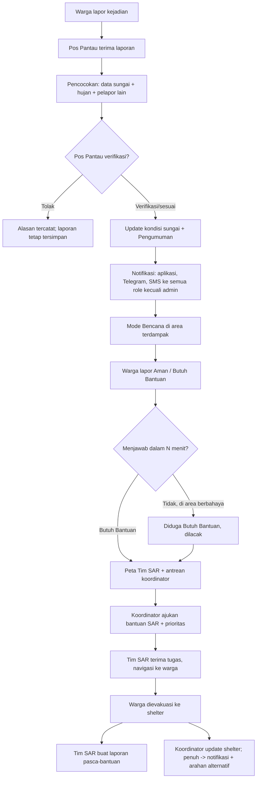

# PRODUCT REQUIREMENTS DOCUMENT (PRD)
# RIKSA WARGA
## Sistem Peringatan Dini Banjir, Pelacakan Keselamatan Warga, dan Koordinasi Evakuasi — Kota Bandung

| Informasi | Keterangan |
|---|---|
| Nama produk | **RIKSA WARGA** ("riksa" = menjaga, memelihara, mengawasi — Bahasa Sunda) |
| Dokumen | Product Requirements Document (PRD) |
| Versi | 2.0 — menggantikan PRD "SALING JAGA" v1.0 (7 Nov 2026) |
| Status | Draft untuk pengembangan dan hackathon; perlu validasi lokasi pilot, ambang sungai, data shelter, dan mitra |
| Wilayah | **Kota Bandung**, Jawa Barat (daerah aliran sungai dan kelurahan rawan banjir; detail pada keputusan D-01/D-02) |
| Bencana prioritas | **Banjir** (kenaikan sungai, genangan, banjir bandang). Jenis bencana lain: lihat §5.4 |
| Pengguna (5 role) | Warga, Koordinator Daerah, Pos Pantau, Tim SAR, Admin |
| Platform | Web responsif dan Progressive Web App (PWA); Telegram Bot; SMS |

> **Catatan penting.** Dokumen ini adalah rancangan kebutuhan, bukan bukti bahwa sistem sudah teruji atau tersertifikasi untuk tanggap darurat. RIKSA WARGA adalah lapisan informasi dan koordinasi di tingkat daerah. Produk **tidak menggantikan** BMKG, BNPB/BPBD, Basarnas/SAR resmi, atau komando penanganan bencana. Prakiraan dan prediksi pada produk ini adalah **perkiraan bantu**, bukan jaminan, dan selalu diberi label sumber, waktu, serta tingkat keyakinan.

---

# 1. Ringkasan Eksekutif

Banjir di Bandung sering datang cepat dan warga sering tidak tahu: seberapa tinggi sungai di hulu, apakah hujan lebat akan berlanjut, dan ke mana harus pergi. Setelah banjir terjadi, tim penyelamat kesulitan mengetahui siapa yang masih terjebak dan di mana.

RIKSA WARGA menjawab empat kebutuhan:

1. **Tahu lebih dulu** — kondisi sungai di berbagai daerah dan data hujan yang diperbarui terus-menerus, ditambah prediksi risiko untuk bersiap.
2. **Diberi tahu cepat** — pos pantau memverifikasi laporan warga terhadap data sensor dan cuaca, lalu mengumumkannya ke seluruh role lewat aplikasi, Telegram, dan SMS.
3. **Terlacak bila membutuhkan bantuan** — warga memberi izin lokasi **sekali saja**; saat bencana, warga yang belum mengonfirmasi keselamatan diperlakukan sebagai *diduga butuh bantuan* dan muncul di peta Tim SAR.
4. **Diarahkan ke tempat aman** — peta navigasi ke shelter terdekat (data shelter nyata di Kota Bandung), dengan kabar jika shelter penuh.

Lima role dengan tugas jelas: **Warga**, **Koordinator Daerah**, **Pos Pantau**, **Tim SAR**, dan **Admin** (hanya kelola pengguna).

---

# 2. Perubahan dari PRD v1.0 (SALING JAGA)

| Aspek | v1.0 | v2.0 (RIKSA WARGA) |
|---|---|---|
| Nama | Saling Jaga | Riksa Warga |
| Wilayah | Bandung Raya (belum ditetapkan) | **Kota Bandung** |
| Fokus bencana | Banjir dan kebakaran + multi-bencana | **Banjir**; kebakaran dan lainnya ditunda (§5.4) |
| Role | Warga, Koordinator RT/RW, Pos Pantau, Relawan, Petugas/Instansi, Admin | **Warga, Koordinator Daerah, Pos Pantau, Tim SAR, Admin** |
| Relawan, Petugas | Ada | Dihapus; fungsinya dilebur ke **Tim SAR** |
| Verifikasi laporan | Koordinator/petugas | **Pos Pantau** (dicocokkan dengan sensor dan cuaca) |
| Penentu pengumuman | Koordinator/otoritas dengan level Pantau-Waspada-Siaga-Evakuasi | **Pos Pantau**; kondisi sungai 3 tingkat: Normal / Waspada / Meluap |
| Lokasi warga | Hanya dibagikan sadar, tanpa pelacakan | **Izin sekali**, dipakai otomatis saat bencana (batasan di §8) |
| Warga belum respons | "Belum terkonfirmasi" (bukan hilang) | Tetap tidak dianggap hilang, tetapi **diperlakukan sebagai diduga butuh bantuan** dan dilacak untuk Tim SAR |
| Data alam | Konteks pendukung | **Fitur utama** untuk semua role non-admin, dinamis + prediksi |
| Notifikasi | Telegram prototipe, SMS roadmap | **Telegram dan SMS wajib** untuk peristiwa penting |
| Shelter | Contoh | **Data nyata Kota Bandung**; koordinator mengelola dan memberi kabar penuh |
| Admin | Konfigurasi, akun, audit | **Kelola pengguna** saja (audit hanya-baca, §6.2) |

Prinsip v1.0 yang **tetap dipertahankan**: sumber informasi transparan, data simulasi selalu berlabel, prediksi bukan deteksi, laporan tidak pernah dihapus karena skor rendah, semua tindakan penting tercatat (audit), dan sistem tidak mengklaim sebagai otoritas.

---

# 3. Latar Belakang, Masalah, dan Tujuan

## 3.1 Masalah

| ID | Masalah | Dampak |
|---|---|---|
| P-01 | Kondisi sungai dan hujan tersebar di banyak sumber, sulit dilihat warga | Warga terlambat bersiap |
| P-02 | Laporan warga tidak diverifikasi cepat dan tidak dicocokkan dengan data | Kepanikan atau peringatan terlambat |
| P-03 | Peringatan hanya lewat satu kanal | Warga tanpa internet tidak menerima |
| P-04 | Tim SAR tidak tahu persis siapa yang masih terjebak dan di mana | Evakuasi lambat, tumpang tindih |
| P-05 | Kelompok rentan (lansia, balita, disabilitas) tidak diprioritaskan | Risiko korban meningkat |
| P-06 | Shelter penuh tidak diketahui warga | Warga menuju shelter yang sudah penuh |
| P-07 | Tidak ada prediksi sederhana yang bisa dipahami warga | Warga hanya bereaksi, tidak bersiap |
| P-08 | Warga yang tidak merespons sering dianggap aman atau tidak diperhatikan | Korban terlewat |

## 3.2 Tujuan produk

1. Menampilkan kondisi sungai dan hujan **dinamis** beserta **prediksi risiko** untuk warga, pos pantau, dan Tim SAR.
2. Memungkinkan pos pantau memverifikasi laporan dan menyiarkan pengumuman ke semua role lewat aplikasi, Telegram, dan SMS.
3. Memberi Tim SAR peta warga yang membutuhkan bantuan di dalam area berbahaya.
4. Memungkinkan koordinator menyimpan data keluarga, meminta bantuan SAR dengan prioritas, dan mengelola shelter.
5. Mengarahkan warga ke shelter nyata terdekat yang masih tersedia.
6. Menghasilkan catatan kejadian dan laporan pasca-bantuan untuk evaluasi.

## 3.3 Indikator keberhasilan

Target numerik final ditetapkan setelah uji coba; untuk prototipe indikator ini mengukur apakah alur bekerja.

| KPI | Definisi | Pengukuran |
|---|---|---|
| Waktu verifikasi | Laporan warga masuk → keputusan pos pantau | Timestamp laporan dan keputusan |
| Waktu siar | Keputusan pengumuman → pesan terkirim ke tiap kanal | Log pengiriman |
| Keberhasilan kanal | Proporsi pesan terkirim per kanal (aplikasi, Telegram, SMS) | Log penyedia |
| Kesegaran data | Persentase pos pantau dengan data tidak kedaluwarsa | Status stasiun |
| Cakupan lokasi | Proporsi warga terdaftar yang sudah memberi izin lokasi | Data persetujuan |
| Cakupan konfirmasi | Proporsi warga di zona terdampak yang sudah menjawab Aman/Butuh Bantuan | Status warga |
| Waktu penugasan SAR | Permintaan bantuan → tugas diterima tim | Log tugas |
| Prioritas rentan | Proporsi rentan yang dievakuasi lebih dulu | Log tugas dan data keluarga |
| Ketepatan shelter | Proporsi warga yang diarahkan ke shelter tidak penuh | Status shelter vs rute |
| Akurasi prediksi | Kesesuaian risiko prediksi dengan kondisi akhir | Evaluasi pasca-kejadian |

---

# 4. Ruang Lingkup

## 4.1 Geografis
Kota Bandung. Pilot menetapkan kelurahan/RW dan sungai spesifik (D-01, D-02). Data hulu di luar batas kota (misalnya aliran dari Kabupaten Bandung) dapat dipakai sebagai konteks bila tersedia, tetapi pengguna dan shelter berada di Kota Bandung.

## 4.2 Fase waktu
1. **Sebelum bencana** — pemantauan, prediksi, notifikasi kesiapsiagaan, pendataan keluarga, izin lokasi.
2. **Saat bencana** — verifikasi, pengumuman, konfirmasi keselamatan, pelacakan, penugasan SAR, arahan shelter.
3. **Setelah bencana** — laporan pasca-bantuan SAR, rekap warga, evaluasi.

## 4.3 Di luar ruang lingkup
- Menerbitkan perintah evakuasi **resmi** atau menggantikan BPBD, BMKG, Basarnas.
- Menjamin pesan sampai ketika seluruh jaringan dan listrik padam.
- Prediksi gempa atau tsunami.
- Penentuan rute teraman hanya dari algoritma peta umum (rute selalu berlabel validasi).
- Pelacakan lokasi di luar kondisi yang dijelaskan di §8 (tidak ada pelacakan terus-menerus saat tidak ada ancaman).
- Mengklaim sensor nyata di seluruh kota sebelum perangkat benar-benar dipasang dan diuji.

## 4.4 Bencana lain
Fokus versi ini adalah **banjir**. Kebakaran, longsor, dan cuaca ekstrem lain ditunda; laporan jenis "lainnya" tetap bisa diterima warga dan diteruskan ke pos pantau sebagai informasi, tanpa mesin aturan khusus (D-12).

---

# 5. Role dan Hak Akses (RBAC)

## 5.1 Ringkasan role

| Role | Siapa | Cakupan data |
|---|---|---|
| **Warga** | Penduduk Kota Bandung | Data sendiri/keluarga; informasi publik wilayah |
| **Koordinator Daerah** | Pengurus daerah (RW/kelurahan) | Wilayah tugasnya |
| **Pos Pantau** | Petugas pemantau sungai di pos | Pos dan area pantauannya; semua kondisi alam kota |
| **Tim SAR** | Tim penyelamat | Seluruh Kota Bandung (warga butuh bantuan di area berbahaya) |
| **Admin** | Pengelola sistem | Akun pengguna saja |

## 5.2 Matriks hak akses

Prinsip *least privilege*. "Wilayah" = wilayah tugas pengguna. Sel kosong = tidak ada akses.

| Fitur | Warga | Koordinator | Pos Pantau | Tim SAR | Admin |
|---|:--:|:--:|:--:|:--:|:--:|
| Masuk / kelola profil sendiri | Ya | Ya | Ya | Ya | Ya |
| Berbagi lokasi (izin sekali) | Ya | | | | |
| Lapor keselamatan (Aman / Butuh Bantuan) | Ya | | | | |
| Lapor kejadian ke pos pantau | Ya | | | | |
| Lapor kondisi daerah yang dipantau | | | Ya | | |
| Lihat kondisi sungai & data hujan (dinamis) | Ya | Ya | Ya | Ya | |
| Lihat prediksi risiko banjir | Ya | Ya | Ya | Ya | |
| Update kondisi sungai (Normal/Waspada/Meluap) | | | Ya | | |
| Verifikasi laporan warga | | | Ya | | |
| Siarkan pengumuman (semua role kecuali admin, Telegram, SMS) | | | Ya | | |
| Lihat pengumuman & notifikasi | Ya | Ya | Ya | Ya | |
| Peta navigasi ke shelter terdekat | Ya | Ya | Ya | Ya | |
| Kelola shelter (status, kapasitas, penuh) | | Ya | | | |
| Input data keluarga warga | | Ya | | | |
| Lihat data keluarga | Milik sendiri | Wilayah | | Sesuai tugas | |
| Lihat lokasi warga | Milik sendiri | Wilayah, saat bencana | | **Warga butuh bantuan**, saat bencana | |
| Ajukan bantuan ke Tim SAR (dengan prioritas) | | Ya | | | |
| Lihat peta menuju warga butuh bantuan | | Wilayah | | Ya | |
| Terima & ubah status tugas | | | | Ya | |
| Buat laporan pasca-bantuan | | | | Ya | |
| Kelola pengguna (buat, nonaktifkan, atur role/wilayah) | | | | | Ya |
| Lihat audit log | | | | | Ya (hanya-baca) |

## 5.3 Aturan akses tambahan
- Data keluarga dan lokasi adalah data sensitif: akses dibatasi sesuai tabel, **setiap pembacaan data sensitif dicatat** (siapa, kapan, alasan/konteks).
- Lokasi warga **tidak pernah** muncul di peta publik, pesan Telegram, atau SMS.
- Koordinator hanya melihat warga di wilayahnya. Tim SAR hanya melihat warga dalam status butuh bantuan/diduga butuh bantuan di area berbahaya selama kejadian aktif.
- Admin tidak melihat data keluarga, lokasi, laporan, atau pengumuman.

---

# 6. Fitur per Role

## 6.1 Warga
1. **Izin lokasi sekali seumur hidup.** Saat onboarding warga menyetujui sekali: lokasi boleh digunakan sistem **saat Mode Bencana** (§8). Tidak diminta ulang; dapat dicabut kapan saja di profil.
2. **Lapor keselamatan.** Saat bencana: *Saya Aman* atau *Butuh Bantuan* (+ jenis kebutuhan: evakuasi, medis, logistik). Tanpa jawaban dalam batas waktu, status menjadi **Diduga Butuh Bantuan** (§9.3).
3. **Peta navigasi ke shelter terdekat** (shelter nyata Kota Bandung): jarak, arah, status ketersediaan, dan alternatif bila shelter penuh. Rute berlabel validasi.
4. **Lapor kejadian** (genangan, sungai naik, banjir masuk rumah) yang diteruskan ke pos pantau terdekat, dengan lokasi dan foto opsional.
5. **Kondisi alam**: kondisi sungai di berbagai daerah dan data hujan, dinamis, beserta **prediksi risiko** dan penjelasan sederhana untuk bersiap.
6. **Notifikasi** (aplikasi, Telegram, SMS) untuk pengumuman, peringatan, dan prediksi banjir di wilayahnya.
7. Melihat status laporan kejadian sendiri.

## 6.2 Koordinator Daerah
1. **Data keluarga**: anggota, usia, kondisi (lansia, balita, ibu hamil, disabilitas, sakit), kontak, dan catatan evakuasi. Data dikumpulkan dengan persetujuan.
2. **Pantau status warga di wilayahnya**: Aman, Butuh Bantuan, Diduga Butuh Bantuan, Dalam Penanganan, Sudah Evakuasi.
3. **Minta bantuan Tim SAR** untuk warga yang belum terevakuasi, dengan **prioritas** (lansia, balita, disabilitas, ibu hamil, sakit, didahulukan; transparan dan dapat dijelaskan).
4. **Kelola shelter**: status (tersedia/terbatas/penuh/tutup), kapasitas, kontak. Saat **penuh**, sistem otomatis memberi kabar ke Tim SAR, warga, dan pos pantau, dan mengarahkan ke shelter alternatif.
5. Melihat kondisi alam, prediksi, pengumuman, dan notifikasi.
6. Peta navigasi ke shelter.

## 6.3 Pos Pantau
1. **Update kondisi sungai** dengan tiga tombol: **Normal**, **Waspada**, **Meluap**. Pembaruan langsung memperbarui data dinamis di semua role, dengan waktu dan nama pemantau.
2. **Pantau kondisi alam**: tinggi/kondisi sungai berbagai daerah, data hujan, dan prediksi.
3. **Terima & verifikasi laporan warga**, dengan panel **pencocokan otomatis** terhadap data sensor/pengamatan sungai dan data cuaca. Hasil pencocokan membantu keputusan; keputusan akhir tetap manusia.
4. **Siarkan pengumuman** ke seluruh role (kecuali admin), Telegram, dan SMS, setelah laporan terverifikasi dan sesuai data.
5. **Lapor kondisi daerah yang dipantau** (misalnya sungai deras, jembatan terhalang).
6. Peta navigasi ke shelter terdekat.

## 6.4 Tim SAR
1. **Peta menuju warga yang membutuhkan bantuan/evakuasi dan masih di area berbahaya**, terurut prioritas dan jarak, dengan rute.
2. **Kondisi alam** (sungai berbagai daerah, hujan) dan **prediksi** untuk persiapan.
3. **Terima tugas** dari koordinator: terima/tolak, menuju lokasi, dalam penanganan, selesai/gagal (alasan wajib).
4. **Laporan pasca-bantuan**: jumlah orang dibantu, kondisi, tujuan (shelter/RS), kendala, hasil.
5. Notifikasi tugas baru, kenaikan risiko, dan status shelter.

## 6.5 Admin
Kelola pengguna: buat akun, nonaktifkan, atur role dan wilayah/pos, reset kredensial. Melihat audit log hanya-baca. Tidak mengakses data operasional atau data pribadi warga.

---

# 7. Modul Utama

| # | Modul | Isi |
|---|---|---|
| M1 | **Kondisi Alam & Prediksi** | Kondisi sungai (3 tingkat + tinggi bila ada), hujan, prediksi risiko |
| M2 | **Pos Pantau & Verifikasi** | Update kondisi, laporan warga, pencocokan data, pengumuman |
| M3 | **Notifikasi Multi-Kanal** | Aplikasi, Telegram Bot, SMS, log pengiriman |
| M4 | **Lokasi & Status Warga** | Izin sekali, Mode Bencana, status keselamatan, pelacakan |
| M5 | **Rescue (Koordinator ↔ SAR)** | Data keluarga, prioritas, permintaan bantuan, tugas, laporan pasca-bantuan |
| M6 | **Shelter & Navigasi** | Data shelter nyata, status/kapasitas, rute, arahan alternatif |
| M7 | **Pengguna & Audit** | Akun, role, wilayah, audit log |
| M8 | **Ketahanan** | PWA offline, antrean laporan, prosedur cadangan |

## 7.1 M1 — Kondisi Alam & Prediksi

**Data dinamis**
- **Kondisi sungai** per pos: *Normal / Waspada / Meluap* (ditetapkan pos pantau), ditambah tinggi air (cm) bila sensor/mistar tersedia. Setiap nilai punya sumber, waktu, dan mode (`REAL` / `SIMULASI`).
- **Data hujan**: prakiraan curah hujan per slot waktu dari BMKG, dan pengamatan hujan bila tersedia dari pos/sensor.
- Data yang lebih tua dari batas kedaluwarsa ditandai *kedaluwarsa* dan **tidak ditampilkan sebagai kondisi sekarang**.
- "Dinamis" berarti diperbarui otomatis pada interval tertentu (polling sumber) dan seketika saat pos pantau menekan tombol kondisi.

**Prediksi (perkiraan bantu, bukan kepastian)**
- Keluaran: **Potensi Banjir** per daerah — *Rendah / Sedang / Tinggi* — beserta alasan, jendela waktu (mis. 6/12/24 jam), dan tingkat keyakinan.
- Masukan: prakiraan hujan BMKG, kondisi dan tren sungai saat ini, kondisi sungai hulu, riwayat kejadian bila tersedia.
- Metode awal (transparan, berbasis aturan): (a) tren kenaikan tinggi air → perkiraan waktu mencapai ambang; (b) hujan prakiraan di atas ambang pada jam mendatang; (c) gabungan aturan menjadi indeks risiko. Setiap penyebab ditampilkan ke pengguna.
- Prediksi **tidak boleh** dipresentasikan sebagai deteksi banjir. Ambang dan bobot adalah asumsi uji, dikalibrasi dengan data historis dan masukan BPBD sebelum pilot (D-05). Satu sensor/tinggi air tunggal tidak cukup untuk memprediksi banjir bandang presisi.
- Prediksi memicu notifikasi bila risiko naik (§7.3).

## 7.2 M2 — Pos Pantau & Verifikasi

**Pencocokan laporan** (membantu keputusan pos pantau):

| Pemeriksaan | Contoh hasil |
|---|---|
| Jarak laporan ke pos/sungai terkait | Dekat / jauh |
| Kondisi sungai terakhir (Normal/Waspada/Meluap, tren) | Sesuai / tidak sesuai laporan banjir |
| Data hujan (pengamatan atau prakiraan jam ini) | Mendukung / tidak |
| Jumlah pelapor unik di area yang sama | 1 / ≥ 2 / ≥ 3 |
| Tanda periksa (duplikat, waktu lama, lokasi tak cocok dengan GPS) | Bertanda / bersih |

Hasil ringkasan: **Sesuai / Sebagian / Tidak sesuai / Data kurang**. Skor ini alat bantu; laporan tidak dihapus karena tidak sesuai. Pos pantau memilih *Verifikasi* atau *Tolak* (alasan wajib).

**Pengumuman**
- Hanya laporan yang **diverifikasi dan sesuai** yang dapat menjadi dasar pengumuman. Pos pantau tetap dapat menyiarkan pengumuman berbasis pengamatan langsung dengan alasan tercatat.
- Pengumuman memuat: jenis (Waspada / Meluap), wilayah sasaran, ringkasan kondisi, sumber (laporan terverifikasi + data), waktu, tindakan yang disarankan, dan kalimat bahwa **instruksi resmi BPBD/petugas berwenang tetap diutamakan**.
- Penerima: seluruh role **kecuali admin**, sesuai wilayah; saluran: aplikasi, Telegram, SMS.
- Koreksi/pembatalan: wajib alasan, dikirim ke penerima dan kanal yang sama; riwayat tetap tersimpan.

## 7.3 M3 — Notifikasi Multi-Kanal

| Peristiwa | Penerima | Kanal |
|---|---|---|
| Kondisi sungai berubah ke **Waspada** / **Meluap** | Warga, Koordinator, Tim SAR (wilayah terdampak), Pos Pantau lain | Aplikasi, Telegram, SMS |
| **Prediksi** risiko naik ke Sedang/Tinggi | Warga, Koordinator, Pos Pantau, Tim SAR (wilayah terkait) | Aplikasi, Telegram; SMS untuk Tinggi |
| **Pengumuman** pos pantau | Semua role non-admin (wilayah sasaran) | Aplikasi, Telegram, SMS |
| Laporan warga baru | Pos Pantau terkait | Aplikasi, Telegram |
| Warga baru *Butuh Bantuan* / *Diduga Butuh Bantuan* | Koordinator wilayah; Tim SAR (bila dalam area berbahaya) | Aplikasi, Telegram |
| Permintaan bantuan / tugas baru | Tim SAR | Aplikasi, Telegram, SMS |
| **Shelter penuh** / ditutup | Warga di sekitar, Tim SAR, Pos Pantau | Aplikasi, Telegram, SMS |

Aturan:
- Telegram: pengguna harus *opt-in* (`/start`). SMS: nomor ponsel terverifikasi dan persetujuan menerima pesan.
- SMS lewat penyedia (gateway) berbayar; dipakai untuk peristiwa berkeparahan tinggi dan dibatasi (anti-spam, deduplikasi, batas per jam). Pemilihan penyedia: D-03.
- Setiap pengiriman dicatat per kanal: berhasil / gagal / menunggu, beserta alasan. Kegagalan satu kanal tidak menghentikan kanal lain.
- Pesan tidak memuat data keluarga, lokasi rumah, atau kondisi kesehatan.
- Telegram dan SMS memerlukan jaringan masing-masing; tidak dapat diandalkan bila jaringan padam total.

## 7.4 M4 — Lokasi dan Status Warga

Lihat detail di §8 (Lokasi) dan §9 (Status).

## 7.5 M5 — Rescue (Koordinator ↔ SAR)

- Koordinator mengajukan **Permintaan Bantuan** untuk satu warga/keluarga: lokasi, jumlah orang, kebutuhan, **prioritas**.
- **Prioritas** (transparan): kerentanan (lansia, balita, ibu hamil, disabilitas, sakit), status keselamatan (Butuh Bantuan > Diduga Butuh Bantuan), berada di area berbahaya, lama menunggu, kedekatan dengan tim. Hasil: **Kritis / Tinggi / Sedang / Rendah** dengan faktor yang tampil. Alat bantu, bukan keputusan mutlak.
- Alur status tugas: Baru → Menunggu penerimaan → Diterima → Menuju lokasi → Dalam penanganan → Selesai; *Gagal* dan *Dibatalkan* wajib alasan.
- Efek ke status warga: diterima/menuju → *Dalam Penanganan*; selesai dengan tujuan shelter → *Sudah Evakuasi*; gagal → kembali ke antrean.
- **Laporan pasca-bantuan** (Tim SAR): jumlah orang, kondisi (selamat/luka/butuh rujukan), tujuan, waktu, kendala, catatan. Terhubung ke tugas dan tersimpan permanen.

## 7.6 M6 — Shelter & Navigasi

- **Data shelter nyata Kota Bandung** (D-04): nama, alamat, koordinat, jenis (mis. gedung serbaguna, sekolah, tempat ibadah, balai warga), kapasitas, fasilitas, kontak, status verifikasi, waktu verifikasi terakhir. Sumber dan proses pengumpulan: §12 (D-04). Tidak ada data shelter yang diisi tanpa sumber yang dapat ditelusuri.
- Status: *Tersedia / Terbatas / Penuh / Tidak dapat digunakan*, diperbarui koordinator (dengan okupansi saat check-in).
- **Navigasi**: rute jalan kaki ke 1–2 shelter terdekat yang masih tersedia; rute berlabel *belum diverifikasi* kecuali sudah divalidasi; peringatan titik bahaya (jalan tertutup, genangan) bila ada; mode posisi langsung bila izin GPS diberikan.
- Shelter **penuh** otomatis dikeluarkan dari rekomendasi dan memicu notifikasi (§7.3) serta arahan ke alternatif terdekat.
- Peta dasar dan data terakhir disimpan di PWA untuk akses terbatas tanpa internet.

## 7.7 M7 — Pengguna & Audit
Akun, role, wilayah/pos, aktivasi. Audit log untuk: login penting, perubahan role, pembuatan/verifikasi/penolakan laporan, perubahan kondisi sungai, pengumuman, pengiriman notifikasi, perubahan status warga dan tugas, perubahan shelter, akses data sensitif.

## 7.8 M8 — Ketahanan
- PWA: cache aplikasi dan data terakhir (berlabel waktu), antrean laporan dengan ID unik tanpa duplikat saat sinkron ulang.
- Pengumuman penting memakai SMS sebagai jalur tambahan.
- Prosedur cadangan: daftar cetak warga prioritas dan shelter; kontak BPBD, Damkar, SAR, RS.
- PWA **tidak** menyimpan atau mengirim data tanpa antrean lokal/jaringan; jangan dianggap menggantikan jaringan komunikasi.

---

# 8. Berbagi Lokasi Warga (Izin Sekali) — Rancangan dan Batasan

Kebutuhan: warga cukup sekali memberi izin, agar saat bencana sistem tahu lokasi mereka.

**Rancangan**
1. **Onboarding (sekali):** warga membaca tujuan dan batas pemakaian lokasi, lalu menyetujui. Persetujuan tersimpan (waktu, versi teks persetujuan). Tidak ditanyakan ulang. Warga **dapat mencabut kapan saja** (hak penarikan persetujuan).
2. **Mode Bencana:** diaktifkan untuk suatu area saat kondisi sungai **Meluap**, atau saat ada pengumuman *Waspada/Meluap* untuk area tersebut. Hanya pada mode ini lokasi warga di area itu dikirim dan dilihat pihak berwenang (koordinator dan Tim SAR sesuai §5.2).
3. **Di luar Mode Bencana:** hanya **lokasi terakhir yang diketahui** disimpan secukupnya (mis. saat aplikasi dibuka) untuk menentukan area; tidak ada pelacakan terus-menerus.
4. **Retensi:** riwayat lokasi dihapus otomatis setelah kejadian ditutup dalam batas waktu yang ditetapkan (D-10); catatan akses tetap di audit log.
5. **Transparansi:** warga melihat kapan lokasinya diakses dan oleh role apa.

**Batasan teknis yang harus diterima**
- Sebagai **PWA/web**, pengiriman lokasi di latar belakang saat aplikasi **tertutup** tidak dapat diandalkan (terutama iOS). Yang realistis: lokasi dikirim ketika aplikasi terbuka, dan ketika warga menekan tautan dari notifikasi Telegram/SMS.
- Pelacakan latar belakang yang benar membutuhkan **aplikasi native** (Android/iOS) — masuk roadmap (D-07).
- Akurasi dan ketersediaan GPS bergantung perangkat, baterai, dan sinyal; hasil lokasi selalu berlabel akurasi dan waktu terakhir.
- Pelacakan lokasi memiliki implikasi privasi dan hukum (UU No. 27 Tahun 2022 tentang Pelindungan Data Pribadi); desain persetujuan, tujuan, retensi, dan hak penarikan harus ditinjau sebelum pilot (D-09).

---

# 9. Status Keselamatan Warga

## 9.1 Status

| Status | Arti |
|---|---|
| Normal | Tidak ada kejadian aktif untuk area warga |
| Belum Dikonfirmasi | Mode Bencana aktif, warga belum menjawab (dalam masa tunggu) |
| **Saya Aman** (laporan mandiri) | Warga menyatakan aman; belum tentu terverifikasi |
| **Butuh Bantuan** | Warga menyatakan butuh bantuan (+ jenis) |
| **Diduga Butuh Bantuan** | Tidak menjawab setelah batas waktu **dan** berada di area berbahaya; dilacak dan diprioritaskan untuk Tim SAR |
| Dalam Penanganan | Tugas SAR diterima/berjalan |
| Sudah Evakuasi | Tiba di shelter/tempat aman (dicatat check-in atau laporan SAR) |
| Tidak Dapat Dihubungi | Upaya kontak (SMS/Telegram/telepon) tidak berhasil |

## 9.2 Prinsip
- "Saya Aman" = laporan mandiri, bukan jaminan.
- Tidak ada respons **bukan** berarti hilang; sistem memperlakukannya sebagai **kemungkinan butuh bantuan** agar tidak terlewat, dengan label jelas bahwa ini dugaan.
- Setiap perubahan status memiliki waktu, sumber, dan pelaku.
- Warga yang menjawab Aman keluar dari antrean SAR.

## 9.3 Aturan "Diduga Butuh Bantuan"
Terpenuhi bila: (a) Mode Bencana aktif untuk area warga, (b) warga memberi izin lokasi dan lokasi terakhir berada di area berbahaya, (c) tidak ada jawaban dalam **N menit** (konfigurasi, usulan awal 15 menit; D-06) setelah notifikasi terkirim lewat aplikasi, Telegram, dan SMS. Sistem juga mencatat apakah notifikasi sampai.

---

# 10. Alur Operasional

## 10.1 Sebelum bencana
1. Data hujan dan sungai diperbarui terus; prediksi dihitung.
2. Risiko naik → notifikasi kesiapsiagaan ke warga, koordinator, pos pantau, Tim SAR.
3. Pos pantau menetapkan kondisi sungai (Normal/Waspada/Meluap) sesuai pengamatan.
4. Koordinator melengkapi data keluarga; warga memberi izin lokasi dan nomor/Telegram.

## 10.2 Saat banjir

## 10.3 Setelah bencana
Koordinator dan pos pantau menutup kejadian; status warga direkap; yang belum terkonfirmasi tetap ditindaklanjuti; data lokasi dihapus sesuai retensi; laporan pasca-bantuan dan log kejadian diekspor untuk evaluasi.

---

# 11. Kebutuhan Fungsional

Prioritas: **P0** wajib MVP/demo; **P1** penting bila waktu cukup; **P2** roadmap.

## 11.1 Akun & Role
| ID | Kebutuhan | Pri | Kriteria penerimaan |
|---|---|:-:|---|
| FR-001 | Login dengan akun; diarahkan ke tampilan sesuai role | P0 | Setiap role melihat menu sesuai §5.2 |
| FR-002 | Admin membuat, menonaktifkan akun, dan mengatur role/wilayah/pos | P0 | Akun baru punya role dan wilayah |
| FR-003 | Hak akses berbasis role dan wilayah | P0 | Pengguna tidak dapat membuka data di luar kewenangan |
| FR-004 | Warga mendaftar mandiri dengan verifikasi nomor ponsel | P1 | Akun warga aktif setelah verifikasi |
| FR-005 | Pengguna memperbarui profil, nomor ponsel, dan Telegram | P0 | Perubahan tersimpan dan tervalidasi |
| FR-006 | Pembatasan percobaan login | P0 | Percobaan gagal berulang ditolak sementara |

## 11.2 Kondisi Alam & Prediksi (M1)
| ID | Kebutuhan | Pri | Kriteria penerimaan |
|---|---|:-:|---|
| FR-010 | Tampilkan kondisi sungai semua pos (Normal/Waspada/Meluap) | P0 | Warna + teks; waktu & pemantau terlihat |
| FR-011 | Tampilkan data hujan (BMKG) per wilayah | P0 | Nilai, slot waktu, label *prakiraan/pengamatan* |
| FR-012 | Data diperbarui otomatis berkala | P0 | Perubahan tampil tanpa muat ulang manual |
| FR-013 | Data kedaluwarsa ditandai dan tidak tampil sebagai kondisi sekarang | P0 | Label *kedaluwarsa*; nilai terakhir diberi tanda |
| FR-014 | Sumber gagal tidak menghentikan sistem; status sumber tampil | P0 | Dasbor tetap berjalan; status *gagal* terlihat |
| FR-015 | Data simulasi berlabel SIMULASI dan tidak tercampur data nyata | P0 | Label konsisten |
| FR-016 | Grafik tren tinggi air/kondisi sungai | P0 | Grafik berdasarkan waktu |
| FR-017 | Prediksi Potensi Banjir (Rendah/Sedang/Tinggi) per daerah dengan alasan dan jendela waktu | P0 | Penyebab dan tingkat keyakinan tampil; label *perkiraan* |
| FR-018 | Perkiraan waktu mencapai ambang dari tren tinggi air | P1 | Estimasi dengan rentang/ketidakpastian |
| FR-019 | Prediksi memicu notifikasi bila risiko naik | P0 | Notifikasi ke penerima §7.3 dengan deduplikasi |

## 11.3 Pos Pantau & Verifikasi (M2)
| ID | Kebutuhan | Pri | Kriteria penerimaan |
|---|---|:-:|---|
| FR-020 | Tiga tombol Normal / Waspada / Meluap per pos | P0 | Update tercatat (waktu, pemantau) dan langsung tampil di semua role |
| FR-021 | Pos pantau input tinggi air (opsional) dan catatan | P0 | Nilai, satuan, waktu, pengirim tercatat |
| FR-022 | Warga mengirim laporan kejadian ke pos pantau terdekat | P0 | Laporan masuk antrean pos terkait |
| FR-023 | Lampirkan foto laporan (jenis & ukuran divalidasi) | P0 | Foto tersimpan terhubung ke laporan |
| FR-024 | Deteksi duplikat dan tanda periksa (waktu lama, lokasi tak cocok) | P0 | Tanda tampil; tidak dihitung sebagai pelapor independen |
| FR-025 | Panel pencocokan laporan vs sensor/sungai vs hujan | P0 | Hasil Sesuai/Sebagian/Tidak sesuai/Data kurang beserta faktor |
| FR-026 | Pos pantau verifikasi atau tolak (alasan wajib untuk tolak) | P0 | Status, pelaku, waktu, alasan tercatat |
| FR-027 | Laporan tetap tersimpan meski tidak sesuai | P0 | Tidak ada laporan yang hilang |
| FR-028 | Pos pantau menyiarkan pengumuman ke semua role kecuali admin, Telegram, SMS | P0 | Pengumuman tiba di semua kanal; admin tidak menerima |
| FR-029 | Koreksi/pembatalan pengumuman dengan alasan | P0 | Pesan koreksi dikirim ke penerima yang sama; riwayat tersimpan |
| FR-030 | Pos pantau melapor kondisi daerah yang dipantau | P0 | Laporan terlihat oleh pengguna sesuai wilayah |
| FR-031 | Warga melihat status laporan sendiri | P1 | Diterima/diverifikasi/ditolak + alasan |

## 11.4 Notifikasi (M3)
| ID | Kebutuhan | Pri | Kriteria penerimaan |
|---|---|:-:|---|
| FR-040 | Notifikasi dalam aplikasi | P0 | Daftar notifikasi tampil |
| FR-041 | Pengiriman Telegram Bot (opt-in) | P0 | Pesan sampai ke chat terdaftar |
| FR-042 | Pengiriman SMS lewat gateway | P0 | Pesan terkirim ke nomor terdaftar (mode uji/mock tersedia) |
| FR-043 | Pesan memuat jenis, wilayah, waktu, sumber, status verifikasi, tindakan | P0 | Penerima paham tanpa membuka aplikasi |
| FR-044 | Log pengiriman per kanal dan penerima | P0 | Berhasil/gagal/menunggu + alasan |
| FR-045 | Anti-spam: deduplikasi dan batas kirim SMS | P0 | Peristiwa sama tidak terkirim berulang berlebihan |
| FR-046 | Pesan tidak memuat data keluarga/lokasi/kesehatan | P0 | Diuji pada semua template |
| FR-047 | Push notification PWA | P2 | Berfungsi pada perangkat yang mendukung |

## 11.5 Lokasi & Status Warga (M4)
| ID | Kebutuhan | Pri | Kriteria penerimaan |
|---|---|:-:|---|
| FR-050 | Persetujuan lokasi sekali; dapat dicabut | P0 | Persetujuan tersimpan (waktu, versi); pencabutan berlaku segera |
| FR-051 | Mode Bencana per area (otomatis saat Meluap/pengumuman) | P0 | Lokasi hanya dikirim/terlihat saat mode aktif |
| FR-052 | Kirim lokasi saat aplikasi terbuka dan dari tautan notifikasi | P0 | Lokasi tersimpan dengan akurasi dan waktu |
| FR-053 | Warga lapor *Saya Aman* / *Butuh Bantuan* + jenis kebutuhan | P0 | Status, waktu, sumber tercatat |
| FR-054 | Otomatis *Diduga Butuh Bantuan* setelah N menit (aturan §9.3) | P0 | Muncul di peta SAR dan antrean koordinator dengan label dugaan |
| FR-055 | Riwayat akses lokasi terlihat oleh warga | P1 | Daftar siapa/kapan |
| FR-056 | Retensi: hapus riwayat lokasi setelah kejadian ditutup | P0 | Penghapusan terjadwal; audit tersimpan |
| FR-057 | Pelacakan latar belakang (aplikasi native) | P2 | Lokasi terkirim saat aplikasi tertutup |

## 11.6 Rescue (M5)
| ID | Kebutuhan | Pri | Kriteria penerimaan |
|---|---|:-:|---|
| FR-060 | Koordinator input data keluarga (anggota, kerentanan, kontak) dengan persetujuan | P0 | Data tersimpan; akses dibatasi dan diaudit |
| FR-061 | Prioritas otomatis dengan faktor transparan | P0 | Label Kritis/Tinggi/Sedang/Rendah + faktor |
| FR-062 | Koordinator mengajukan bantuan SAR untuk warga belum terevakuasi | P0 | Permintaan berisi lokasi, jumlah, kebutuhan, prioritas |
| FR-063 | Peta Tim SAR menuju warga butuh bantuan/diduga butuh bantuan di area berbahaya | P0 | Pin berprioritas; rute dan jarak tampil |
| FR-064 | Tim SAR terima/tolak dan ubah status tugas | P0 | Status, waktu, pelaku tercatat; gagal/batal wajib alasan |
| FR-065 | Laporan pasca-bantuan Tim SAR | P0 | Tersimpan, terhubung ke tugas |
| FR-066 | Efek tugas ke status warga | P0 | Status warga mengikuti tugas |
| FR-067 | Koordinator melihat status warga wilayahnya dan rekap | P0 | Hitungan per status |
| FR-068 | Cetak daftar prioritas untuk prosedur cadangan | P1 | File dapat dicetak |

## 11.7 Shelter & Navigasi (M6)
| ID | Kebutuhan | Pri | Kriteria penerimaan |
|---|---|:-:|---|
| FR-070 | Data shelter nyata Kota Bandung dengan sumber dan status verifikasi | P0 | Setiap shelter punya sumber data dan waktu verifikasi |
| FR-071 | Peta menampilkan shelter dan status | P0 | Status berlabel teks, bukan warna saja |
| FR-072 | Navigasi ke shelter terdekat yang tersedia | P0 | Rute, jarak, dan label validasi |
| FR-073 | Koordinator mengubah status/kapasitas shelter | P0 | Tercatat dengan pelaku |
| FR-074 | Shelter penuh → notifikasi ke Tim SAR, warga, pos pantau + arahan alternatif | P0 | Rekomendasi otomatis beralih; notifikasi terkirim |
| FR-075 | Check-in kedatangan di shelter | P1 | Waktu dan pencatat tersimpan |
| FR-076 | Titik bahaya jalan (tertutup/genangan) dari laporan | P1 | Sumber dan waktu pembaruan |
| FR-077 | Peta dapat dibuka dari cache untuk informasi dasar | P1 | Ditandai waktu terakhir diperbarui |

## 11.8 Pengguna & Audit (M7)
| ID | Kebutuhan | Pri | Kriteria penerimaan |
|---|---|:-:|---|
| FR-080 | Audit log perubahan penting | P0 | Siapa, apa, kapan, alasan |
| FR-081 | Admin melihat audit log (hanya-baca) | P1 | Tanpa akses data pribadi/operasional |
| FR-082 | Pencatatan akses data sensitif | P0 | Setiap baca data keluarga/lokasi tercatat |

---

# 12. Data Shelter dan Sumber Data Eksternal

## 12.1 Shelter nyata Kota Bandung (D-04)
Daftar shelter **tidak diisi dari asumsi**. Proses:
1. Kumpulkan kandidat dari sumber yang dapat ditelusuri: **BPBD Kota Bandung**, portal data terbuka pemerintah kota, dan peta terbuka (mis. OpenStreetMap), lalu verifikasi dengan pengelola/koordinator.
2. Setiap shelter wajib: nama, alamat, koordinat, jenis, kapasitas (bila diketahui), kontak, sumber, tanggal verifikasi.
3. Shelter yang belum terverifikasi ditandai dan tidak direkomendasikan sebagai *aman* sampai diverifikasi koordinator/pihak berwenang.

## 12.2 Sumber data
| Sumber | Peran | Catatan |
|---|---|---|
| **BMKG** (prakiraan cuaca per kelurahan) | Prakiraan hujan | Terverifikasi dapat diakses; prakiraan per slot 3 jam, bukan pengamatan |
| Pengamatan pos pantau | Kondisi sungai 3 tingkat dan tinggi air | Sumber utama kondisi sungai |
| Sensor tinggi air/curah hujan | Data otomatis | Hanya setelah perangkat dipasang dan dikalibrasi; sebelum itu berlabel simulasi |
| Telegram Bot API | Notifikasi | Opt-in; token dijaga |
| **SMS gateway** | Notifikasi | Penyedia dipilih (D-03); ada biaya dan aturan operator |
| Penyedia peta/rute | Peta dan navigasi | Periksa lisensi, batas penggunaan, privasi |
| Data historis banjir | Kalibrasi prediksi | BPBD/pemerintah kota; ketersediaan perlu dikonfirmasi |

Prinsip: setiap sumber eksternal dapat gagal; sistem tetap menerima laporan lokal dan menampilkan status sumber.

---

# 13. Entitas Data Utama (konseptual)

| Entitas | Atribut inti |
|---|---|
| User | id, nama, username, role (`warga`/`koordinator`/`pos_pantau`/`tim_sar`/`admin`), wilayah, ponsel, telegram_chat_id, aktif |
| Region | id, induk, nama, tingkat |
| LocationConsent | user, waktu, versi teks, dicabut_pada |
| LocationPing | user, lat, lng, akurasi, waktu, kejadian/mode |
| HazardZone | area, geometri/radius, pos terkait, status |
| Household / FamilyMember | wilayah, anggota, usia, kerentanan, kontak, catatan, persetujuan |
| SafetyStatusLog | user/anggota, status, sumber, waktu, pelaku |
| Station | pos, wilayah, lokasi, hulu/hilir, ambang waspada/meluap |
| RiverStatusUpdate | pos, status (Normal/Waspada/Meluap), tinggi opsional, pemantau, waktu, mode (REAL/SIMULASI) |
| Observation / RainReading | pos/area, nilai, satuan, waktu, sumber, mode |
| Forecast / Prediction | area, jendela waktu, risiko, penyebab, keyakinan, dibuat_pada |
| Report | pelapor, lokasi, waktu, jenis, foto, tanda periksa, status verifikasi, pos penerima |
| Announcement | pos pembuat, wilayah sasaran, jenis, isi, dasar laporan, status, koreksi |
| Notification / Delivery | peristiwa, penerima, kanal, status, waktu, galat |
| Shelter | nama, alamat, koordinat, jenis, kapasitas, okupansi, status, sumber, terverifikasi |
| RescueRequest / Task | warga/keluarga, lokasi, prioritas + faktor, tim, status, hasil |
| RescueReport | tugas, jumlah dibantu, kondisi, tujuan, kendala, catatan |
| AuditLog | pelaku, aksi, objek, nilai lama/baru, alasan, waktu |

Aturan: ID unik; waktu kejadian dan waktu diterima disimpan terpisah; data simulasi bertanda permanen; data keluarga/lokasi tidak disalin ke pesan.

---

# 14. Kebutuhan Nonfungsional

**Kinerja & ketersediaan.** Pengiriman notifikasi asinkron; kegagalan satu kanal tidak menghentikan kanal lain; pembaruan kondisi sungai tampil di semua role dalam hitungan detik (target numerik ditetapkan setelah uji beban).

**Keamanan.** Autentikasi, otorisasi per role dan wilayah, HTTPS, rahasia (token bot, kunci SMS) di konfigurasi aman, pembatasan login, validasi unggahan (jenis, ukuran, isi file), perlindungan spam laporan, backup terlindungi dan teruji.

**Privasi.** Data minimum; persetujuan eksplisit untuk lokasi dan data keluarga; hak mencabut persetujuan; retensi dan penghapusan; pembatasan akses dan audit; lokasi dan data kesehatan tidak masuk pesan atau peta publik; tinjauan kepatuhan UU PDP sebelum pilot.

**Aksesibilitas.** Bahasa Indonesia sederhana; status selalu teks, bukan warna saja; tombol besar di ponsel; kontras memadai; langkah lapor singkat.

**Keandalan informasi.** Setiap data penting berlabel sumber, waktu, mode (nyata/simulasi), dan status (terbaru/kedaluwarsa, belum/terverifikasi, dibatalkan).

**Ketahanan.** PWA cache dan antrean; SMS sebagai jalur cadangan; prosedur manual; kegagalan API eksternal tidak mematikan sistem.

---

# 15. Arsitektur dan Teknologi (rekomendasi)

| Lapisan | Pilihan |
|---|---|
| Frontend | PWA/web responsif; Leaflet + peta terbuka |
| Backend | FastAPI (Python); SQLAlchemy |
| Database | MySQL 8 |
| Realtime | Polling terkontrol / WebSocket |
| Notifikasi | Telegram Bot API; SMS gateway (adaptor, dengan mode mock); push PWA (P2) |
| Integrasi data | Adaptor terpisah per sumber (BMKG, dll.) agar perubahan endpoint tidak merusak sistem |
| Rute | Layanan rute jalan kaki (mis. OSRM) dengan fallback garis lurus berlabel |
| Simulator | Layanan terpisah, berlabel SIMULASI |
| Lokasi latar belakang | Aplikasi native (roadmap) |

---

# 16. Rancangan MVP Hackathon

## 16.1 Fitur wajib (P0)
Lima role dan RBAC; kondisi sungai 3 tombol (pos pantau) yang tampil di semua role; data hujan BMKG; prediksi risiko berbasis aturan dengan alasan; laporan warga → pos pantau; pencocokan dan verifikasi; pengumuman ke semua role kecuali admin dengan Telegram dan SMS (SMS minimal lewat mode uji); izin lokasi sekali + Mode Bencana + *Diduga Butuh Bantuan*; peta Tim SAR ke warga butuh bantuan; data keluarga dan permintaan bantuan berprioritas; tugas SAR dan laporan pasca-bantuan; shelter nyata dengan navigasi dan status penuh + notifikasi; audit log; admin kelola pengguna.

## 16.2 Penting bila waktu cukup (P1)
Estimasi waktu mencapai ambang; riwayat akses lokasi untuk warga; check-in shelter; titik bahaya jalan; peta offline dasar; cetak daftar; registrasi mandiri warga.

## 16.3 Roadmap (P2)
Sensor fisik terpasang; aplikasi native dengan pelacakan latar belakang; push PWA; kebakaran dan bencana lain; prediksi berbasis model terkalibrasi data historis; integrasi resmi dengan BPBD.

## 16.4 Urutan pengerjaan
1. Fondasi: akun, role, wilayah, audit. 2. Kondisi alam: sungai, hujan, kedaluwarsa. 3. Pos pantau: tombol, laporan, pencocokan, pengumuman. 4. Notifikasi: Telegram + SMS + log. 5. Lokasi dan status warga. 6. Rescue: keluarga, prioritas, tugas SAR, laporan. 7. Shelter: data nyata, navigasi, penuh. 8. Prediksi. 9. Demo dan pengujian.

---

# 17. Skenario Demo dan Pengujian

## 17.1 Skenario utama — banjir Bandung
1. Dasbor warga menampilkan sungai Normal dan hujan prakiraan; prediksi *Rendah*.
2. Prakiraan hujan naik dan tinggi air simulasi naik → prediksi *Sedang→Tinggi*; notifikasi kesiapsiagaan ke warga, koordinator, pos pantau, Tim SAR (Telegram + SMS).
3. Pos pantau menekan **Waspada**; semua role melihat pembaruan seketika.
4. Dua–tiga warga melapor genangan; pos pantau melihat panel pencocokan: sungai Waspada + hujan mendukung + beberapa pelapor = *Sesuai*.
5. Pos pantau memverifikasi dan menyiarkan pengumuman; diterima semua role non-admin lewat aplikasi, Telegram, SMS; admin tidak menerima.
6. Sungai **Meluap** → Mode Bencana; warga diminta konfirmasi.
7. Satu warga *Butuh Bantuan*; satu warga tidak menjawab dan berada di area berbahaya → *Diduga Butuh Bantuan*; keduanya muncul di peta Tim SAR.
8. Koordinator melihat data keluarga (lansia/balita), mengajukan bantuan SAR dengan prioritas.
9. Tim SAR menerima tugas, menavigasi ke warga, mengubah status hingga selesai, lalu mengisi laporan pasca-bantuan.
10. Warga dievakuasi ke shelter; koordinator menandai shelter **Penuh**; Tim SAR, warga, pos pantau menerima kabar; navigasi beralih ke shelter alternatif.
11. Pos pantau mengoreksi satu pengumuman; pesan koreksi terkirim; audit log tersimpan.

## 17.2 Skenario kegagalan wajib diuji
| Skenario | Respons yang diharapkan |
|---|---|
| API BMKG gagal | Status sumber *gagal*; data hujan lama ditandai kedaluwarsa; dasbor tetap jalan |
| Telegram/SMS gagal | Kegagalan dicatat per kanal; kanal lain tetap terkirim; tampil di dasbor |
| Pos pantau tidak memperbarui lama | Kondisi sungai ditandai *belum diperbarui* |
| Laporan duplikat / waktu lama / lokasi tak cocok | Bertanda; tidak dihitung independen |
| Laporan tidak sesuai data | Hasil *Tidak sesuai*; laporan tetap tersimpan |
| Warga mencabut izin lokasi | Lokasi tidak lagi dikirim/terlihat; status tetap bisa dilaporkan manual |
| Warga tidak merespons di luar area berbahaya | Tidak otomatis *Diduga Butuh Bantuan* |
| Shelter penuh | Tidak direkomendasikan; notifikasi terkirim |
| Jaringan seluler mati | Telegram/SMS ditandai tidak andal; prosedur manual |
| Akses di luar kewenangan | Ditolak dan tercatat |

---

# 18. Kriteria Penerimaan

- [ ] Setiap role melihat hanya fitur sesuai §5.2; admin tidak melihat data operasional/pribadi.
- [ ] Pos pantau menekan Normal/Waspada/Meluap dan semua role melihat perubahan.
- [ ] Data sungai dan hujan dinamis, berlabel sumber/waktu, kedaluwarsa tidak tampil sebagai terkini.
- [ ] Prediksi menampilkan risiko, alasan, dan jendela waktu, dengan label perkiraan.
- [ ] Laporan warga diverifikasi pos pantau dengan panel pencocokan sensor dan cuaca.
- [ ] Pengumuman tiba ke semua role non-admin lewat aplikasi, Telegram, dan SMS, dengan log per kanal.
- [ ] Izin lokasi diminta sekali dan dapat dicabut; lokasi hanya terlihat saat Mode Bencana.
- [ ] Warga tidak menjawab di area berbahaya menjadi *Diduga Butuh Bantuan* dan tampil di peta Tim SAR.
- [ ] Koordinator menyimpan data keluarga dan mengajukan bantuan SAR dengan prioritas.
- [ ] Tim SAR menerima tugas, menavigasi ke warga, dan membuat laporan pasca-bantuan.
- [ ] Shelter berdata nyata bersumber jelas; navigasi ke terdekat yang tersedia.
- [ ] Shelter penuh memicu notifikasi dan arahan alternatif.
- [ ] Data simulasi berlabel SIMULASI konsisten.
- [ ] Notifikasi tidak memuat lokasi/data keluarga/kesehatan.
- [ ] Audit log mencatat tindakan penting dan akses data sensitif.
- [ ] Kegagalan API/kanal eksternal tidak menghentikan sistem.

---

# 19. Risiko dan Mitigasi

| Risiko | Dampak | Mitigasi |
|---|---|---|
| Prediksi salah | Peringatan palsu atau terlewat | Label perkiraan; alasan tampil; kalibrasi historis dan masukan BPBD; hindari klaim presisi |
| Pelacakan lokasi melanggar privasi/hukum | Sanksi, hilang kepercayaan | Persetujuan eksplisit, tujuan terbatas, Mode Bencana, retensi, hak cabut, tinjauan UU PDP |
| PWA tidak melacak saat tertutup | Lokasi tidak terbarui | Terima batas; dorong buka dari tautan SMS/Telegram; roadmap aplikasi native |
| "Diduga butuh bantuan" membanjiri SAR | Prioritas kabur | Syarat berlapis (izin, area berbahaya, N menit); prioritas transparan; ambang dapat disetel |
| Pos pantau terlambat/tidak aktif | Pengumuman tertunda | Penugasan cadangan per pos; tanda *belum diperbarui*; eskalasi ke pos lain/koordinator |
| Laporan palsu/massal | Bias dan alarm palsu | Autentikasi, batas laporan, deduplikasi, pencocokan data, verifikasi manusia |
| Biaya dan keandalan SMS | Pesan tidak sampai/biaya tinggi | Batasi untuk peristiwa berat; deduplikasi; pilih penyedia andal; kanal cadangan |
| Data shelter tidak akurat | Warga diarahkan ke tempat tidak layak | Sumber tertelusur; verifikasi koordinator; status verifikasi tampil |
| Rute tidak aman | Warga melewati bahaya | Label validasi; peringatan titik bahaya; tidak menyebut "aman" tanpa verifikasi |
| Sensor/API gagal | Data salah/hilang | Adaptor terpisah; status sumber; kedaluwarsa otomatis |
| Klaim berlebihan saat pitch | Kepercayaan turun | Bedakan demo, simulasi, prototipe, integrasi nyata, dan roadmap |
| Admin tanpa akses operasional | Sulit mengonfigurasi ambang | Konfigurasi teknis lewat deployment; ambang dikelola sesuai D-05 |

---

# 20. Keputusan yang Masih Harus Ditetapkan

| ID | Keputusan | Pemilik yang disarankan |
|---|---|---|
| D-01 | Kelurahan/RW dan sungai pilot di Kota Bandung (dan perlukah data hulu dari luar kota) | Tim + mitra lokal |
| D-02 | Penetapan **zona berbahaya** (polygon dari peta rawan banjir BPBD atau radius per pos sebagai awal) | Tim + BPBD |
| D-03 | Penyedia SMS gateway, anggaran, sender ID, dan aturan operator | Tim + sponsor |
| D-04 | Sumber dan proses verifikasi daftar shelter nyata Kota Bandung | Tim + BPBD/pemerintah kota |
| D-05 | Ambang Normal/Waspada/Meluap per pos; bobot prediksi; **siapa yang mengelola ambang** (usulan: admin teknis berdasar masukan pos pantau + BPBD) | Ahli lokal + tim |
| D-06 | Batas waktu "belum konfirmasi" (usulan 15 menit) dan kriteria *Diduga Butuh Bantuan* | Koordinator + SAR |
| D-07 | Aplikasi native untuk pelacakan latar belakang (jadwal dan kapabilitas) | Tim |
| D-08 | Identitas dan kewenangan Tim SAR (Basarnas, BPBD, relawan) dan akses lintas wilayah | Mitra SAR |
| D-09 | Teks persetujuan lokasi dan data keluarga; tinjauan hukum UU PDP | Tim + penasihat hukum |
| D-10 | Masa retensi lokasi dan data keluarga | Pengelola data + mitra |
| D-11 | Prosedur jika pos pantau tidak merespons (pos pengganti) | Mitra + koordinator |
| D-12 | Penanganan jenis bencana lain (kebakaran, longsor) — ditunda atau minimal | Tim |
| D-13 | Apakah warga mendaftar mandiri atau didaftarkan koordinator | Tim + koordinator |
| D-14 | Mode uji SMS/Telegram untuk demo (mock vs nyata) | Tim |

---

# 21. Asumsi dan Batasan

1. Prototipe hackathon dengan waktu, perangkat, dan akses mitra terbatas; satu wilayah demo.
2. Data sensor yang belum berasal dari perangkat fisik **berlabel simulasi**.
3. Prakiraan BMKG adalah prakiraan, bukan pengamatan; dipakai sebagai konteks dan masukan prediksi.
4. Telegram dan SMS membutuhkan jaringan; bukan solusi saat jaringan padam total.
5. PWA bukan pengganti jaringan komunikasi dan tidak melacak lokasi andal saat tertutup.
6. "Izin sekali" adalah persetujuan yang dapat dicabut; bukan penghapusan hak privasi warga.
7. Ambang, skor, dan prediksi tidak dianggap ilmiah sampai diuji data dan masukan pihak berwenang.
8. Sistem adalah alat bantu koordinasi; keputusan dan instruksi resmi tetap mengikuti BPBD, BMKG, dan pihak berwenang.

---

# 22. Definisi Istilah

| Istilah | Definisi |
|---|---|
| Riksa | Menjaga, memelihara, mengawasi (Bahasa Sunda) |
| Kondisi sungai | Normal / Waspada / Meluap, ditetapkan pos pantau |
| Prediksi risiko | Perkiraan Potensi Banjir (Rendah/Sedang/Tinggi), bukan kepastian |
| Mode Bencana | Keadaan area saat sungai Meluap atau ada pengumuman; membuka penggunaan lokasi warga |
| Diduga Butuh Bantuan | Warga tak menjawab di area berbahaya setelah batas waktu; dilacak dan diprioritaskan |
| Pencocokan | Perbandingan laporan dengan data sungai dan hujan untuk membantu keputusan pos pantau |
| Pengumuman | Pesan resmi pos pantau ke seluruh role non-admin lewat aplikasi, Telegram, SMS |
| Laporan pasca-bantuan | Catatan hasil pertolongan oleh Tim SAR |
| Simulasi | Data buatan untuk uji/demo, bukan data lapangan |
| PWA | Aplikasi web yang dapat dipasang dan memiliki cache terbatas |

---

# Lampiran A — Dampak terhadap Proyek yang Sedang Berjalan

Perbandingan PRD ini dengan implementasi saat ini (repo `Riksa-Warga` + tambahan kita):

| Area | Kondisi implementasi | Perubahan yang dibutuhkan |
|---|---|---|
| Role | 6 role (termasuk relawan, petugas) | Menjadi 5: hapus relawan & petugas; tambah `tim_sar`; ubah nama koordinator RT/RW → Koordinator Daerah |
| Kondisi sungai | Tinggi air (cm) + status vs ambang | Tambah tombol 3 kondisi pos pantau (Normal/Waspada/Meluap) sebagai data dinamis lintas role |
| Verifikasi laporan | Koordinator | Pindah ke **pos pantau** + panel pencocokan sensor/cuaca |
| Pengumuman | Mesin eskalasi + Telegram | Pengumuman manual pos pantau ke semua role non-admin; tambah **SMS** |
| Prediksi | Belum ada (hanya tren) | Modul prediksi risiko + notifikasi |
| Lokasi warga | Lokasi rumah + dibagikan sadar | Izin sekali, Mode Bencana, *Diduga Butuh Bantuan*, peta SAR |
| Data keluarga | Profil warga rentan | Perluas ke keluarga/anggota rumah tangga |
| Shelter | 3 contoh dummy | Data **nyata** Kota Bandung + notifikasi penuh |
| Tugas | Relawan | Tim SAR + laporan pasca-bantuan |
| Admin | Aksi operasional luas | Dibatasi: kelola pengguna (+ audit hanya-baca) |
| Kebakaran | Ada | Ditunda (D-12) |
| Sudah sesuai | Telegram, BMKG otomatis, simulator, PWA, rute shelter (OSRM), audit log, RBAC wilayah | Dipertahankan |
