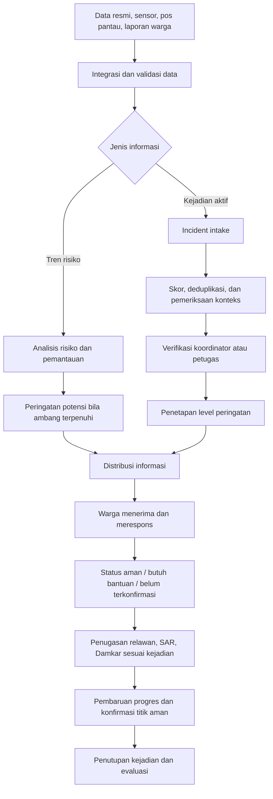
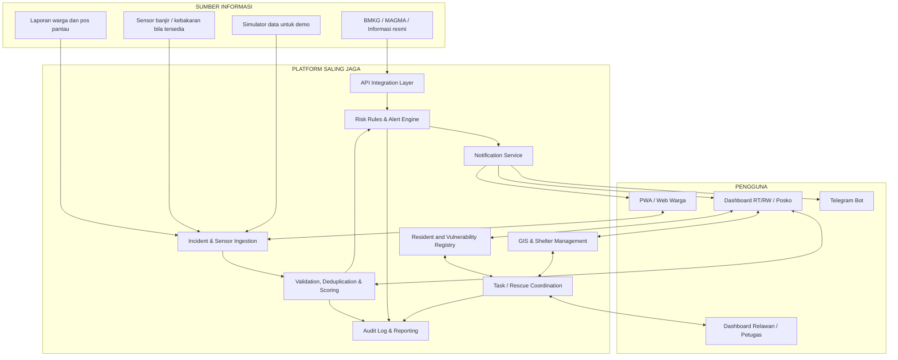

# PRODUCT REQUIREMENTS DOCUMENT (PRD)
# SALING JAGA
## Integrated Multi-Hazard Monitoring, Early Warning & Emergency Response Ecosystem

| Informasi | Keterangan |
|---|---|
| Nama Produk | **SALING JAGA** |
| Nama Dokumen | Product Requirements Document (PRD) |
| Versi | 1.0 — Draft untuk pengembangan dan hackathon |
| Tanggal | 7 November 2026 |
| Status | Draft — perlu validasi lokasi pilot, ambang risiko, dan mitra operasional |
| Wilayah awal | Bandung Raya, Jawa Barat — batas administratif pilot belum ditetapkan |
| Pengguna utama | Koordinator RT/RW, warga, petugas/relawan respons, operator sistem |
| Fokus respons utama | Banjir/banjir bandang dan kebakaran |
| Cakupan pemantauan | Multi-bencana, termasuk bencana lain melalui data dan peringatan dari sumber berwenang |
| Platform target | Web responsif dan Progressive Web App (PWA) |

> **Catatan penting:** PRD ini adalah rancangan kebutuhan produk, bukan bukti bahwa sistem telah diuji atau disertifikasi untuk operasi tanggap darurat. SALING JAGA dirancang sebagai lapisan koordinasi dan informasi tingkat lingkungan yang membantu warga, koordinator, dan petugas. Produk ini tidak menggantikan BMKG, BNPB/BPBD, Damkar, Basarnas/SAR, atau komando resmi penanganan bencana.

---

# 1. Ringkasan Eksekutif

**SALING JAGA** adalah ekosistem digital untuk membantu masyarakat dan pemangku kepentingan lokal memantau risiko bencana, menyampaikan peringatan dini, melaporkan kejadian, mengoordinasikan bantuan, dan memastikan status keselamatan warga ketika keadaan darurat berlangsung.

SALING JAGA menggabungkan tiga fungsi utama:

1. **MONITOR** — memantau kondisi lingkungan, tren risiko, data resmi, laporan warga, dan data sensor bila tersedia.
2. **ALERT** — mengubah informasi menjadi peringatan bertingkat yang memiliki sumber, tingkat keyakinan, wilayah sasaran, waktu, dan status verifikasi yang jelas.
3. **RESCUE** — membantu koordinator dan petugas mendata warga terdampak, mengidentifikasi warga yang membutuhkan bantuan, membagi tugas penanganan, serta memperbarui status evakuasi.

Produk memiliki cakupan multi-bencana, tetapi dua jenis kejadian menjadi prioritas respons operasional pada wilayah awal Bandung, yaitu:

- **Banjir dan banjir bandang:** pemantauan hujan dan ketinggian air, laporan kondisi sungai, deteksi kenaikan risiko, peringatan bertingkat, penentuan area terdampak, dan koordinasi evakuasi.
- **Kebakaran:** laporan warga, indikasi asap/panas/gas atau sensor jika tersedia, proses verifikasi, peringatan area sekitar, serta koordinasi dengan Damkar dan relawan.

Bencana lain—seperti gempa bumi, longsor, cuaca ekstrem, erupsi gunung api, tsunami, dan kekeringan—tetap dapat dipantau melalui data resmi, informasi risiko, dan laporan masyarakat. Namun, SALING JAGA **tidak mengklaim dapat memprediksi gempa bumi atau tsunami**. Untuk kejadian tersebut, sistem berfungsi terutama sebagai penerima, penerjemah, dan penyebar informasi/peringatan dari sumber berwenang.

Nilai pembeda utama SALING JAGA bukan sekadar menampilkan peta bencana atau mengirim notifikasi. SALING JAGA berfokus pada **koordinasi tingkat lingkungan dan verifikasi kondisi warga**: siapa yang melapor, apakah laporan dapat dipercaya, area mana yang perlu diperhatikan, siapa yang sudah aman, siapa yang membutuhkan bantuan, siapa yang ditugaskan, dan apakah proses evakuasi sudah selesai.

---

# 2. Latar Belakang dan Permasalahan

## 2.1 Latar Belakang

Informasi bencana dapat berasal dari banyak saluran: informasi resmi, pengamatan warga, grup percakapan, pos pantau, kamera, maupun sensor lingkungan. Dalam kondisi darurat, informasi tersebut sering tersebar dan tidak selalu memiliki konteks yang cukup. Koordinator lingkungan perlu memilah laporan, menentukan prioritas, menyampaikan peringatan, dan menghubungkan warga dengan petugas atau relawan.

Di sisi lain, tidak semua warga memiliki smartphone, akses internet stabil, daya baterai, atau kemampuan untuk mengirim lokasi secara digital. Kelompok rentan seperti lansia, anak-anak, penyandang disabilitas, orang sakit, dan warga yang tinggal sendiri membutuhkan perhatian khusus. Status warga yang tidak memberikan respons juga tidak boleh otomatis dianggap aman ataupun hilang.

## 2.2 Masalah yang Ingin Diselesaikan

| ID | Permasalahan | Dampak |
|---|---|---|
| P-01 | Laporan kejadian tersebar di banyak kanal dan sulit dikonsolidasikan | Koordinator terlambat memahami situasi menyeluruh |
| P-02 | Informasi warga dapat tidak akurat, berulang, kedaluwarsa, atau menyesatkan | Risiko kepanikan dan peringatan palsu |
| P-03 | Peringatan tidak selalu menjangkau semua warga | Warga tanpa smartphone atau internet berisiko tertinggal |
| P-04 | Data warga rentan tidak selalu tersedia di tingkat lingkungan | Evakuasi dapat tidak memprioritaskan kebutuhan khusus |
| P-05 | Status evakuasi tidak tercatat secara terpusat | Sulit mengetahui siapa yang sudah aman dan siapa yang membutuhkan bantuan |
| P-06 | Koordinasi warga, RT/RW, relawan, SAR, dan Damkar dapat terpisah | Penanganan berpotensi tumpang tindih atau tidak terarah |
| P-07 | Rute dan titik aman dapat berubah saat bencana berlangsung | Rute yang terlihat singkat belum tentu aman untuk dilalui |
| P-08 | Koneksi internet, listrik, atau jaringan seluler dapat terganggu | Sistem digital dapat kehilangan kemampuan komunikasi |
| P-09 | Sistem pemantauan risiko dan sistem respons kejadian sering dipahami sebagai satu hal | Pengguna dapat keliru membedakan prediksi risiko dan kejadian yang telah terdeteksi |

## 2.3 Pernyataan Masalah

> Bagaimana menyediakan satu sistem koordinasi tingkat lingkungan yang membantu masyarakat dan petugas memahami risiko bencana, menerima peringatan yang jelas, memverifikasi laporan kejadian, mengoordinasikan respons, dan memastikan status keselamatan warga—termasuk warga yang tidak memiliki perangkat atau koneksi internet?

## 2.4 Peluang Produk

SALING JAGA menjadi lapisan penghubung antara informasi bencana dan tindakan komunitas. Sistem tidak berusaha menggantikan layanan resmi atau menjadi pusat komando pemerintah. Sistem membantu informasi lokal menjadi lebih terstruktur, dapat ditelusuri, dan dapat ditindaklanjuti.

---

# 3. Visi, Misi, dan Prinsip Produk

## 3.1 Visi

Mewujudkan lingkungan masyarakat yang lebih siap, saling terhubung, dan tangguh dalam menghadapi bencana melalui informasi yang dapat dipahami, peringatan yang bertanggung jawab, serta koordinasi penyelamatan yang inklusif.

## 3.2 Misi

1. Mengintegrasikan data resmi, pengamatan lingkungan, laporan masyarakat, dan sensor bila tersedia.
2. Menyampaikan informasi risiko dan peringatan kejadian dengan cepat, jelas, dan berjenjang.
3. Memudahkan koordinasi warga, RT/RW, pos pantau, relawan, SAR, dan Damkar.
4. Menyediakan pencatatan warga terdampak dan kebutuhan bantuan, termasuk kelompok rentan.
5. Menyediakan strategi layanan yang tetap berguna saat koneksi internet terbatas atau terputus.

## 3.3 Prinsip Produk

- **Keselamatan di atas otomatisasi:** otomatisasi membantu mempercepat informasi, bukan mengambil alih seluruh keputusan keselamatan.
- **Sumber informasi transparan:** pengguna dapat melihat apakah informasi berasal dari sumber resmi, laporan warga, sensor, atau simulasi.
- **Prediksi bukan deteksi:** risiko yang meningkat tidak sama dengan bencana yang sudah terjadi.
- **Tidak ada respons bukan berarti aman:** status tanpa konfirmasi harus tetap ditandai *belum terkonfirmasi*.
- **Inklusif:** warga tanpa smartphone tetap masuk dalam prosedur pendataan dan bantuan.
- **Bisa ditelusuri:** perubahan level, keputusan, pembatalan, dan penugasan memiliki catatan waktu dan pelaku.
- **Tahan gangguan secara bertahap:** aplikasi, server lokal, komunikasi radio, dan prosedur manual memiliki peran yang jelas.
- **Tidak menggantikan otoritas:** keputusan dan instruksi resmi tetap mengikuti instansi serta prosedur yang berwenang.

---

# 4. Tujuan Produk dan Ukuran Keberhasilan

## 4.1 Tujuan Produk

1. Menyatukan laporan kejadian dan informasi risiko dalam dashboard yang dapat dipahami koordinator.
2. Membantu mendeteksi peningkatan risiko banjir dan mengelola laporan banjir/kebakaran aktif.
3. Menyediakan eskalasi peringatan yang konsisten serta mencatat siapa yang memutuskan.
4. Mengirim peringatan kepada kanal yang tersedia dan mencatat status pengiriman.
5. Memudahkan pendataan warga, terutama warga yang memerlukan bantuan khusus.
6. Memungkinkan koordinator menugaskan relawan atau meneruskan kebutuhan kepada petugas terkait.
7. Menghasilkan catatan kejadian untuk evaluasi setelah bencana.

## 4.2 Indikator Keberhasilan (KPI)

Nilai target numerik final perlu ditetapkan setelah uji coba. Untuk prototipe hackathon, indikator berikut digunakan untuk mengukur apakah alur produk bekerja.

| KPI | Definisi | Cara pengukuran |
|---|---|---|
| Waktu masuk laporan | Waktu dari laporan dikirim hingga tampil pada dashboard | Selisih timestamp laporan dan tampil |
| Waktu eskalasi | Waktu dari terpenuhinya aturan eskalasi hingga peringatan dibuat | Log mesin aturan |
| Keberhasilan pengiriman alert | Proporsi pesan yang berhasil dikirim ke kanal terhubung | Log penyedia kanal |
| Kelengkapan laporan | Proporsi laporan yang memiliki informasi minimum | Audit field wajib |
| Kecepatan verifikasi | Waktu dari laporan masuk hingga status verifikasi ditetapkan | Log status laporan |
| Cakupan status warga | Proporsi warga terdampak dengan status terbaru | Daftar warga dan status |
| Warga rentan terdata | Jumlah warga rentan yang memiliki rencana kontak/buddy atau penanggung jawab | Audit data warga |
| Penugasan respons | Proporsi permintaan bantuan yang memiliki petugas/relawan penanggung jawab | Log penugasan |
| Akurasi klasifikasi kejadian | Kesesuaian label/tingkat kejadian terhadap hasil verifikasi lapangan | Evaluasi setelah simulasi atau pilot |
| Ketersediaan informasi offline | Kemampuan mengakses informasi minimum saat internet publik terputus, jika infrastruktur lokal tersedia | Uji mode offline/lokal |

## 4.3 Kriteria Keberhasilan Hackathon

- Demo menunjukkan alur pelaporan hingga tindak lanjut, bukan hanya tampilan dashboard.
- Dua kategori utama—banjir dan kebakaran—dapat dibuat sebagai insiden dan diproses melalui alur inti.
- Skenario banjir menjadi skenario demonstrasi utama yang menunjukkan laporan bertahap, penilaian, eskalasi, peringatan, dan koordinasi warga.
- Skenario kebakaran menunjukkan laporan/indikasi, verifikasi, notifikasi area, dan penugasan Damkar.
- Data simulasi ditandai dengan jelas dan tidak diklaim sebagai data sensor nyata.
- Status warga membedakan *aman terkonfirmasi*, *membutuhkan bantuan*, *sedang ditangani*, dan *belum terkonfirmasi*.
- Koordinator dapat mengoreksi atau membatalkan peringatan dengan alasan dan audit log.

---

# 5. Ruang Lingkup Produk

## 5.1 Cakupan Geografis

Wilayah awal adalah Bandung Raya, Jawa Barat. Penetapan lokasi pilot harus menyebutkan secara spesifik kelurahan/desa, kecamatan, sungai atau area berisiko, serta yurisdiksi pemerintahan setempat.

**Keputusan yang belum final:** apakah pilot berada di Kota Bandung, Kabupaten Bandung, atau Kabupaten Bandung Barat. Penetapan ini penting karena koordinasi BPBD dan instansi daerah harus sesuai wilayah administratif. BNPB merupakan lembaga tingkat nasional; koordinasi lokal diarahkan kepada BPBD kabupaten/kota atau provinsi sesuai kewenangannya.

## 5.2 Cakupan Jenis Bencana

| Kategori | Fungsi SALING JAGA | Tingkat prioritas |
|---|---|---|
| Banjir/banjir bandang | Pemantauan risiko, laporan warga/pos pantau, eskalasi alert, pemetaan area, koordinasi evakuasi | **Prioritas utama** |
| Kebakaran | Laporan kejadian, indikasi sensor bila tersedia, verifikasi, alert area, koordinasi Damkar/relawan | **Prioritas utama** |
| Longsor | Informasi risiko berbasis hujan/kondisi lereng, laporan retakan/longsor, distribusi peringatan resmi | Pemantauan dan alert dasar |
| Gempa bumi | Distribusi informasi/peringatan resmi dan laporan dampak | Pemantauan sumber resmi; bukan prediksi gempa |
| Tsunami | Distribusi peringatan resmi dan koordinasi informasi evakuasi sesuai arahan berwenang | Pemantauan sumber resmi; bukan prediksi tsunami mandiri |
| Erupsi gunung api | Informasi status dan rekomendasi dari sumber resmi seperti MAGMA Indonesia | Pemantauan sumber resmi |
| Cuaca ekstrem | Peringatan hujan lebat, angin kencang, petir, dan dampak lokal | Pemantauan dan alert dasar |
| Kekeringan | Tren curah hujan dan laporan ketersediaan air | Pemantauan risiko jangka menengah |

## 5.3 Ruang Lingkup Waktu

Produk mencakup tiga fase:

1. **Sebelum bencana — kesiapsiagaan dan peringatan dini:** pemantauan tren, informasi risiko, kesiapan warga, dan peringatan potensi.
2. **Saat bencana — deteksi kejadian dan respons aktif:** laporan kejadian, verifikasi, notifikasi, pendataan warga, dan koordinasi bantuan.
3. **Setelah bencana — pemulihan awal dan evaluasi:** pendataan dampak, status akhir warga, kebutuhan bantuan, dokumentasi, dan laporan kejadian.

Istilah *early warning* terutama berkaitan dengan peringatan sebelum atau pada awal kejadian. Ketika bencana sudah berlangsung, SALING JAGA masuk ke fungsi **active incident alert and emergency response**.

## 5.4 Di Luar Ruang Lingkup

- Menggantikan sistem peringatan resmi pemerintah atau mengeluarkan perintah evakuasi resmi tanpa otoritas.
- Menjamin semua warga menerima pesan dalam kondisi seluruh jaringan dan listrik mati.
- Memprediksi waktu dan lokasi gempa bumi atau tsunami.
- Menentukan rute evakuasi yang aman hanya berdasarkan jarak terpendek dari aplikasi peta umum.
- Menjamin pelacakan GPS setiap warga setiap saat.
- Menggantikan keputusan komandan lapangan, petugas Damkar, SAR, BPBD, atau tenaga medis.
- Mengklaim memiliki jaringan sensor nyata di seluruh wilayah sebelum perangkat benar-benar dipasang dan diuji.

---

# 6. Pengguna, Persona, dan Hak Akses

## 6.1 Persona Utama

### A. Koordinator RT/RW

**Kebutuhan:** memahami laporan di lingkungannya, mengetahui warga rentan, memvalidasi informasi, mengirim peringatan, dan mengatur relawan.

**Aktivitas utama:** membuka dashboard, memeriksa laporan, mengubah status verifikasi, mengonfirmasi eskalasi, mengelola daftar warga, dan membuat penugasan.

### B. Warga/Pelapor

**Kebutuhan:** melaporkan kondisi dengan cepat, mengetahui informasi yang relevan, meminta bantuan, dan mengabarkan status keselamatan.

**Aktivitas utama:** mengirim laporan foto/lokasi/deskripsi, menerima alert, menjawab “Saya Aman” atau “Butuh Bantuan”, dan melihat informasi titik kumpul yang telah dikonfirmasi.

### C. Warga Rentan atau Pendamping

**Kebutuhan:** terdata sebelum kejadian dan memiliki mekanisme bantuan yang jelas.

**Contoh:** lansia, anak-anak, penyandang disabilitas, orang sakit, ibu hamil, warga yang tinggal sendiri, atau warga yang tidak memiliki smartphone.

**Aktivitas utama:** dapat didata oleh koordinator/pendamping dengan persetujuan yang sesuai; status dan kebutuhan bantuan diperbarui oleh warga, keluarga, buddy, atau petugas.

### D. Petugas Pos Pantau

**Kebutuhan:** mencatat tinggi air, perubahan kondisi, foto, dan waktu pengamatan.

**Aktivitas utama:** memasukkan hasil pembacaan mistar air, kondisi sungai, kondisi titik rawan, dan laporan periodik.

### E. Relawan / Tim Evakuasi

**Kebutuhan:** menerima tugas dan lokasi, memahami prioritas, memperbarui progres, dan melaporkan hasil penanganan.

**Aktivitas utama:** menerima penugasan, mengubah status tugas, mencatat jumlah warga yang ditangani, dan melaporkan kendala.

### F. BPBD / Damkar / SAR atau Petugas Berwenang

**Kebutuhan:** menerima informasi yang terstruktur dan dapat ditindaklanjuti sesuai kewenangan.

**Catatan:** akses langsung untuk petugas merupakan rancangan integrasi/kemitraan dan tidak diasumsikan otomatis tersedia dalam MVP. Damkar menjadi rujukan utama untuk penanganan kebakaran; SAR/relawan dapat membantu evakuasi dan penyelamatan sesuai kapasitas serta arahan petugas.

### G. Administrator Sistem

**Kebutuhan:** mengelola akun, wilayah, konfigurasi aturan, kanal notifikasi, sumber data, audit log, dan ketersediaan sistem.

## 6.2 Matriks Hak Akses (RBAC)

| Fitur | Warga | Koordinator RT/RW | Pos Pantau | Relawan | Petugas/Instansi | Admin |
|---|---:|---:|---:|---:|---:|---:|
| Melihat alert untuk wilayahnya | Ya | Ya | Ya | Ya | Ya | Ya |
| Membuat laporan kejadian | Ya | Ya | Ya | Ya | Ya | Ya |
| Melihat laporan umum wilayah | Terbatas | Ya | Sesuai tugas | Sesuai penugasan | Sesuai kewenangan | Ya |
| Memverifikasi laporan | Tidak | Ya | Terbatas/ditugaskan | Tidak | Sesuai kewenangan | Ya |
| Mengubah level alert lingkungan | Tidak | Ya, sesuai SOP | Tidak | Tidak | Sesuai kewenangan/kemitraan | Konfigurasi saja |
| Membatalkan alert | Tidak | Ya, dengan alasan | Tidak | Tidak | Sesuai kewenangan | Tidak tanpa audit |
| Melihat detail warga rentan | Data sendiri/keluarga sesuai izin | Terbatas dan perlu otorisasi | Tidak secara default | Hanya data tugas | Sesuai kebutuhan tugas | Akses terbatas dan diaudit |
| Membuat penugasan | Meminta bantuan | Ya | Tidak | Tidak | Sesuai komando | Tidak operasional |
| Memperbarui progres tugas | Tidak | Ya | Tidak | Ya, untuk tugasnya | Ya | Tidak operasional |
| Mengelola akun dan konfigurasi | Tidak | Terbatas pada wilayah | Tidak | Tidak | Tidak | Ya |

Semua hak akses detail harus mengikuti prinsip *least privilege*: pengguna hanya melihat informasi yang diperlukan untuk tugasnya.

---

# 7. Konsep Produk dan Modul Utama

SALING JAGA dibagi menjadi enam modul inti.

## 7.1 Modul 1 — Disaster Intelligence (MONITOR)

Mengumpulkan dan menampilkan informasi dari:

- Sumber resmi seperti BMKG, MAGMA Indonesia, dan informasi kebencanaan pemerintah yang relevan.
- Laporan warga dan pos pantau.
- Data sensor lingkungan jika tersedia.
- Simulator data untuk pengembangan dan demonstrasi.

Setiap data harus memiliki label sumber, waktu pembaruan, lokasi cakupan, dan status aktual/simulasi. Bila API tidak tersedia, dashboard menampilkan waktu data terakhir dan status gangguan; sistem tidak boleh menampilkan data lama seolah-olah data terbaru.

## 7.2 Modul 2 — Incident Verification & Risk Engine

Memproses laporan dan kondisi untuk membantu menentukan tingkat perhatian. Mesin ini menggunakan aturan yang transparan dan dapat dikonfigurasi.

Masukan dapat mencakup:

- Jumlah pelapor unik pada wilayah dan rentang waktu tertentu.
- Kedekatan lokasi laporan.
- Posisi laporan terhadap aliran sungai (contohnya hulu atau hilir) untuk konteks banjir.
- Foto atau bukti yang disertakan.
- Timestamp dan kecocokan lokasi.
- Riwayat keandalan akun/pelapor, dengan aturan yang adil dan dapat diaudit.
- Data cuaca sebagai konteks pendukung.
- Data sensor bila tersedia.
- Status konfirmasi koordinator atau sumber resmi.

**Penting:** skor adalah alat bantu prioritas, bukan bukti mutlak bahwa kejadian benar atau salah. Skor rendah tidak boleh menghapus laporan darurat secara permanen. Laporan tetap disimpan dan dapat diperiksa manusia.

## 7.3 Modul 3 — Multi-Channel Warning (ALERT)

Mengelola pembuatan, persetujuan, distribusi, pembaruan, dan pembatalan peringatan.

Kanal awal untuk prototipe:

- Dashboard web.
- Telegram Bot untuk penerima/kelompok yang telah didaftarkan.

Kanal pengembangan berikutnya:

- Push notification PWA.
- SMS gateway.
- WhatsApp Business/API melalui penyedia resmi bila tersedia dan sesuai kebijakan.
- Pengeras suara lingkungan, radio komunikasi, atau prosedur pengumuman manual.

Telegram dan SMS memerlukan jaringan masing-masing. Keduanya tidak bekerja ketika seluruh jaringan seluler/internet yang diperlukan benar-benar tidak tersedia.

## 7.4 Modul 4 — Smart Evacuation & GIS

Menampilkan:

- Posisi laporan dan area terdampak.
- Lokasi warga yang berbagi lokasi dengan izin.
- Titik kumpul dan shelter yang telah diverifikasi.
- Jalur dan ruas jalan yang dilaporkan aman/terhalang.
- Titik bahaya seperti genangan, api, kabel, pohon tumbang, atau akses tertutup.

Rute yang direkomendasikan harus mempertimbangkan informasi bahaya, penutupan jalan, kapasitas shelter, kemampuan warga, dan validasi petugas/koordinator lapangan. Peta umum tidak otomatis mengetahui apakah sebuah jalan aman saat banjir atau kebakaran.

## 7.5 Modul 5 — Inclusive Rescue Management

Mendukung:

- Daftar warga terdampak.
- Status keselamatan warga.
- Penandaan kebutuhan bantuan dan tingkat prioritas.
- Daftar warga rentan dan mekanisme buddy/pendamping.
- Penugasan relawan atau tim respons.
- Pembaruan progres penanganan.
- Rekap jumlah warga yang telah tiba di titik aman.

## 7.6 Modul 6 — Hybrid Offline Infrastructure

Menyediakan strategi keberlangsungan layanan pada kondisi jaringan terbatas:

- PWA dengan cache untuk membuka informasi dasar yang pernah dimuat.
- Penyimpanan lokal sementara dan sinkronisasi ketika jaringan pulih.
- Server lokal di posko yang dapat diakses melalui Wi-Fi/intranet.
- Backup power untuk router/server/perangkat kritis.
- LoRa/radio untuk telemetri atau pesan ringkas pada tahap pengembangan.
- Prosedur manual: daftar cetak, papan status, pengeras suara, radio, dan penanggung jawab per wilayah.

PWA yang hanya menyimpan tampilan atau peta dasar **tidak otomatis dapat menyimpan data ke server** saat tidak ada koneksi. Pengiriman data saat internet mati memerlukan antrean lokal dan/atau server lokal yang dapat diakses melalui jaringan setempat.

---

# 8. Alur Operasional Utama

## 8.1 Alur Umum dari Pemantauan hingga Respons



## 8.2 Alur Sebelum Bencana

1. Sistem menerima data cuaca, pengamatan pos pantau, sensor, dan informasi risiko resmi.
2. Sistem menampilkan kondisi terbaru beserta sumber dan waktu pembaruan.
3. Mesin aturan menganalisis tren dan membandingkannya dengan ambang lokal yang telah dikonfigurasi.
4. Jika risiko meningkat, sistem membuat peringatan potensi dengan level dan alasan yang jelas.
5. Koordinator menerima ringkasan dan dapat menambahkan informasi kesiapsiagaan.
6. Warga menerima informasi yang relevan, misalnya imbauan menyiapkan dokumen, memantau kondisi, atau mengetahui titik kumpul resmi.

## 8.3 Alur Saat Banjir/Banjir Bandang

1. Pos pantau atau warga melaporkan kondisi sungai, genangan, kenaikan air, atau kejadian banjir.
2. Laporan menyertakan lokasi, waktu, deskripsi, dan bukti foto bila memungkinkan.
3. Sistem memeriksa kelengkapan, duplikasi, kecocokan lokasi, jumlah pelapor unik, serta konteks hulu/hilir.
4. Sistem menghitung skor prioritas dan mengusulkan level Pantau, Waspada, atau Siaga sesuai aturan konfigurasi.
5. Koordinator memeriksa ringkasan bukti, mengonfirmasi atau mengoreksi status.
6. Peringatan dikirim kepada wilayah terdampak melalui kanal yang tersedia.
7. Untuk level Evakuasi resmi/operasional, keputusan harus dilakukan oleh pihak yang berwenang sesuai SOP. Mekanisme delegasi ketika koordinator utama tidak merespons harus ditetapkan sebelum pilot.
8. Warga memperbarui status: Saya Aman, Butuh Bantuan, atau Belum Dapat Mengonfirmasi.
9. Koordinator memprioritaskan warga rentan dan membuat tugas penjemputan/bantuan.
10. Relawan atau tim terkait memperbarui status tugas hingga warga tiba di titik aman.
11. Kejadian ditutup setelah kondisi terkendali dan seluruh status yang mungkin telah diverifikasi.

## 8.4 Alur Saat Kebakaran

1. Warga melaporkan api, asap, bau gas, ledakan, atau kondisi yang mengindikasikan kebakaran.
2. Petugas/pos pantau dapat memasukkan indikasi sensor suhu, asap, atau gas bila perangkat tersedia.
3. Sistem mencatat posisi, waktu, jenis indikasi, bukti, dan sumber.
4. Mesin aturan memberi tingkat prioritas. Satu sensor atau satu laporan tidak otomatis dianggap bukti kebakaran terkonfirmasi.
5. Koordinator/petugas memverifikasi melalui laporan tambahan, kontak lapangan, atau kanal resmi.
6. Sistem membuat alert untuk area yang relevan dan meneruskan informasi kepada Damkar melalui mekanisme yang disepakati.
7. Warga menerima instruksi keselamatan yang telah disetujui; sistem tidak menyarankan warga memasuki area api atau melakukan tindakan pemadaman berbahaya.
8. Relawan membantu pendataan/evakuasi dari area aman sesuai tugas dan arahan petugas.
9. Status warga dan progres penanganan diperbarui hingga kejadian ditutup.

## 8.5 Alur Setelah Bencana

1. Koordinator mengubah status kejadian menjadi terkendali atau selesai berdasarkan konfirmasi yang tersedia.
2. Data warga yang telah terkonfirmasi aman direkap.
3. Warga yang belum terkonfirmasi tetap ditandai untuk tindak lanjut; tidak otomatis ditandai hilang.
4. Kerusakan, akses terputus, kebutuhan bantuan, dan laporan lanjutan dikumpulkan.
5. Sistem menyimpan kronologi, peringatan, pembatalan, penugasan, dan hasil.
6. Admin/koordinator mengekspor laporan evaluasi untuk perbaikan SOP dan kesiapsiagaan.

---

# 9. Model Peringatan dan Eskalasi

## 9.1 Pemisahan Status Risiko dan Status Kejadian

SALING JAGA harus membedakan dua hal:

- **Status risiko:** perkiraan atau indikasi kondisi berpotensi membahayakan berdasarkan tren dan sumber data.
- **Status kejadian:** laporan atau bukti bahwa insiden sedang berlangsung atau telah terjadi.

Contoh: hujan lebat dan kenaikan tinggi air dapat meningkatkan status risiko banjir. Itu tidak otomatis membuktikan banjir telah terjadi di seluruh wilayah. Sebaliknya, laporan warga tentang air masuk ke rumah merupakan laporan kejadian aktif yang harus diproses tanpa menunggu model prediksi.

## 9.2 Level Peringatan Lingkungan

Level berikut merupakan rancangan operasional awal. Istilah dan ambangnya harus diselaraskan dengan SOP BPBD/instansi terkait sebelum digunakan di lapangan.

| Level | Makna | Tindakan sistem | Otorisasi |
|---|---|---|---|
| **Pantau** | Ada informasi awal atau indikator dengan bukti terbatas | Catat kejadian, tampilkan di dashboard, beri tahu koordinator | Otomatis untuk pencatatan/notifikasi internal |
| **Waspada** | Ada beberapa indikator/laporan yang mengarah pada peningkatan risiko | Kirim peringatan kewaspadaan ke kelompok/wilayah yang ditentukan | Otomatis berdasarkan aturan yang sudah disetujui, dengan pemantauan koordinator |
| **Siaga** | Indikasi kuat atau kondisi berisiko tinggi; status verifikasi dapat belum final | Kirim alert penting, tandai status verifikasi secara eksplisit, tampilkan tindakan kesiapsiagaan | Dapat otomatis berdasarkan aturan tervalidasi; harus menampilkan label belum diverifikasi bila belum ada konfirmasi manusia |
| **Evakuasi** | Dibutuhkan perpindahan warga dari area berbahaya | Tampilkan instruksi evakuasi, area sasaran, titik aman, dan kebutuhan bantuan | Keputusan oleh otoritas/komandan yang ditunjuk sesuai SOP. Sistem dapat mendistribusikan setelah ada persetujuan |
| **Terkendali/Selesai** | Kejadian dinyatakan terkendali atau selesai | Kirim pembaruan, tutup penugasan, mulai evaluasi | Koordinator/petugas berwenang |

**Catatan keselamatan:** sistem tidak boleh membiarkan antarmuka mengesankan bahwa *Siaga* sama dengan perintah evakuasi. Untuk kondisi ekstrem dan waktu respons sangat singkat, organisasi pilot perlu menetapkan prosedur delegasi, petugas pengganti, atau aturan praotorisasi yang sah. Produk tidak boleh mengarang kewenangan tersebut.

## 9.3 Aturan Eskalasi Awal untuk Prototipe

Dokumen rencana hackathon mengusulkan parameter awal berikut:

- Pantau: satu laporan dengan skor rendah, notifikasi hanya kepada koordinator.
- Waspada: dua pelapor unik atau lebih di area yang sama (contoh radius 1 km), skor sedang; dapat otomatis setelah lima menit tanpa respons koordinator.
- Siaga: tiga pelapor unik atau lebih, minimal satu laporan dari area hulu, dan konteks cuaca BMKG aktif; dapat dibuat otomatis dengan label “belum diverifikasi”.
- Evakuasi: setelah Siaga dan konfirmasi manusia yang berwenang.

Parameter 1 km, tiga pelapor unik, dan lima menit **adalah asumsi konfigurasi untuk diuji, bukan angka ilmiah atau ambang universal**. Parameter harus dapat diubah per lokasi, jenis sungai, karakter permukiman, jenis bencana, dan SOP otoritas.

Jika koordinator utama tidak merespons, sistem harus menampilkan kontak eskalasi berikutnya dan menjalankan prosedur pengganti yang telah disepakati. Sistem tidak boleh diam-diam menaikkan level menjadi perintah evakuasi hanya karena timer habis.

## 9.4 Skor Keandalan Laporan

Skor digunakan untuk mengurutkan prioritas pemeriksaan. Komponen yang dapat dipertimbangkan:

| Komponen | Contoh pertimbangan | Catatan |
|---|---|---|
| Jumlah pelapor unik | Laporan independen dari beberapa warga | Laporan ulang dari akun yang sama tidak dianggap pelapor unik |
| Kedekatan lokasi | Beberapa laporan terjadi di area berdekatan | Radius harus dapat dikonfigurasi |
| Posisi geografis | Lokasi hulu dapat menjadi konteks penting untuk banjir | Memerlukan peta aliran sungai yang benar |
| Timestamp | Waktu pengambilan dan pengiriman bukti | Metadata dapat hilang atau diubah; bukan bukti tunggal |
| Bukti visual | Foto/video yang relevan | Bukti visual harus diperiksa, bukan dipercaya otomatis |
| Reputasi pelapor | Riwayat laporan yang telah diverifikasi | Jangan memberi hukuman permanen untuk satu laporan keliru |
| Konteks cuaca | Peringatan hujan atau cuaca ekstrem dari BMKG | Konteks pendukung; hujan tidak membuktikan sungai meluap |
| Sensor | Data ketinggian air, suhu, asap, atau gas | Perlu kalibrasi, pemeliharaan, dan pemeriksaan kesehatan perangkat |
| Konfirmasi lapangan | Pemeriksaan koordinator/petugas | Dapat meningkatkan keyakinan, namun tetap menyimpan identitas pemeriksa |

Skema bobot numerik belum ditetapkan. Tim harus melakukan uji skenario normal, laporan palsu, laporan ganda, API mati, sensor gagal, dan kejadian cepat sebelum mengaktifkan bobot tertentu.

## 9.5 Pembatalan dan Koreksi Alert

Koordinator yang memiliki izin dapat menekan **Batalkan/Koreksi** dengan ketentuan:

- Wajib memilih atau mengisi alasan.
- Waktu, akun, level sebelumnya, level baru, dan alasan dicatat.
- Pesan koreksi/pembatalan dikirim melalui kanal dan kelompok sasaran yang sama atau lebih luas daripada alert sebelumnya.
- Pesan pembatalan harus terlihat jelas dan tidak sekadar menghapus alert lama.
- Riwayat alert lama tetap tersimpan dalam audit log.

---

# 10. Kebutuhan Fungsional (Functional Requirements)

Prioritas:
- **P0 — Wajib MVP:** harus dapat didemonstrasikan.
- **P1 — Penting:** dikerjakan jika kapasitas dan waktu mencukupi.
- **P2 — Roadmap:** pengembangan setelah prototipe.

## 10.1 Akun, Wilayah, dan Peran

| ID | Kebutuhan | Prioritas | Kriteria penerimaan |
|---|---|---:|---|
| FR-001 | Pengguna dapat masuk ke sistem menggunakan akun | P0 | Pengguna berhasil masuk dan diarahkan ke tampilan sesuai perannya |
| FR-002 | Admin dapat membuat dan menonaktifkan akun | P0 | Akun baru dapat diberi peran dan wilayah |
| FR-003 | Sistem mendukung pengelompokan provinsi/kabupaten/kota/kecamatan/kelurahan/RW/RT | P0 | Laporan dan alert dapat difilter berdasarkan wilayah |
| FR-004 | Sistem menerapkan pembatasan akses berbasis peran | P0 | Pengguna tidak dapat membuka data di luar kewenangannya |
| FR-005 | Pengguna dapat memperbarui profil dan kanal kontak | P1 | Perubahan tersimpan dan tervalidasi |

## 10.2 Pemantauan Data dan Dashboard

| ID | Kebutuhan | Prioritas | Kriteria penerimaan |
|---|---|---:|---|
| FR-010 | Dashboard menampilkan ringkasan risiko dan kejadian aktif | P0 | Jumlah laporan, level alert, serta kejadian aktif terlihat |
| FR-011 | Dashboard menampilkan data dengan label sumber dan timestamp | P0 | Pengguna dapat membedakan sumber resmi, warga, sensor, dan simulasi |
| FR-012 | Sistem menerima data simulasi untuk demo | P0 | Data simulasi diberi label yang terlihat dan tidak tercampur dengan data nyata |
| FR-013 | Sistem dapat mengintegrasikan konteks cuaca BMKG | P1 | Jika endpoint tersedia, data tampil dengan waktu pembaruan dan status sumber |
| FR-014 | Sistem menampilkan status integrasi/API | P1 | API gagal tidak membuat dashboard crash; data lama ditandai kedaluwarsa |
| FR-015 | Sistem menampilkan tren tinggi air dan indikator terkait | P0 untuk simulasi banjir | Grafik menunjukkan perubahan nilai berdasarkan waktu |
| FR-016 | Sistem menyediakan tampilan indikator kebakaran | P0 untuk simulasi/laporan | Indikasi asap/panas/laporan tampil dengan sumber dan waktu |
| FR-017 | Sistem dapat menerima data sensor nyata | P2 | Data masuk dengan identitas perangkat, satuan, timestamp, dan status kalibrasi |

## 10.3 Laporan Warga dan Pos Pantau

| ID | Kebutuhan | Prioritas | Kriteria penerimaan |
|---|---|---:|---|
| FR-020 | Warga dapat membuat laporan banjir atau kebakaran | P0 | Form menerima tipe kejadian, deskripsi, lokasi, waktu, dan bukti opsional |
| FR-021 | Warga dapat melampirkan foto | P0 | Foto tersimpan dan terhubung dengan ID laporan |
| FR-022 | Lokasi laporan dapat dipilih melalui peta atau GPS dengan izin | P0 | Pengguna dapat mengoreksi pin lokasi sebelum mengirim |
| FR-023 | Pos pantau dapat mengirim tinggi air dan kondisi sungai | P0 | Nilai, satuan, lokasi pos, waktu, dan pengirim tercatat |
| FR-024 | Sistem mendukung laporan indikasi kebakaran | P0 | Jenis indikasi (api/asap/panas/gas/lainnya) dapat dicatat |
| FR-025 | Sistem memeriksa field wajib dan kemungkinan duplikasi | P0 | Form menampilkan validasi; laporan berulang dapat ditandai |
| FR-026 | Laporan tetap disimpan meski skornya rendah | P0 | Tidak ada laporan yang hilang hanya karena nilai skor rendah |
| FR-027 | Warga dapat melihat status laporannya | P1 | Pengguna dapat melihat diterima, sedang ditinjau, terverifikasi, atau ditolak dengan alasan yang sesuai |

## 10.4 Verifikasi dan Mesin Aturan

| ID | Kebutuhan | Prioritas | Kriteria penerimaan |
|---|---|---:|---|
| FR-030 | Sistem menghitung skor prioritas laporan | P0 | Skor dan faktor yang memengaruhi dapat dilihat koordinator |
| FR-031 | Sistem mengelompokkan laporan berdasarkan lokasi dan waktu | P0 | Laporan terkait dapat ditampilkan sebagai satu kejadian/kelompok tanpa menghapus laporan asli |
| FR-032 | Koordinator dapat memverifikasi atau menolak laporan | P0 | Perubahan status menyimpan akun, waktu, dan alasan |
| FR-033 | Sistem dapat memberikan label “belum diverifikasi” | P0 | Label tampil di dashboard dan pesan alert |
| FR-034 | Aturan eskalasi dapat dikonfigurasi | P0 | Parameter tidak dikunci permanen di kode |
| FR-035 | Sistem tidak menganggap konteks cuaca sebagai bukti tunggal banjir | P0 | BMKG hanya menjadi faktor pendukung dalam aturan banjir |
| FR-036 | Sistem menyimpan riwayat perubahan level | P0 | Log menunjukkan level lama, level baru, pemicu, dan pelaku |
| FR-037 | Koordinator dapat membatalkan/mengoreksi alert dengan alasan | P0 | Koreksi dikirim dan dicatat tanpa menghapus riwayat |
| FR-038 | Sistem memiliki alur pengganti jika koordinator utama tidak merespons | P1 | Kontak/peran pengganti muncul sesuai konfigurasi |

## 10.5 Peringatan dan Notifikasi

| ID | Kebutuhan | Prioritas | Kriteria penerimaan |
|---|---|---:|---|
| FR-040 | Sistem membuat notifikasi internal untuk Pantau | P0 | Koordinator melihat notifikasi pada dashboard |
| FR-041 | Sistem mengirim alert melalui Telegram Bot | P0 | Pesan sampai pada chat/kelompok uji yang terdaftar |
| FR-042 | Pesan mencantumkan jenis kejadian, level, area, waktu, status verifikasi, dan sumber | P0 | Penerima dapat memahami konteks tanpa membuka dashboard |
| FR-043 | Sistem mengirim pembaruan jika level naik/turun | P0 | Penerima mendapat status terbaru dengan referensi kejadian yang sama |
| FR-044 | Sistem mengirim pembatalan/koreksi alert | P0 | Pembatalan tidak diam-diam menghapus pesan sebelumnya |
| FR-045 | Sistem mencatat status pengiriman kanal | P1 | Tercatat berhasil/gagal/menunggu bila tersedia dari penyedia kanal |
| FR-046 | Sistem mendukung SMS gateway | P2 | Diuji dengan penyedia dan jaringan yang sesuai |
| FR-047 | Sistem mendukung push notification PWA | P2 | Notifikasi bekerja pada perangkat/browser yang mendukung dan telah memberi izin |
| FR-048 | Sistem menyediakan template pesan lokal yang mudah dipahami | P1 | Template dapat disesuaikan dengan wilayah dan bahasa yang disetujui |

## 10.6 GIS, Evakuasi, dan Shelter

| ID | Kebutuhan | Prioritas | Kriteria penerimaan |
|---|---|---:|---|
| FR-050 | Peta menampilkan laporan dan area kejadian | P0 | Pin memiliki kategori dan status |
| FR-051 | Peta menampilkan titik kumpul/shelter | P0 | Shelter memuat nama, alamat/koordinat, status validasi, dan kapasitas jika diketahui |
| FR-052 | Peta menampilkan jalan/titik yang dilaporkan terhalang atau berbahaya | P1 | Status hambatan memiliki sumber dan waktu pembaruan |
| FR-053 | Sistem dapat menampilkan rute evakuasi yang disetujui/ditinjau petugas | P1 | Rute menampilkan status validasi dan peringatan kondisi |
| FR-054 | Sistem mendukung pembaruan status shelter | P1 | Shelter dapat ditandai tersedia, penuh, atau tidak dapat digunakan |
| FR-055 | Peta dapat dibuka dari cache untuk informasi dasar | P2 | Pengguna dapat membuka data peta yang sebelumnya disimpan; data harus ditandai waktu terakhir diperbarui |

## 10.7 Warga, Keselamatan, dan Kebutuhan Bantuan

| ID | Kebutuhan | Prioritas | Kriteria penerimaan |
|---|---|---:|---|
| FR-060 | Koordinator dapat mengelola daftar warga wilayahnya | P0 | Daftar warga dapat dicari dan difilter berdasarkan wilayah |
| FR-061 | Sistem dapat menandai warga yang memerlukan bantuan khusus | P0 | Penanda dapat digunakan untuk prioritas, dengan pembatasan akses |
| FR-062 | Warga dapat mengirim status “Saya Aman” | P0 | Status dan timestamp tercatat serta berlabel laporan mandiri |
| FR-063 | Warga dapat memilih “Butuh Bantuan” dan jenis kebutuhan | P0 | Permintaan masuk ke antrean tindak lanjut |
| FR-064 | Sistem mendukung status “Belum Terkonfirmasi” | P0 | Warga tanpa respons tidak otomatis dianggap aman atau hilang |
| FR-065 | Sistem mendukung pendataan warga tanpa smartphone | P0 | Koordinator/buddy dapat memperbarui status dengan sumber pencatatan yang jelas |
| FR-066 | Sistem mendukung buddy/pendamping untuk warga rentan | P1 | Setiap warga yang memerlukan pendamping dapat memiliki penanggung jawab yang ditetapkan |
| FR-067 | Sistem dapat mencatat kedatangan warga di shelter | P1 | Check-in dapat dilakukan manual/QR dengan waktu dan petugas pencatat |

## 10.8 Penugasan dan Koordinasi Respons

| ID | Kebutuhan | Prioritas | Kriteria penerimaan |
|---|---|---:|---|
| FR-070 | Koordinator dapat membuat penugasan bantuan/evakuasi | P0 | Penugasan memiliki lokasi, kebutuhan, prioritas, dan penanggung jawab |
| FR-071 | Relawan dapat melihat tugas yang diberikan kepadanya | P0 | Relawan hanya melihat penugasan yang relevan |
| FR-072 | Relawan dapat memperbarui status tugas | P0 | Status tugas tersimpan beserta waktu dan pelaku |
| FR-073 | Sistem membedakan kebutuhan Damkar, SAR, medis, logistik, dan bantuan warga | P1 | Kategori tugas dapat dipilih dan difilter |
| FR-074 | Sistem mencatat hasil penanganan | P0 | Tugas memiliki hasil akhir atau alasan belum terselesaikan |
| FR-075 | Sistem dapat menampilkan inventaris sumber daya per RW | P2 | Daftar perahu, kendaraan, alat komunikasi, P3K, dan sumber daya lain dapat dikelola |

## 10.9 Mode Terbatas dan Offline

| ID | Kebutuhan | Prioritas | Kriteria penerimaan |
|---|---|---:|---|
| FR-080 | PWA menyimpan shell aplikasi dan informasi dasar | P2 | Halaman dasar dapat dibuka tanpa internet setelah pernah dimuat |
| FR-081 | Form dapat menyimpan laporan sementara di perangkat | P2 | Data antrean tidak hilang saat aplikasi ditutup dan dapat dikirim saat jaringan pulih |
| FR-082 | Server lokal dapat melayani perangkat melalui Wi-Fi/intranet | P2 | Perangkat yang terhubung ke jaringan lokal dapat mengakses layanan lokal |
| FR-083 | Sistem melakukan sinkronisasi data lokal dengan server pusat | P2 | Konflik data ditangani dan dicatat |
| FR-084 | Sistem mendukung telemetri/pesan ringkas melalui LoRa atau radio gateway | P2 | Pesan sampai pada gateway yang diuji; bukan untuk foto/video |
| FR-085 | Koordinator dapat mengekspor daftar warga dan tugas untuk dicetak | P1 | File dapat digunakan sebagai daftar cadangan saat perangkat/jaringan mati |

---

# 11. Kebutuhan Khusus Berdasarkan Jenis Bencana

## 11.1 Banjir dan Banjir Bandang

### Data Masukan

- Curah hujan dan peringatan cuaca dari sumber resmi.
- Ketinggian air sungai atau saluran dari sensor jika tersedia.
- Pengukuran mistar air oleh pos pantau.
- Laporan warga tentang kenaikan air, genangan, arus, atau air masuk bangunan.
- Lokasi pos pantau dan posisi relatif terhadap hulu/hilir.
- Informasi kondisi jalan, jembatan, dan shelter.

### Logika Pemantauan

- Tampilkan nilai ketinggian air beserta waktu pengukuran.
- Tampilkan arah tren (naik, stabil, turun) berdasarkan data berurutan.
- Bandingkan dengan ambang lokal yang ditetapkan berdasarkan data dan SOP lokasi.
- Gabungkan konteks hujan dengan pengamatan lapangan, bukan menggantikannya.
- Tandai sensor yang tidak mengirim data, tidak wajar, atau belum dikalibrasi.

### Catatan Teknis dan Keselamatan

Ketinggian air pada satu titik saja tidak cukup untuk memastikan waktu datangnya banjir bandang. Analisis yang lebih dapat dipertanggungjawabkan membutuhkan konteks curah hujan, kondisi hulu, karakter DAS, laju perubahan tinggi air, waktu tempuh aliran, dan validasi lokal. Prototipe tidak boleh mengklaim mampu memprediksi banjir bandang secara presisi hanya dari satu sensor ultrasonik.

### Output

- Status risiko banjir.
- Grafik dan riwayat tinggi air.
- Peringatan bertingkat.
- Peta laporan dan area yang diduga terdampak.
- Daftar warga yang perlu diperiksa/ditolong.
- Tugas evakuasi/bantuan dan status penyelesaiannya.

## 11.2 Kebakaran

### Data Masukan

- Laporan warga tentang api, asap, bau gas, ledakan, atau kejadian lain.
- Data sensor suhu, asap, atau gas apabila perangkat tersedia dan sesuai jenis bahaya.
- Lokasi bangunan/area kejadian dan akses jalan.
- Laporan kondisi warga dan kebutuhan evakuasi.
- Informasi petugas Damkar atau pihak berwenang.

### Logika Pemantauan

- Bedakan indikator risiko (misalnya suhu tidak normal) dari dugaan kejadian aktif (misalnya asap teramati atau api dilaporkan).
- Satu indikator tidak otomatis membuktikan kebakaran.
- Laporan tambahan dan verifikasi manusia meningkatkan keyakinan kejadian.
- Peringatan hanya ditujukan kepada area yang relevan berdasarkan informasi yang tersedia.
- Informasi akses dan titik bahaya diperbarui bila ada laporan lapangan.

### Output

- Status indikasi/dugaan/terverifikasi.
- Lokasi dan waktu laporan.
- Alert area sekitar.
- Ringkasan untuk Damkar/petugas terkait.
- Status warga dan kebutuhan evakuasi.
- Penugasan relawan untuk bantuan dari area aman.

### Batas Keselamatan

Sistem tidak boleh memberi instruksi kepada warga untuk memasuki bangunan terbakar, mendekati sumber api, menyentuh kabel, atau melakukan pemadaman yang berisiko. Pesan keselamatan harus mengarahkan warga menjauh dari bahaya dan mengikuti arahan petugas berwenang.

## 11.3 Bencana Lain

| Bencana | Data/layanan yang dapat dipantau | Batas kemampuan |
|---|---|---|
| Gempa bumi | Informasi kejadian/peringatan resmi BMKG dan laporan dampak lokal | Tidak memprediksi gempa |
| Tsunami | Peringatan resmi dan informasi evakuasi dari pihak berwenang | Tidak menerbitkan prediksi tsunami sendiri |
| Longsor | Hujan, informasi risiko lereng, laporan retakan/pergerakan tanah, laporan kejadian | Tidak menyatakan lereng pasti aman hanya dari satu indikator |
| Erupsi | Status gunung api dan rekomendasi MAGMA Indonesia | Mengikuti rekomendasi resmi; tidak membuat status tandingan |
| Cuaca ekstrem | Peringatan hujan lebat, angin, petir, dan kondisi terkait | Data harus memiliki wilayah dan waktu berlaku yang jelas |
| Kekeringan | Tren hujan, laporan sumber air, dan kondisi ketersediaan air | Analisis bersifat tren, bukan prediksi dampak pasti |

---

# 12. Status Warga, Status Tugas, dan Definisi “Aman”

## 12.1 Status Warga

Status warga harus menggunakan istilah yang tidak menyesatkan.

| Status | Definisi |
|---|---|
| Belum Terkonfirmasi | Belum ada informasi terbaru atau belum ada pihak yang dapat memastikan kondisi warga |
| Saya Aman (Laporan Mandiri) | Warga/pihak yang berwenang melaporkan aman, belum tentu diverifikasi lapangan |
| Aman Terverifikasi | Kondisi warga telah dikonfirmasi oleh petugas/koordinator sesuai metode verifikasi yang dicatat |
| Butuh Bantuan | Warga atau pendamping menyatakan perlu bantuan |
| Dalam Penanganan | Bantuan/evakuasi telah ditugaskan atau sedang dilakukan |
| Dalam Perjalanan | Warga sedang menuju titik aman dengan penanggung jawab yang diketahui |
| Tiba di Titik Aman | Kedatangan tercatat di shelter/titik aman atau dikonfirmasi petugas |
| Tidak Dapat Dihubungi | Upaya kontak tidak berhasil; bukan kesimpulan bahwa warga hilang |

## 12.2 Prinsip Verifikasi

- “Saya Aman” adalah laporan mandiri, bukan otomatis status aman terverifikasi.
- Warga yang tidak memiliki smartphone dapat diperiksa melalui daftar RT, buddy, keluarga, atau petugas lapangan.
- Tidak ada jawaban bukan berarti warga hilang.
- Setiap perubahan status harus memiliki waktu dan sumber perubahan.
- Detail kondisi kesehatan atau kebutuhan khusus hanya ditampilkan kepada peran yang membutuhkan.

## 12.3 Status Penugasan

Status tugas:

1. Baru dibuat.
2. Menunggu penerimaan.
3. Diterima.
4. Menuju lokasi.
5. Dalam penanganan.
6. Selesai.
7. Gagal/tidak dapat dilaksanakan — wajib alasan.
8. Dibatalkan — wajib alasan dan pelaku.

---

# 13. Peringatan dan Format Komunikasi

## 13.1 Elemen Wajib Pesan Alert

Setiap pesan idealnya menyertakan:

- Nama sistem dan ID kejadian.
- Jenis bencana.
- Level dan status verifikasi.
- Wilayah terdampak.
- Waktu kejadian/laporan dan waktu pesan dibuat.
- Ringkasan kondisi dan sumber informasi.
- Tindakan yang perlu dilakukan.
- Titik aman atau kanal informasi lanjutan bila telah diverifikasi.
- Kontak koordinator/posko atau instansi resmi yang relevan.
- Peringatan agar warga mengikuti instruksi petugas berwenang.

## 13.2 Contoh Template Waspada Banjir

```text
[SALING JAGA — WASPADA BANJIR]
Wilayah: [RT/RW/Kelurahan]
Waktu pembaruan: [tanggal, jam]
Status: WASPADA — [terverifikasi/belum terverifikasi]

Terdapat laporan kenaikan air di [lokasi]. Warga di sekitar area tersebut diminta
memantau informasi, menjauhi aliran air, menyiapkan kebutuhan penting, dan
mengikuti arahan koordinator serta petugas berwenang.

Sumber: [laporan warga/pos pantau/sumber resmi]
Pembaruan: [tautan/kontak posko]
```

## 13.3 Contoh Template Siaga Kebakaran

```text
[SALING JAGA — SIAGA KEBAKARAN]
Wilayah: [area]
Waktu pembaruan: [tanggal, jam]
Status: SIAGA — [dugaan/terverifikasi]

Terdapat laporan [asap/api/indikasi lain] di [lokasi]. Jauhi area kejadian,
jangan mendekati sumber api atau kabel, bantu informasikan kepada warga sekitar
bila aman dilakukan, dan ikuti arahan Damkar/petugas berwenang.

Sumber: [laporan warga/petugas/sensor]
Pembaruan: [tautan/kontak posko]
```

Template final harus ditinjau bersama mitra/otoritas lokal sebelum digunakan pada operasi nyata. Template contoh di atas bukan instruksi evakuasi resmi.

---

# 14. Peta, Rute, dan Titik Aman

## 14.1 Informasi Peta

Peta minimum menampilkan:

- Batas area administrasi dan RT/RW.
- Lokasi laporan dan pos pantau.
- Titik shelter/titik kumpul.
- Area bahaya yang dilaporkan atau dinyatakan oleh pihak berwenang.
- Jalan terhalang/berisiko.
- Titik warga yang membutuhkan bantuan, dengan pembatasan akses.

## 14.2 Validasi Rute

Rute yang ditampilkan harus memuat status validasi, misalnya:

- Belum diverifikasi.
- Dilaporkan dapat dilalui.
- Terverifikasi oleh petugas/koordinator pada waktu tertentu.
- Ditutup/berbahaya.

Rute terpendek tidak selalu rute teraman. Sistem tidak boleh menampilkan label “rute aman” jika hanya berasal dari algoritma routing umum tanpa pemeriksaan risiko dan validasi lapangan.

## 14.3 Shelter

Setiap shelter idealnya memiliki:

- Nama dan koordinat/alamat.
- Penanggung jawab/kontak.
- Kapasitas dan ketersediaan jika diketahui.
- Aksesibilitas dasar.
- Waktu terakhir diverifikasi.
- Status: tersedia, terbatas, penuh, atau tidak dapat digunakan.

---

# 15. Strategi Offline dan Keberlangsungan Operasi

Offline bukan satu fitur tunggal. Kemampuan harus dijelaskan per kondisi.

| Kondisi | Kemampuan yang mungkin | Keterbatasan/Prasyarat |
|---|---|---|
| Internet lambat/tidak stabil | Cache aplikasi, antrean laporan, sinkronisasi ulang | Data dapat tertunda; harus diberi label waktu |
| Internet publik mati, listrik tersedia | Server lokal + Wi-Fi/intranet untuk pengguna di sekitar posko | Perangkat harus terhubung ke jaringan lokal; perlu konfigurasi dan admin lokal |
| Jaringan seluler mati | Pengumuman lokal, radio/LoRa yang tersedia, server lokal | Telegram/SMS tidak dapat diandalkan tanpa jaringan yang diperlukan |
| Internet dan listrik mati | Prosedur manual, radio baterai, daftar cetak, pengeras suara | Membutuhkan SOP, personel, dan backup power untuk perangkat yang tetap digunakan |
| Jaringan LoRa tersedia | Telemetri dan pesan teks ringkas melalui gateway | Bandwidth rendah; bukan untuk foto/video atau peta kompleks |

## 15.1 Perilaku Antrean Offline

Pada tahap lanjutan, laporan yang dibuat tanpa koneksi internet harus:

1. Disimpan lokal dengan ID unik dan timestamp perangkat.
2. Menampilkan status “menunggu dikirim”.
3. Dikirim ulang saat koneksi tersedia.
4. Mencegah duplikasi saat retry.
5. Menyimpan waktu asli laporan dan waktu diterima server.
6. Menangani konflik jika status berubah di perangkat lain.

## 15.2 Prosedur Manual Cadangan

- Daftar warga dan warga rentan yang telah disetujui untuk kebutuhan darurat dapat dicetak dan disimpan secara aman.
- Tetapkan koordinator, wakil, dan buddy per blok/RT.
- Tetapkan metode pengumuman lokal.
- Tetapkan kontak dan prosedur untuk menghubungi BPBD, Damkar, SAR, layanan medis, serta aparat setempat.
- Lakukan latihan berkala dan simpan hasil evaluasinya.

---

# 16. Kebutuhan Nonfungsional

## 16.1 Kinerja

- Dashboard harus dapat digunakan pada ponsel dan desktop dengan kondisi jaringan umum.
- Laporan baru harus muncul tanpa pengguna perlu memuat ulang halaman secara manual, sejauh koneksi tersedia.
- Pengiriman notifikasi diproses secara asinkron agar kegagalan satu kanal tidak menghentikan pencatatan kejadian.
- Target waktu respons numerik ditetapkan setelah pengujian beban pada lingkungan prototipe/pilot.

## 16.2 Ketersediaan dan Ketahanan

- Kegagalan API eksternal tidak boleh membuat sistem utama berhenti.
- Data dari sumber eksternal memiliki timestamp dan status kedaluwarsa.
- Kegagalan pengiriman notifikasi dicatat dan dapat dicoba ulang secara aman.
- Backup basis data dan pemulihan perlu diuji sebelum pilot.

## 16.3 Keamanan

- Autentikasi untuk akses dashboard dan fungsi pengelolaan.
- Otorisasi berbasis peran dan wilayah.
- HTTPS untuk komunikasi internet.
- Rahasia API/bot disimpan di konfigurasi aman, bukan di repository publik.
- Pembatasan percobaan login dan perlindungan terhadap spam laporan.
- Validasi tipe dan ukuran file unggahan.
- Audit log untuk perubahan penting.
- Backup yang dilindungi dan pengujian pemulihan.

## 16.4 Privasi dan Data Pribadi

- Kumpulkan data minimum yang benar-benar diperlukan untuk keselamatan dan koordinasi.
- Jelaskan tujuan pengumpulan data kepada warga.
- Dapatkan persetujuan atau dasar pemrosesan yang sesuai, terutama untuk data warga rentan.
- Batasi detail warga rentan hanya kepada pengguna yang memiliki kebutuhan tugas.
- Hindari menampilkan alamat rumah, nomor telepon, dan informasi sensitif pada peta publik.
- Tentukan masa retensi, prosedur koreksi, penghapusan, serta penanganan insiden data.
- Evaluasi kepatuhan terhadap peraturan perlindungan data pribadi yang berlaku sebelum pilot.

## 16.5 Aksesibilitas dan Kemudahan Penggunaan

- Bahasa Indonesia sederhana dan instruksi singkat.
- Kontras warna cukup dan ikon tidak menjadi satu-satunya penanda status.
- Tombol utama mudah digunakan di layar ponsel.
- Form laporan tidak memerlukan terlalu banyak langkah.
- Status penting ditulis dengan teks, bukan warna saja.
- Pertimbangkan ukuran teks, pembaca layar, dan kebutuhan pengguna lanjut usia/disabilitas.

## 16.6 Auditabilitas

Perubahan berikut wajib dicatat:

- Login penting dan perubahan peran.
- Pembuatan, verifikasi, penolakan, dan pengelompokan laporan.
- Perubahan skor atau hasil aturan jika konfigurasi berubah.
- Perubahan level alert.
- Persetujuan, pembatalan, dan koreksi alert.
- Perubahan status warga dan tugas.
- Ekspor data sensitif.

## 16.7 Keandalan Informasi

Setiap informasi penting harus memiliki sumber dan waktu. Sistem perlu membedakan:

- Data terbaru.
- Data terlambat/kedaluwarsa.
- Data simulasi.
- Data belum diverifikasi.
- Data terverifikasi.
- Data yang dibatalkan atau dikoreksi.

---

# 17. Rancangan Arsitektur Sistem

## 17.1 Arsitektur Logis



## 17.2 Arsitektur Deployment Target

- **Frontend:** PWA/web responsif.
- **Backend:** REST API berbasis Flask atau FastAPI untuk prototipe.
- **Database:** SQLite untuk prototipe lokal/sederhana; PostgreSQL disarankan untuk pilot multi-pengguna dan operasi lebih serius.
- **Peta:** Leaflet dengan penyedia tile/geodata yang sesuai lisensi dan kebutuhan.
- **Realtime:** WebSocket atau mekanisme polling terkontrol untuk pembaruan dashboard.
- **Notifikasi:** Telegram Bot pada MVP; penyedia SMS/push pada fase berikutnya.
- **Integrasi data:** adaptor terpisah untuk BMKG/MAGMA/dataset resmi agar perubahan endpoint tidak merusak seluruh sistem.
- **Simulator:** layanan terpisah dari data nyata, dengan label lingkungan DEMO/SIMULATION.
- **Offline lanjutan:** server lokal, Wi-Fi, antrean sinkronisasi, backup power, dan gateway LoRa/radio bila benar-benar diuji.

## 17.3 Rekomendasi Stack MVP

| Lapisan | Rekomendasi | Alasan |
|---|---|---|
| Frontend | HTML/CSS/JavaScript atau framework web yang dikuasai tim; PWA bertahap | Mempercepat pengembangan lintas perangkat |
| Backend | Flask atau FastAPI | Ringkas untuk API, aturan, dan integrasi |
| Database | SQLite untuk demo; desain migrasi ke PostgreSQL | Setup sederhana untuk hackathon |
| GIS | Leaflet | Ringan dan fleksibel untuk peta web |
| Realtime | WebSocket atau polling | Menampilkan perubahan laporan dan sensor |
| Notifikasi | Telegram Bot | Cocok untuk demonstrasi alur notifikasi |
| Data demo | Script simulator | Menunjukkan tren dan eskalasi tanpa mengklaim sensor nyata |
| Version control | Git/GitHub | Kolaborasi dan histori perubahan |

Pemilihan stack final harus mempertimbangkan kemampuan anggota tim. Jangan menggabungkan banyak teknologi hanya demi terlihat kompleks.

---

# 18. Entitas Data Utama

Rancangan berikut merupakan model konseptual, bukan skema database final.

| Entitas | Atribut inti | Keterangan |
|---|---|---|
| User | user_id, nama, kontak, role, wilayah_id, status_akun | Akun dan peran pengguna |
| Household/Resident | resident_id, household_id, nama, wilayah_id, kontak opsional, consent_status | Data warga minimum |
| VulnerabilityProfile | resident_id, kategori_bantuan, kebutuhan_umum, buddy_id, visibilitas | Data terbatas untuk kebutuhan bantuan |
| Region | region_id, parent_region_id, nama, level_administratif, geometri opsional | Struktur wilayah |
| Incident | incident_id, jenis_bencana, status_kejadian, level_alert, lokasi, waktu_mulai, status_verifikasi | Kejadian utama |
| Report | report_id, incident_id, reporter_id, deskripsi, lokasi, timestamp, evidence_id, score, status | Laporan individu |
| Evidence | evidence_id, report_id, file_path, metadata_waktu, metadata_lokasi, checksum | Foto/bukti |
| SensorDevice | device_id, tipe, lokasi, status, last_seen, kalibrasi | Identitas perangkat sensor |
| SensorReading | reading_id, device_id, nilai, satuan, timestamp, quality_flag, source_mode | Data sensor nyata/simulasi |
| Alert | alert_id, incident_id, level, audience_region, message, verification_label, created_by, created_at | Peringatan yang dibuat |
| AlertDelivery | delivery_id, alert_id, channel, recipient_group, delivery_status, timestamp | Riwayat pengiriman |
| Shelter | shelter_id, nama, lokasi, kapasitas, status, verified_at, contact | Titik aman/shelter |
| RoadCondition | road_id, lokasi/segmen, status, sumber, valid_until | Informasi akses jalan |
| ResidentStatus | status_id, resident_id, incident_id, status, source, updated_by, timestamp | Status keselamatan warga |
| RescueTask | task_id, incident_id, task_type, priority, location, assignee_id, status, result | Penugasan respons |
| AuditLog | log_id, actor_id, action, entity_type, entity_id, old_value, new_value, reason, timestamp | Jejak perubahan |
| IntegrationSource | source_id, name, source_type, last_sync, status, config_reference | Status integrasi sumber data |

## 18.1 Aturan Data

- Gunakan ID unik untuk setiap laporan, kejadian, alert, warga, dan tugas.
- Simpan waktu kejadian/laporan serta waktu diterima server secara terpisah jika tersedia.
- Data simulasi memiliki penanda permanen agar tidak salah dibaca sebagai data nyata.
- Data warga rentan tidak disalin ke pesan Telegram umum.
- Perubahan status memiliki sumber dan pelaku.
- Simpan koordinat dengan sistem referensi yang jelas.
- File bukti harus memiliki batas ukuran, tipe file yang diizinkan, dan pemeriksaan keamanan.

---

# 19. Integrasi Eksternal

| Sumber/layanan | Peran | Persyaratan integrasi |
|---|---|---|
| BMKG | Konteks cuaca, hujan, dan peringatan terkait | Verifikasi endpoint, format, wilayah, waktu pembaruan, ketentuan penggunaan, dan fallback |
| MAGMA Indonesia | Informasi aktivitas/status gunung api | Gunakan informasi yang diterbitkan sumber resmi; sertakan waktu dan tautan sumber |
| BNPB/BPBD dan kanal pemerintah | Informasi kebencanaan dan koordinasi | Ketersediaan API/akses perlu dikonfirmasi; jangan mengasumsikan ada API publik yang stabil |
| Telegram Bot API | Notifikasi prototipe | Pengguna/kelompok harus opt-in; token bot dijaga; catat hasil pengiriman |
| Penyedia peta/geocoding | Peta dasar dan pencarian lokasi | Periksa batas penggunaan, lisensi, privasi, dan ketersediaan tile |
| SMS gateway | Jalur pesan tambahan | Fase lanjutan; bergantung penyedia dan jaringan seluler |
| Sensor IoT | Telemetri tinggi air/asap/suhu/gas | Perlu identitas perangkat, satuan, kalibrasi, konektivitas, dan pemeliharaan |

**Prinsip integrasi:** setiap sumber eksternal bersifat dapat gagal. SALING JAGA harus tetap dapat menerima laporan lokal, menampilkan status sumber, dan menjalankan alur inti ketika API eksternal tidak tersedia.

---

# 20. Rancangan MVP untuk Hackathon

## 20.1 Sasaran MVP

Membuktikan bahwa SALING JAGA dapat mengubah informasi lokal menjadi proses koordinasi yang dapat ditindaklanjuti: laporan masuk, diperiksa, diberi prioritas, diperingatkan kepada wilayah terkait, dan diikuti pembaruan status warga serta penugasan bantuan.

## 20.2 Fitur Wajib MVP (P0)

1. Login sederhana dengan peran warga, koordinator, relawan, dan admin.
2. Struktur wilayah demo untuk satu area RT/RW/kelurahan.
3. Dashboard kejadian dan peta laporan.
4. Form laporan banjir dan kebakaran (deskripsi, lokasi, foto opsional, waktu).
5. Form pengamatan pos pantau untuk tinggi air.
6. Simulator data tinggi air dan/atau indikasi sensor kebakaran yang diberi label **SIMULASI**.
7. Skor prioritas dan pengelompokan laporan dengan penjelasan faktor skor.
8. Eskalasi Pantau, Waspada, Siaga, dan Evakuasi sesuai konfigurasi; Evakuasi memerlukan konfirmasi manusia yang berwenang.
9. Telegram Bot untuk pesan alert, pembaruan, serta pembatalan/koreksi.
10. Daftar warga sederhana, termasuk penanda kebutuhan bantuan.
11. Status Saya Aman, Butuh Bantuan, dan Belum Terkonfirmasi.
12. Penugasan relawan dan pembaruan progres tugas.
13. Audit log dasar untuk verifikasi, perubahan level, pembatalan, dan penugasan.

## 20.3 Fitur Penting bila Waktu Cukup (P1)

- Integrasi BMKG yang benar-benar telah diuji pada endpoint yang tersedia.
- Dashboard khusus kebakaran dengan status indikasi/dugaan/terverifikasi.
- Data shelter dan status kapasitas.
- Daftar cetak warga dan tugas.
- Eskalasi ke koordinator pengganti.
- Status pengiriman pesan.
- Export laporan kejadian.

## 20.4 Bukan Target MVP / Roadmap (P2)

- Pemasangan sensor fisik permanen di lapangan.
- Jaringan LoRa/mesh offline yang telah diuji operasional.
- Server lokal multi-perangkat dengan sinkronisasi dua arah penuh.
- SMS gateway/WhatsApp Business API.
- Computer vision untuk deteksi asap/api dari kamera.
- Pelacakan GPS terus-menerus untuk semua warga.
- Prediksi berbasis machine learning yang diklaim akurat tanpa data dan validasi memadai.
- Integrasi langsung dengan sistem komando pemerintah yang belum memiliki persetujuan/akses resmi.

## 20.5 Prioritas Pengerjaan Hackathon

| Tahap | Hasil yang harus terlihat | Ketergantungan |
|---|---|---|
| 1. Fondasi | Login, role, wilayah, database, dashboard dasar | Desain data dan alur disepakati |
| 2. Laporan | Form banjir/kebakaran, peta, bukti, laporan pos pantau | Peta dan penyimpanan file |
| 3. Engine | Skor, deduplikasi, level alert, simulator | Definisi aturan dan data uji |
| 4. Alert | Telegram Bot, template, pembatalan/koreksi | Token bot dan daftar penerima uji |
| 5. Rescue | Daftar warga, status aman/bantuan, tugas relawan | Role dan data warga demo |
| 6. Demo & pengujian | Skenario banjir dan kebakaran berjalan ujung ke ujung | Integrasi semua modul |

---

# 21. Skenario Pengujian dan Demo

## 21.1 Skenario Demo Utama — Banjir

1. Dashboard menampilkan data tinggi air simulasi pada kondisi normal.
2. Nilai tinggi air simulasi naik bertahap; grafik memperlihatkan tren dan label SIMULASI.
3. Tiga laporan warga masuk di satu kelurahan, satu laporan berasal dari area hulu.
4. Sistem mengelompokkan laporan, menghitung skor, dan menunjukkan alasan perubahan skor.
5. Sistem mengirim alert Waspada kepada kelompok Telegram uji.
6. Konteks cuaca aktif dimasukkan sebagai faktor pendukung; status naik ke Siaga dengan label “belum diverifikasi” bila belum dikonfirmasi manusia.
7. Koordinator memeriksa ringkasan, mengonfirmasi tindakan sesuai kewenangannya, lalu membuat keputusan/eskalasi Evakuasi untuk skenario simulasi.
8. Telegram mengirim pesan pembaruan level.
9. Daftar warga rentan muncul sebagai prioritas tindak lanjut.
10. Satu warga memilih “Saya Aman”; status tampil sebagai laporan mandiri, belum otomatis aman terverifikasi.
11. Satu warga memilih “Butuh Bantuan”; koordinator membuat tugas bagi relawan.
12. Relawan memperbarui tugas hingga selesai dan warga tercatat tiba di titik aman.
13. Laporan palsu/duplikat dengan foto lama atau lokasi tidak cocok ditandai untuk pemeriksaan dan tidak langsung diperlakukan sebagai laporan terverifikasi.
14. Koordinator mengoreksi atau membatalkan alert uji; pesan koreksi dikirim dan audit log tersimpan.

## 21.2 Skenario Demo Kedua — Kebakaran

1. Warga mengirim laporan asap/api pada lokasi tertentu.
2. Simulator mengirim indikasi suhu/asap (jika ditampilkan) dengan label SIMULASI.
3. Sistem membuat dugaan kejadian dan menampilkan sumber indikator.
4. Koordinator memeriksa laporan tambahan atau melakukan konfirmasi pada alur demo.
5. Alert area dibuat dan informasi diteruskan ke kontak/kanal Damkar simulasi.
6. Warga sekitar melihat imbauan menjauh dari area bahaya.
7. Warga yang membutuhkan bantuan didata dan tugas relawan dibuat.
8. Tugas ditutup dengan catatan hasil.

## 21.3 Skenario Kegagalan yang Wajib Diuji

| Skenario | Respons yang diharapkan |
|---|---|
| API BMKG tidak tersedia | Dashboard memberi label sumber tidak tersedia/data terakhir; laporan lokal tetap berjalan |
| Telegram gagal mengirim | Status gagal dicatat; dashboard tetap menampilkan alert; kanal alternatif/manual dapat digunakan |
| Laporan duplikat | Laporan ditandai/ditautkan, tidak dihitung sebagai pelapor independen |
| Foto lama atau lokasi tidak cocok | Laporan diberi indikator pemeriksaan; tidak dianggap bukti terverifikasi |
| Koordinator utama tidak merespons | Sistem mengingatkan dan menampilkan kontak pengganti sesuai konfigurasi; tidak mengeluarkan perintah evakuasi tanpa otorisasi |
| Warga tidak merespons | Status tetap Belum Terkonfirmasi atau Tidak Dapat Dihubungi sesuai upaya kontak |
| Sensor berhenti mengirim | Perangkat ditandai tidak aktif/data kedaluwarsa; tidak menganggap nilai terakhir sebagai nilai sekarang |
| Alert dibatalkan | Pesan koreksi dikirim dengan prioritas yang memadai dan alasan tersimpan |
| Jaringan seluler mati | Telegram/SMS ditandai tidak dapat diandalkan; jalankan prosedur lokal/manual jika tersedia |

---

# 22. Kriteria Penerimaan Produk (Acceptance Criteria)

MVP dianggap memenuhi kebutuhan dasar apabila:

- [ ] Pengguna dengan peran berbeda melihat fitur sesuai hak aksesnya.
- [ ] Warga dapat membuat laporan banjir dan kebakaran.
- [ ] Laporan memiliki lokasi, waktu, kategori, status, dan sumber.
- [ ] Foto dapat diunggah dengan validasi file.
- [ ] Peta menampilkan laporan dan titik penting.
- [ ] Data simulator ditandai secara konsisten sebagai simulasi.
- [ ] Koordinator dapat melihat skor dan alasan faktor skor.
- [ ] Laporan bernilai rendah tetap disimpan.
- [ ] Sistem membedakan Pantau, Waspada, Siaga, dan Evakuasi.
- [ ] Siaga yang belum dikonfirmasi menampilkan label “belum diverifikasi”.
- [ ] Evakuasi memerlukan tindakan/konfirmasi pihak yang memiliki kewenangan sesuai skenario pilot.
- [ ] Telegram Bot mengirim alert dan pembaruan pada kelompok uji.
- [ ] Pembatalan/koreksi alert memerlukan alasan dan menghasilkan audit log.
- [ ] Koordinator dapat melihat daftar warga rentan sesuai hak akses.
- [ ] Warga dapat mengirim status Saya Aman atau Butuh Bantuan.
- [ ] Warga tanpa smartphone dapat dicatat melalui mekanisme koordinator/buddy.
- [ ] Status belum terkonfirmasi tidak ditampilkan sebagai aman.
- [ ] Koordinator dapat membuat tugas dan relawan memperbarui progres.
- [ ] Dashboard tidak berhenti ketika API eksternal gagal.
- [ ] Riwayat kejadian dan tindakan dapat ditinjau setelah simulasi.

---

# 23. Risiko Produk dan Mitigasi

| Risiko | Dampak | Mitigasi |
|---|---|---|
| Ambang peringatan tidak sesuai karakter lokasi | Alert terlambat atau terlalu sering | Validasi dengan data historis dan otoritas lokal; konfigurasi per wilayah; latihan berkala |
| Alert palsu | Kepanikan dan turunnya kepercayaan | Pelabelan status verifikasi, skor transparan, verifikasi manusia, koreksi dengan log |
| Laporan palsu/massal | Data dashboard bias | Autentikasi, rate limit, deduplikasi, reputasi dengan pengawasan, pemeriksaan koordinator |
| Kejadian berkembang lebih cepat dari respons manusia | Peringatan terlambat | Tetapkan SOP praotorisasi, koordinator pengganti, jalur komunikasi darurat, dan latihan; jangan menyembunyikan ketidakpastian |
| Koordinator utama tidak aktif | Proses verifikasi tertunda | Wakil koordinator dan rantai eskalasi yang disepakati |
| Warga tanpa smartphone tidak terdata | Kelompok rentan tertinggal | Daftar cetak, buddy system, pencatatan oleh RT/relawan, posko lokal |
| Internet/listrik mati | Sistem tidak dapat diakses | Server lokal, backup power, radio/pengeras suara, daftar manual; uji secara terpisah |
| API resmi berubah atau down | Data eksternal terhenti | Adapter integrasi, monitoring, fallback, label waktu data terakhir |
| Sensor rusak/tidak terkalibrasi | Peringatan salah | Pemeliharaan, sensor health-check, kalibrasi, validasi silang |
| Lokasi/rute tidak akurat | Warga diarahkan ke area bahaya | Validasi lapangan dan status rute; jangan klaim aman tanpa verifikasi |
| Kebocoran data warga rentan | Dampak privasi dan keselamatan | Data minimum, akses berbasis peran, enkripsi, audit log, retensi terbatas |
| Ketergantungan satu kanal notifikasi | Alert tidak sampai | Kanal alternatif, status delivery, prosedur manual dan komunikasi lokal |
| Pengguna tidak mengadopsi aplikasi baru | Data tidak lengkap | Masuk melalui struktur RT/RW dan kanal yang telah dipakai masyarakat; sederhanakan alur |
| Klaim kemampuan berlebihan saat pitch | Kepercayaan juri/mitra menurun | Bedakan demo, simulasi, prototipe, integrasi nyata, dan roadmap secara terbuka |

---

# 24. Analitik dan Pelaporan

Dashboard analitik untuk koordinator/admin dapat menampilkan:

- Jumlah laporan berdasarkan jenis bencana dan wilayah.
- Jumlah laporan berdasarkan status verifikasi.
- Distribusi level peringatan.
- Waktu rata-rata dari laporan ke verifikasi.
- Waktu dari eskalasi ke pengiriman alert.
- Status pengiriman per kanal.
- Jumlah warga aman laporan mandiri, aman terverifikasi, butuh bantuan, dan belum terkonfirmasi.
- Jumlah tugas yang baru, sedang berjalan, selesai, atau gagal.
- Jenis kebutuhan bantuan yang paling banyak muncul.
- Kejadian dan area yang sering dilaporkan.
- Riwayat sumber data yang gagal atau terlambat.

Laporan analitik tidak boleh menampilkan identitas pribadi secara publik. Data agregat digunakan untuk evaluasi kesiapsiagaan dan perbaikan proses.

---

# 25. Roadmap Pengembangan

## Fase 0 — Validasi Konsep dan Lokasi

- Menentukan lokasi pilot yang spesifik.
- Memvalidasi persona utama dan struktur koordinasi RT/RW.
- Mengidentifikasi BPBD kabupaten/kota yang berwenang, Damkar, SAR, relawan, dan pengelola lokasi.
- Menentukan sumber data resmi yang dapat diakses.
- Mengumpulkan informasi shelter, jalur, titik rawan, dan pos pantau.
- Menetapkan SOP verifikasi dan eskalasi.

## Fase 1 — Hackathon MVP

- Dashboard.
- Laporan banjir dan kebakaran.
- Peta laporan.
- Simulator data.
- Mesin skor/aturan eskalasi.
- Telegram Bot.
- Daftar warga dan status aman/bantuan.
- Penugasan relawan sederhana.
- Audit log dasar.

## Fase 2 — Pilot Terbatas

- Uji bersama komunitas/RT/RW pada satu wilayah yang disepakati.
- Validasi parameter peringatan dengan data dan SOP lokal.
- Uji integrasi BMKG dan sumber relevan.
- Uji prosedur daftar warga rentan dan buddy system.
- Uji kanal komunikasi dan kesiapan operator.
- Uji shelter, rute, dan pembaruan kondisi lapangan.

## Fase 3 — Integrasi Perangkat dan Ketahanan Offline

- Pemasangan sensor pada titik terpilih.
- Dashboard kesehatan sensor dan kalibrasi.
- Server lokal di posko.
- PWA dengan antrean data offline.
- Backup power.
- Gateway LoRa/radio untuk telemetri/pesan ringkas.
- Simulasi pemutusan internet dan latihan operasional.

## Fase 4 — Ekspansi dan Integrasi Lanjutan

- Perluasan ke wilayah lain setelah evaluasi pilot.
- Integrasi SMS/push notification dan kanal lain.
- Inventaris sumber daya tingkat RW.
- Peningkatan analitik risiko berbasis data lokal tervalidasi.
- Integrasi formal dengan instansi/mitra bila tersedia persetujuan dan akses.
- Evaluasi aksesibilitas dan tata kelola data secara berkala.

---

# 26. Keputusan yang Masih Harus Ditetapkan

Hal-hal berikut tidak boleh dianggap telah diputuskan sebelum tim dan calon mitra menyepakatinya.

| ID | Keputusan | Mengapa penting | Pemilik keputusan yang disarankan |
|---|---|---|---|
| D-01 | Wilayah pilot: Kota Bandung, Kabupaten Bandung, atau Kabupaten Bandung Barat | Menentukan otoritas BPBD, data wilayah, dan mitra | Tim + mitra lokal |
| D-02 | Kelurahan/desa dan sungai/area studi kasus | Menentukan konteks risiko, titik pantau, serta shelter | Tim + RT/RW/mitra |
| D-03 | Persona operasional utama: ketua RT, koordinator RW, atau operator posko | Menentukan alur dashboard dan wewenang | Tim + calon pengguna |
| D-04 | Jenis data BMKG yang digunakan dan endpoint yang tersedia | Menentukan integrasi nyata dan fallback | Tim teknis |
| D-05 | Ambang level Pantau/Waspada/Siaga | Memengaruhi keselamatan dan kepercayaan | Otoritas/ahli lokal + tim |
| D-06 | Parameter awal radius 1 km, 3 pelapor, dan 5 menit | Parameter ini masih asumsi dari rancangan hackathon | Tim + validasi lapangan |
| D-07 | Prosedur jika koordinator utama tidak merespons | Menghindari keterlambatan keputusan | RT/RW + instansi/mitra |
| D-08 | Siapa yang dapat menetapkan level Evakuasi | Menentukan batas kewenangan | Otoritas lokal/komandan sesuai SOP |
| D-09 | Penerima Telegram dan mekanisme persetujuan | Mencegah pengiriman ke pihak yang tidak tepat | Koordinator/admin |
| D-10 | Data warga rentan yang diperlukan dan masa retensinya | Mengurangi risiko privasi | Pengelola data + mitra |
| D-11 | Titik shelter dan rute yang telah diverifikasi | Menghindari rekomendasi yang berbahaya | Petugas/otoritas lokal |
| D-12 | Apakah MVP menyediakan alur kebakaran simulasi saja atau uji lapangan | Menentukan kebutuhan mitra dan perangkat | Tim |
| D-13 | Strategi offline yang realistis untuk pilot | Memerlukan infrastruktur, biaya, dan personel | Tim + pengelola posko |
| D-14 | Stack final dan pembagian kontribusi pengembangan | Menjaga pengerjaan tetap terukur | Tim teknis |

---

# 27. Asumsi dan Batasan

1. Pengembangan pertama dilakukan sebagai prototipe hackathon dengan waktu, anggota, perangkat, dan akses mitra yang terbatas.
2. Satu wilayah demo digunakan untuk menunjukkan alur; belum berarti sistem telah siap diterapkan lintas kota.
3. Data sensor yang tidak berasal dari perangkat fisik harus diberi label simulasi.
4. Data BMKG/MAGMA dan sumber lain hanya digunakan sesuai ketersediaan, ketentuan penggunaan, dan format yang benar-benar dapat diakses.
5. Sistem dapat mengoperasikan fungsi inti berbasis laporan lokal tanpa API eksternal, tetapi kualitas konteks risiko dapat berkurang.
6. Telegram memerlukan koneksi internet yang memadai; kanal tersebut bukan solusi ketika seluruh jaringan mati.
7. PWA bukan pengganti jaringan komunikasi atau server lokal.
8. Pelacakan lokasi warga bergantung pada izin, perangkat, baterai, koneksi, dan kebijakan privasi. Tidak semua warga dapat dilacak.
9. Status aman mandiri dan aman terverifikasi diperlakukan berbeda.
10. Rute, shelter, dan tingkat bahaya perlu validasi lokal.
11. Ambang dan skor tidak dianggap ilmiah hingga diuji dengan data dan masukan pihak berwenang.
12. Sistem hanya menjadi alat bantu koordinasi; keputusan respons tetap mengikuti otoritas dan SOP yang berlaku.

---

# 28. Definisi Istilah

| Istilah | Definisi |
|---|---|
| Early Warning | Informasi peringatan sebelum atau pada awal kondisi berbahaya agar tindakan kesiapsiagaan dapat dilakukan |
| Active Emergency Alert | Peringatan ketika kejadian sudah diduga atau sedang berlangsung |
| Incident | Kejadian bencana/insiden yang dikelola sebagai satu kasus |
| Report | Satu laporan dari warga, pos pantau, sensor, atau sumber lain |
| Verification | Proses memeriksa keakuratan dan status sebuah laporan/kejadian |
| Risk Score | Nilai bantu untuk menentukan prioritas pemeriksaan atau eskalasi, bukan bukti mutlak |
| Escalation | Proses peningkatan level perhatian/peringatan sesuai aturan |
| Shelter | Lokasi/titik aman yang disiapkan atau diverifikasi untuk warga terdampak |
| Buddy System | Penunjukan orang yang membantu memastikan kondisi warga yang membutuhkan pendampingan |
| PWA | Progressive Web App, aplikasi web yang dapat dipasang/dibuka seperti aplikasi dan memiliki kemampuan cache tertentu |
| LoRa | Teknologi komunikasi radio jarak jauh berdaya rendah untuk data berukuran kecil |
| Audit Log | Catatan perubahan sistem yang memuat siapa, apa, kapan, dan alasan perubahan |
| Simulasi | Data buatan untuk pengujian/demo, bukan data lapangan aktual |
| Belum Terkonfirmasi | Kondisi warga/kejadian yang belum dapat dipastikan; bukan berarti aman atau hilang |

---

# 29. Penutup

SALING JAGA dirancang sebagai ekosistem yang menyatukan **pemantauan, peringatan, dan koordinasi respons**. Fokus awalnya adalah banjir/banjir bandang dan kebakaran di wilayah pilot Bandung, sambil tetap membuka pemantauan informasi untuk jenis bencana lain melalui sumber yang berwenang.

Kekuatan utama produk terletak pada hubungan antara informasi dan tindakan: laporan warga tidak berhenti sebagai pin di peta; laporan diproses, diverifikasi, dan diteruskan menjadi keputusan atau tugas. Peringatan tidak berhenti pada pesan terkirim; sistem membantu mencatat siapa yang merespons, siapa yang membutuhkan bantuan, siapa yang sedang ditangani, dan siapa yang telah terkonfirmasi aman.

> **SALING JAGA — Monitor. Alert. Rescue.**
>
> *Bukan hanya memberi tahu bahwa bencana sedang mengancam, tetapi membantu lingkungan saling mengabari, saling mengoordinasikan, dan memastikan tidak ada warga yang tertinggal.*

---

# Lampiran A — Dokumen Acuan Internal

PRD ini disusun dengan mempertimbangkan konsep dan alur dalam dokumen **“Plan Hackathon: Platform Koordinasi Darurat RT/RW”** (7 November 2026), khususnya:

- Pelaporan warga dan pos pantau sebagai sumber informasi lingkungan.
- Skor laporan berdasarkan lokasi, bukti, timestamp, pelapor unik, dan konteks BMKG.
- Eskalasi bertingkat Pantau, Waspada, Siaga, dan Evakuasi.
- Konfirmasi manusia untuk keputusan Evakuasi.
- Telegram Bot sebagai kanal prototipe.
- Status “Saya Aman” dan pendataan warga rentan.
- Pembatalan alert dengan alasan dan log.
- Penggunaan simulator data yang diberi label secara eksplisit.
- Pengakuan atas keterbatasan jaringan, API, dan akses warga tanpa smartphone.

Ruang lingkup PRD diperluas untuk memasukkan kebakaran sebagai fokus respons utama kedua dan pemantauan multi-bencana, sesuai arah produk SALING JAGA yang telah disepakati dalam diskusi.
