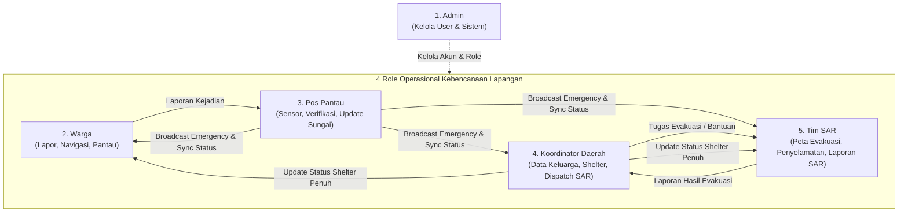
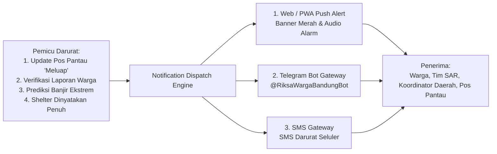
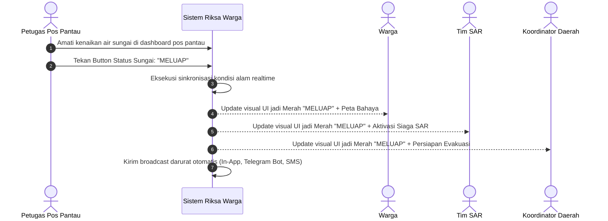
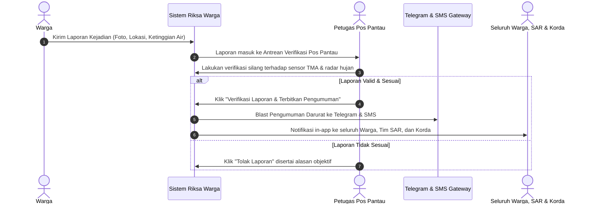
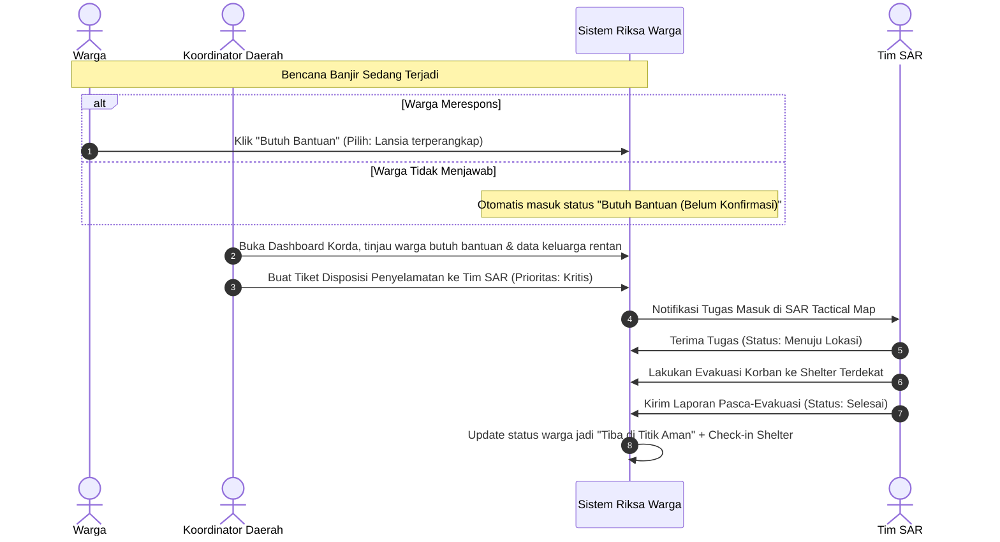
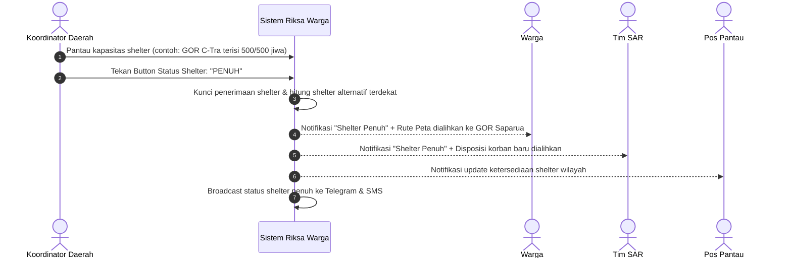

# PRODUCT REQUIREMENTS DOCUMENT (PRD)
# RIKSA WARGA (KOTA BANDUNG)
## Integrated Smart River Monitoring, Early Warning System & Community-Based Search and Rescue Ecosystem

| Atribut Dokumen | Rincian Spesifikasi |
|---|---|
| **Nama Produk** | **RIKSA WARGA** (sebelumnya *Saling Jaga*) |
| **Semboyan / Tagline** | *Riksa Sasama, Tanggap Bencana, Salamet Balarea* |
| **Nama Dokumen** | Product Requirements Document (PRD) — Final Edition |
| **Versi Dokumen** | 2.0 — Penyesuaian Arsitektur Wilayah Bandung & 5 Role Operasional |
| **Tanggal Pembaruan** | 7 November 2026 |
| **Status Dokumen** | Disetujui untuk Implementasi Arsitektur Sistem |
| **Wilayah Fokus** | **Kota Bandung dan Kawasan Cekungan Bandung (Bandung Raya)** |
| **Fokus Bencana Utama** | **Banjir Luapan Sungai, Banjir Bandang, Genangan Ekstrem, dan Tanggul Kritis** |
| **Struktur Peran (5 Role)** | **1. Warga** **2. Koordinator Daerah** **3. Pos Pantau** **4. Tim SAR** **5. Admin** |
| **Kanal Notifikasi** | Web/PWA Push Notification, Telegram Bot Gateway, SMS Gateway |
| **Platform Target** | Web App Responsif & Progressive Web App (PWA) Mobile-First |

---

# 1. Ringkasan Eksekutif & Visi Produk

## 1.1 Filosofi dan Definisi Produk
**RIKSA WARGA** mengambil akar kata dari bahasa Sunda: *Riksa* (ngariksa: merawat, menjaga, melindungi dengan penuh kewaspadaan) dan *Warga* (masyarakat/penduduk). 

**RIKSA WARGA** adalah platform digital kebencanaan terpadu berbasis komunitas yang dirancang khusus untuk menghadapi kerentanan hidrometeorologi di **Kota Bandung dan Cekungan Bandung**. Platform ini menghubungkan sensor alam, petugas pos pemantau sungai, koordinator kewilayahan, unit pencarian dan pertolongan (Tim SAR), serta warga dalam satu siklus tertutup: **Deteksi Dini $\to$ Verifikasi Silang $\to$ Peringatan Multi-Kanal $\to$ Operasi Penyelamatan Cepat $\to$ Manajemen Pengungsian Terarah**.

## 1.2 Tiga Pilar Utama RIKSA WARGA
1. **SMART HYDRO-METEOROLOGICAL MONITORING (PANTAU)**
   Integrasi data pemantauan air sungai (TMA) secara dinamis di berbagai titik sungai strategis Bandung (Sungai Cikapundung, Citepus, Cidurian, Gedebage, Citarum Hulu), data curah hujan realtime, serta model prediksi kenaikan air untuk peringatan sebelum banjir terjadi (*predictive early warning*).
2. **CENTRALIZED VERIFICATION & INSTANT WARNING (PERINGATAN)**
   Pos Pantau menjadi garda terdepan verifikasi laporan warga dengan pencocokan data sensor/radar cuaca, didukung kendali cepat 3 kondisi sungai (*Normal, Waspada, Meluap*) yang langsung menyinkronkan seluruh ekosistem digital secara realtime serta memicu notifikasi masif ke Web, Bot Telegram, dan SMS.
3. **INCLUSIVE SEARCH, RESCUE & SHELTER NAVIGATION (PENYELAMATAN)**
   Operasi evakuasi presisi tinggi oleh Tim SAR menggunakan peta taktis yang menampilkan seluruh warga yang membutuhkan bantuan dan warga yang belum memberikan konfirmasi keselamatan di zona bahaya, diprioritaskan berdasarkan data keluarga dan kelompok rentan yang dikelola oleh Koordinator Daerah, serta diarahkan ke shelter-shelter riil Kota Bandung yang kapasitasnya dipantau secara realtime.

---

# 2. Konteks Wilayah Bandung & Permasalahan Lapangan

## 2.1 Karakteristik Geografis & Hidrologi Kota Bandung
Kota Bandung terletak pada cekungan dataran tinggi (*Bandung Basin*) yang dikelilingi oleh pegunungan di sisi utara, timur, dan selatan. Kondisi ini menyebabkan dinamika banjir yang spesifik:
- **Aliran Cepat dari Hulu (Kawasan Bandung Utara / Lembang):** Hujan lebat di hulu menyebabkan lonjakan debit Sungai Cikapundung dalam waktu 45–90 menit menuju pusat kota (Gandok, Tamansari, Braga) sebelum bermuara ke Citarum.
- **Titik Langganan Banjir Cepat (Flash Flood) Perkotaan:**
  - *Sungai Citepus:* Meluap cepat di kawasan Pagarsih, Astanaanyar, Pasirkaliki akibat penyempitan penampang sungai dan sedimentasi.
  - *Sungai Cidurian:* Mengancam kawasan Cicaheum, Antapani, Kiaracondong, hingga Rancasari.
  - *Kawasan Retensi Gedebage:* Daerah cekungan timur yang menampung aliran air dari Cinambo dan Cipamokolan.
- **Karakteristik Korban Jiwa & Hambatan Evakuasi:** Sebagian besar korban terjebak di dalam rumah akibat air yang naik tiba-tiba pada malam hari, warga lanjut usia yang tidak dapat menyelamatkan diri sendiri, serta putusnya akses jalan akibat genangan arus deras.

## 2.2 Masalah yang Diselesaikan (Problem Statement)

| Kode | Masalah di Lapangan | Solusi Spesifik RIKSA WARGA |
|---|---|---|
| **P-01** | Warga panik dan tidak tahu kondisi air sungai di hulu hingga air tiba-tiba meluap di permukiman. | Dashboard kondisi alam publik menampilkan TMA sungai dinamis, curah hujan, dan prediksi luapan (*Time-to-Flood*). |
| **P-02** | Warga yang tidak membalas pesan darurat sering diabaikan atau dianggap sudah selamat. | **Prinsip Keselamatan Riksa Warga:** Warga yang *Belum Konfirmasi* otomatis diklasifikasikan sebagai *Butuh Bantuan* dan masuk radar pencarian Tim SAR. |
| **P-03** | Petugas SAR kesulitan mencari posisi korban dan tidak tahu siapa yang paling kritis. | Peta Taktis SAR memetakan posisi warga di zona merah dengan indikator kerentanan (lansia, balita, disabilitas) dari data Koordinator Daerah. |
| **P-04** | Validasi laporan bencana lambat sehingga kabar hoaks memicu kepanikan warga. | Laporan warga masuk ke Pos Pantau untuk diverifikasi silang dengan sensor air & cuaca sebelum disiarkan ke publik. |
| **P-05** | Shelter pengungsian penuh sesak dan pengungsi menumpuk di satu titik saja. | Koordinator Daerah mengelola kuota shelter riil; jika penuh, status broadcast otomatis dialihkan ke shelter cadangan terdekat di Bandung. |
| **P-06** | Tidak semua warga memiliki kuota data aktif atau internet stabil saat cuaca buruk. | Sistem peringatan darurat terintegrasi tiga lapis: Web/PWA, Bot Telegram, dan SMS Gateway. |

---

# 3. Struktur Pengguna & Matriks Hak Akses (5 Role Eksklusif)

Sistem RIKSA WARGA membatasi arsitektur pengguna menjadi tepat **5 peran hierarkis dan operasional**:

## 3.1 Definisi 5 Peran (User Roles)

### 1. Warga (Resident)
Masyarakat yang tinggal atau beraktivitas di wilayah Kota Bandung. Memiliki hak untuk mendaftarkan titik lokasi rumah tinggal sekali seumur hidup (*baseline location*), melaporkan status kondisi keselamatan saat bencana, melihat peta rute ke shelter terdekat, melaporkan kejadian bencana ke Pos Pantau, memantau kondisi alam dan prediksi hujan/sungai, serta menerima notifikasi darurat multi-kanal.

### 2. Koordinator Daerah (Korda / Regional Coordinator)
Tokoh perwakilan masyarakat atau koordinator lapangan di tingkat RW/Kelurahan/Kecamatan di Kota Bandung. Bertanggung jawab menginput dan memvalidasi basis data keluarga (termasuk pendataan kelompok rentan: lansia, balita, disabilitas, orang sakit), mengajukan permohonan bantuan/evakuasi kepada Tim SAR untuk warga yang belum terevakuasi, serta mengelola kapasitas shelter pengungsian di wilayahnya dan mengumumkan pengalihan rute jika shelter penuh.

### 3. Pos Pantau (Observation Post Operator)
Petugas pengawas pos hidrologi dan titik pantau sungai di Kota Bandung (misal: Pos Gandok Cikapundung, Pos Pagarsih Citepus, Pos Cicaheum Cidurian). Memiliki kewenangan memperbarui status kondisi sungai melalui kendali 3 status (*Normal, Waspada, Meluap*) yang menyinkronkan seluruh platform, memvalidasi laporan warga dengan mencocokkannya ke data sensor dan cuaca, menerbitkan pengumuman darurat resmi ke seluruh role dan kanal pesan luar (Telegram/SMS), serta melaporkan kondisi lingkungan sekitar pos.

### 4. Tim SAR (Search and Rescue Team)
Personel penyelamat gabungan (Basarnas, BPBD Kota Bandung, Tagana, Relawan PMI, Tim Respon Cepat). Menggunakan peta navigasi taktis untuk menemukan seluruh warga yang membutuhkan bantuan dan warga yang belum konfirmasi di daerah rawan bencana, memantau kondisi hidrologi terkini untuk keselamatan personel lapangan, menerima dan mengeksekusi disposisi tugas penyelamatan dari Koordinator Daerah, serta menyusun laporan resmi hasil penanganan warga.

### 5. Admin (System Administrator)
Pengelola teknis platform RIKSA WARGA. Bertanggung jawab atas administrasi identitas pengguna (*User Management*), validasi pendaftaran, pemberian/perubahan peran pengguna, aktivasi/deaktivasi akun, manajemen hierarki wilayah administratif Bandung, dan pengawasan audit trail log.

---

## 3.2 Matriks Hak Akses (Role-Based Access Control / RBAC)

| Modul Fitur Sistem | Warga | Koordinator Daerah | Pos Pantau | Tim SAR | Admin |
|---|:---:|:---:|:---:|:---:|:---:|
| **Manajemen Pengguna (User Management)** | ❌ | ❌ | ❌ | ❌ | **Penuh** |
| **Share Lokasi Realtime Baseline (Sekali Seumur Hidup)** | **Milik Sendiri** | ❌ | ❌ | ❌ | ❌ |
| **Input / Update Status Kondisi Darurat (Aman/Bantuan)** | **Milik Sendiri** | Milik Warganya | ❌ | ❌ | ❌ |
| **Peta Navigasi Shelter Terdekat (Real Kota Bandung)** | **Baca & Navigasi** | **Baca & Navigasi** | **Baca & Navigasi** | **Baca & Navigasi** | Baca |
| **Input Laporan Kejadian Bencana ke Pos Pantau** | **Buat Laporan** | Buat Laporan | Buat Laporan | ❌ | ❌ |
| **Dashboard Kondisi Alam & Prediksi Cuaca/Sungai Dinamis** | **Baca** | **Baca** | **Baca** | **Baca** | Baca |
| **Button Update 3 Kondisi Sungai (Normal, Waspada, Meluap)** | ❌ | ❌ | **Eksekusi Penuh** | ❌ | ❌ |
| **Verifikasi Laporan Warga vs Sensor & Cuaca** | ❌ | ❌ | **Verifikasi & Tolak** | ❌ | Audit |
| **Terbitkan Pengumuman Darurat (Broadcast ke Telegram/SMS)** | ❌ | ❌ | **Rilis Pengumuman** | ❌ | Audit |
| **Manajemen Data Keluarga & Profil Warga Rentan** | ❌ | **Kelola & Input** | ❌ | Baca (Tugas) | Audit |
| **Pengajuan Bantuan Evakuasi ke Tim SAR** | Permintaan Personal | **Kirim Penugasan** | ❌ | ❌ | ❌ |
| **Peta Taktis Warga Butuh Bantuan & Belum Konfirmasi** | ❌ | Wilayahnya Saja | ❌ | **Peta Seluruh Korban** | ❌ |
| **Penerimaan & Update Status Tugas Penyelamatan** | ❌ | Monitor Progres | ❌ | **Eksekusi & Update** | ❌ |
| **Pembuatan Laporan Misi Penanganan (Post-Rescue)** | ❌ | Validasi Penerimaan | ❌ | **Buat Laporan Resmi**| ❌ |
| **Pengelolaan Kapasitas Shelter & Update Status Penuh** | ❌ | **Kelola & Update** | ❌ | ❌ | Audit |
| **Penerimaan Notifikasi Bencana & Prediksi Banjir** | **Terima (App/TG/SMS)**| **Terima (App/TG/SMS)**| **Terima (App/TG/SMS)**| **Terima (App/TG/SMS)**| ❌ (Bypass Log) |

---

# 4. Kebutuhan Fungsional Lengkap per Peran

## 4.1 Role 1: WARGA

### FR-W01: Share Lokasi Realtime Baseline (Cukup Sekali Seumur Hidup)
- Sistem menyediakan fitur pengaturan koordinat tempat tinggal/titik aman dasar (*home baseline coordinate*) bagi setiap akun Warga.
- Warga mengaktifkan izin GPS browser/ponsel cukup **satu kali saja seumur hidup** saat proses pendaftaran/onboarding. Titik koordinat latitude dan longitude tersimpan permanen di profil akun.
- Ketika bencana terjadi, sistem secara otomatis mengasumsikan posisi awal warga berada pada koordinat rumah tersebut tanpa mewajibkan ponsel warga terus-menerus mengaktifkan GPS latar belakang (menghemat baterai dan kuota data darurat).
- Warga tetap memiliki opsi memperbarui lokasi seketika (*live update*) apabila sedang berada di luar rumah saat air mulai naik.

### FR-W02: Pelaporan Kondisi Saat Terjadi Bencana & Pelacakan Otomatis
- Saat bencana dinyatakan aktif (atau status sungai memasuki Waspada/Meluap), antarmuka Beranda Warga berubah menjadi mode tanggap darurat dengan dua tombol utama berukuran besar:
  1. 🟢 **"Saya Aman"** (Konfirmasi mandiri bahwa warga telah berada di tempat yang terlindung/aman).
  2. 🔴 **"Butuh Bantuan"** (Warga meminta pertolongan darurat disertai pemilihan kategori kebutuhan: evakuasi fisik, pertolongan medis, terdapat lansia/balita, dsb).
- **ATURAN KESELAMATAN VITAL (Zero-Victim Fallback):**
  - Seluruh warga terdaftar yang berada di wilayah terdampak yang **BELUM MEMBERIKAN KONFIRMASI (No Response)** secara sistematis langsung diklasifikasikan dengan status **"MEMBUTUHKAN BANTUAN (BELUM TERKONFIRMASI)"**.
  - Warga yang belum konfirmasi ini langsung diproyeksikan ke dalam **Peta Taktis Tim SAR** dan **Dashboard Koordinator Daerah** beserta koordinat baseline rumah mereka agar dapat dilacak (*trackable*) dan segera diperiksa fisik ke lokasi.

### FR-W03: Peta Navigasi ke Shelter Terdekat (Real Kota Bandung)
- Warga dapat membuka peta evakuasi interaktif yang mendeteksi posisi mereka dan menampilkan rute navigasi terpendek yang aman menuju **Shelter Evakuasi Riil di Kota Bandung**.
- Titik shelter menampilkan informasi: Nama Fasilitas, Alamat Lengkap, Kapasitas Tampung, Jumlah Jiwa yang Sedang Ditampung, Fasilitas Tersedia (P3K, Dapur Umum, Musholla), dan Status Keterisian (Tersedia / Terbatas / Penuh).
- Rute navigasi secara dinamis menghindari ruas jalan yang telah ditandai berbahaya (tergenang >40 cm, arus deras, atau akses terputus).

### FR-W04: Pelaporan Kejadian Bencana ke Pos Pantau
- Warga dapat mengirim laporan insiden lapangan jika melihat: kenaikan air cepat di parit/sungai sekitar rumah, tanggul jebol, pohon tumbang, atau genangan jalan.
- Formulir laporan memuat: pin lokasi otomatis dari peta, deskripsi singkat, foto bukti visual (maksimal 5 MB), dan estimasi ketinggian air.
- Seluruh laporan dari warga ini tidak langsung dipublikasikan secara liar ke publik, melainkan dialirkan secara terpusat ke antrean verifikasi petugas **Pos Pantau** wilayah terkait untuk menghindari informasi simpang siur.

### FR-W05: Pemantauan Kondisi Alam & Prediksi Cuaca/Sungai Dinamis
- Warga dapat memantau dashboard kondisi alam Kota Bandung yang menyajikan:
  - Grafik tren ketinggian air (TMA dalam cm) di pos-pos sungai strategis (Cikapundung, Citepus, Cidurian, Gedebage).
  - Data curah hujan realtime (mm/jam) dan prakiraan cuaca setempat.
  - **Model Prediksi Kenaikan Air (Hydrological Predictive Alert):** Menampilkan estimasi probabilitas banjir dalam rentang waktu ke depan (misal: *"Kondisi Hulu Lembang Hujan Ekstrem (65 mm/jam), diprediksi Sungai Cikapundung Pos Gandok meluap dalam 60 menit ke depan. Harap bersiap!"*).

### FR-W06: Penerimaan Notifikasi Peringatan Multi-Kanal
- Warga secara otomatis menerima notifikasi instan apabila:
  - Pos Pantau menaikkan status sungai ke *Waspada* atau *Meluap*.
  - Pos Pantau menerbitkan pengumuman darurat hasil verifikasi.
  - Model prediksi mendeteksi ancaman banjir bandang yang menuju permukiman mereka.
- Notifikasi diterima melalui 3 jalur terpadu: Notifikasi Layar PWA, Pesan Telegram via Bot RIKSA WARGA, dan Pesan Singkat SMS bagi nomor telepon yang terdaftar.

---

## 4.2 Role 2: TIM SAR (Search and Rescue)

### FR-S01: Peta Taktis Navigasi Seluruh Warga Butuh Bantuan & Zona Bahaya
- Tim SAR dibekali antarmuka khusus **"SAR Tactical Rescue Map"** yang menampilkan visualisasi geospasial real-time:
  - Seluruh warga yang menekan tombol *Butuh Bantuan*.
  - Seluruh warga dengan status *Belum Konfirmasi* yang berada di dalam radius zona bahaya/poligon genangan air.
  - Klaster kepadatan korban yang memerlukan evakuasi massal.
- Setiap pin warga menampilkan profil cepat: Nama Kepala Keluarga, Jumlah Anggota Keluarga, Penanda Khusus Kerentanan (misal: 1 Lansia lumpuh, 2 Balita), Alamat/Koordinat Rumah, dan Waktu sejak status aktif.
- Peta dilengkapi kalkulasi rute navigasi tim penyelamat dari posko aju SAR menuju koordinat korban dengan mempertimbangkan jalur darat yang masih dapat dilalui perahu karet atau kendaraan taktis amfibi.

### FR-S02: Pemantauan Kondisi Alam & Data Hujan Dinamis untuk Taktik Operasi
- Tim SAR dapat memantau data sensor TMA sungai, debit air, curah hujan hulu-hilir, dan data cuaca radar BMKG secara dinamis.
- Informasi tren kenaikan air dan waktu puncak banjir (*peak flood arrival time*) digunakan oleh komandan regu SAR untuk menghitung batas waktu operasi aman personel (*safety timeout*) sebelum arus sungai mencapai titik kritis yang membahayakan perahu karet penyelamat.

### FR-S03: Penerimaan Disposisi Tugas Evakuasi dari Koordinator Daerah
- Tim SAR memiliki modul penerimaan tugas evakuasi resmi (*Rescue Task Inbox*) yang diajukan oleh Koordinator Daerah.
- Tiket penugasan memuat: ID Tugas, Lokasi Evakuasi, Nama Korban/Keluarga, Prioritas Operasi (Kritis / Tinggi / Sedang), Catatan Khusus Medis, dan Shelter Tujuan Rujukan.
- Personel SAR dapat memperbarui status penanganan secara realtime melalui alur bertahap:
  $$\text{Diterima} \longrightarrow \text{Menuju Lokasi} \longrightarrow \text{Tiba di Titik} \longrightarrow \text{Proses Evakuasi} \longrightarrow \text{Selesai (Tiba di Shelter)} / \text{Terkendala}$$

### FR-S04: Pembuatan Laporan Resmi Pasca-Evakuasi (Post-Rescue Report)
- Setelah menyelesaikan operasi penyelamatan, personel SAR wajib mengisi laporan hasil tindakan melalui sistem:
  - Jumlah total jiwa yang berhasil dievakuasi (dirinci per kategori dewasa, lansia, anak-anak/balita).
  - Kondisi fisik/kesehatan korban (Selamat tanpa luka, Luka ringan, Butuh penanganan medis darurat di RS rujukan).
  - Shelter atau fasilitas kesehatan tempat korban diserahterimakan.
  - Catatan kendala operasional lapangan (arus deras, puing menghalangi perahu, kabel listrik terendam).
- Laporan ini otomatis mengubah status warga terkait menjadi **"Tiba di Titik Aman"** dan mencatat check-in resmi pada database shelter terkait.

### FR-S05: Penerimaan Notifikasi Darurat Lapangan
- Tim SAR menerima notifikasi siaga satu secara instan melalui Web App, Bot Telegram SAR Rescue Command, dan SMS Gateway ketika ada kenaikan status sungai atau permohonan evakuasi darurat prioritas tinggi dari Koordinator Daerah.

---

## 4.3 Role 3: POS PANTAU (Observation Post Operator)

### FR-P01: Pemantauan Kondisi Alam & Data Hujan Dinamis + Model Prediksi
- Petugas Pos Pantau memiliki dashboard stasiun pemantauan yang menampilkan:
  - Sensor ultrasonik/radar tinggi muka air (TMA) dengan grafik pembacaan per menit.
  - Nilai ambang batas mistar ukur sungai: Normal ($< 150\text{ cm}$), Waspada ($150 - 250\text{ cm}$), Meluap ($> 250\text{ cm}$) — *dapat disesuaikan per karakter sungai*.
  - Tren hidrologi (Naik Cepat / Stabil / Menurun).
  - Data curah hujan posko dan radar cuaca BMKG.
  - Prediksi waktu luapan berdasarkan perambatan debit hulu (*upstream flow lag-time*).

### FR-P02: Button 3 Kondisi Sungai (Normal, Waspada, Meluap) & Realtime Synchronization
- Antarmuka utama Pos Pantau dilengkapi dengan **Tiga Tombol Kontrol Cepat (Quick Status Override Buttons)**:
  - 🟢 **NORMAL:** Aliran air sungai aman, tinggi muka air dalam batas wajar.
  - 🟡 **WASPADA:** Ketinggian air meningkat drastis, mendekati bibir tanggul; aliran air berarus deras.
  - 🔴 **MELUAP:** Air sungai telah keluar dari badan sungai dan mulai menggenangi permukiman/jalan sekitar.
- **INTEGRASI REAKTIF SISTEM (DYNAMIC REALTIME SYNC):**
  - Ketika petugas menekan salah satu dari 3 tombol tersebut, sistem secara otomatis mengeksekusi *state transition* terpusat.
  - Seluruh dashboard role lain (Warga, Tim SAR, Koordinator Daerah) seketika memperbarui status warna visual, banner level, dan petunjuk keselamatan tanpa perlu memuat ulang browser (*reactive push update*).
  - Perubahan status ke Waspada atau Meluap secara otomatis memicu pembentukan draf peringatan dini sistem.

### FR-P03: Verifikasi Laporan Kejadian Warga & Validasi Silang Sensor/Cuaca
- Laporan kejadian yang dikirim oleh Warga (FR-W04) masuk ke antrean verifikasi Pos Pantau (*Verification Queue*).
- Petugas Pos Pantau melakukan pemeriksaan silang (*cross-validation*):
  1. Memeriksa kesesuaian lokasi laporan warga terhadap wilayah sungai yang dipantau.
  2. Mencocokkan foto dan deskripsi kenaikan air dengan pembacaan sensor TMA pada jam yang sama.
  3. Memeriksa korelasi dengan intensitas curah hujan di wilayah hulu dan sekitarnya.
- Jika laporan warga dinilai valid dan konsisten dengan data fisik:
  - Petugas menyetujui verifikasi laporan (*Verify Incident*).
  - Pos Pantau memiliki otorisasi penuh untuk menerbitkan **PENGUMUMAN DARURAT RESMI (Emergency Public Announcement)** ke seluruh role (Warga, Koordinator Daerah, Tim SAR — kecuali Admin) yang secara otomatis menyebarkan broadcast ke **Bot Telegram** dan **SMS Gateway**.
- Jika laporan tidak valid/keliru, petugas dapat menolak laporan dengan mencantumkan alasan tertulis demi menjaga integritas data.

### FR-P04: Pelaporan Kondisi Berkala Wilayah Pantauan
- Petugas Pos Pantau dapat menyusun dan mengirimkan laporan kondisi fisik berkala: kondisi struktur tanggul sungai, penumpukan sampah di pintu air/jembatan, kejernihan/kekeruhan air, dan kecepatan arus permukaan.

### FR-P05: Peta Navigasi ke Shelter Terdekat
- Pos Pantau memiliki akses navigasi ke titik shelter riil terdekat di Kota Bandung untuk mengarahkan warga yang datang mencari pertolongan langsung ke pos pemantauan.

### FR-P06: Penerimaan Notifikasi Peringatan Multi-Kanal
- Petugas pos pantau menerima sinyal peringatan dini dari stasiun pemantau hulu atau laporan anomali sensor melalui Web, Bot Telegram, dan SMS.

---

## 4.4 Role 4: KOORDINATOR DAERAH (Regional Coordinator)

### FR-K01: Manajemen Basis Data Keluarga & Kelompok Rentan (Household Registry)
- Koordinator Daerah bertanggung jawab menginput dan mengelola basis data keluarga di wilayah kewenangannya (RT/RW/Kelurahan):
  - Nomor Kartu Keluarga (KK) / Identitas Kepala Keluarga.
  - Daftar nama dan usia seluruh anggota keluarga.
  - Titik koordinat tempat tinggal keluarga.
  - **Identifikasi Kelompok Rentan Berisiko Tinggi:**
    - 🧓 **Lansia** (Lanjut usia $\ge 60$ tahun).
    - 👶 **Balita & Anak-anak** ($< 5$ tahun).
    - ♿ **Penyandang Disabilitas** (fisik, sensorik, intelektual, mental).
    - 🤰 **Ibu Hamil / Menyusui**.
    - 🏥 **Warga Sakit Kronis / Butuh Alat Medis Berjalan**.
  - Catatan khusus kebutuhan bantuan darurat (misal: "Menggunakan kursi roda", "Memerlukan tabung oksigen", "Tidak dapat berjalan").
- Basis data keluarga ini menjadi landasan utama penentuan skala prioritas penyelamatan saat bencana melanda.

### FR-K02: Pengajuan Bantuan & Disposisi Penyelamatan ke Tim SAR
- Koordinator Daerah memantau status keselamatan seluruh warganya melalui dashboard wilayah.
- Ketika teridentifikasi warga yang:
  - Memilih tombol *Butuh Bantuan*, ATAU
  - Berstatus *Belum Konfirmasi* dan berada di area berisiko tinggi luapan air;
- Koordinator Daerah dapat membuat tiket permohonan resmi (*Emergency Dispatch Request*) yang ditujukan langsung ke dashboard **Tim SAR**.
- Tiket bantuan secara otomatis menyertakan rincian profil keluarga rentan tersebut sehingga Tim SAR dapat mempersiapkan peralatan penyelamatan yang tepat (perahu karet khusus, tandu, pelampung anak).

### FR-K03: Pengelolaan Shelter & Broadcast Status Keterisian (Shelter Full Alert)
- Koordinator Daerah bertindak sebagai pengelola dan pengawas shelter pengungsian yang berada di yurisdiksinya (misal: Balai Pertemuan, GOR, Gedung Serbaguna).
- Korda menginput kapasitas maksimal tempat tidur/ruang dan secara berkala memperbarui jumlah pengungsi yang telah masuk (*realtime occupancy*).
- **MEKANISME PENGALIHAN ARUS PENGUNGSI (SHELTER REDIRECTION):**
  - Apabila kapasitas shelter telah mencapai batas maksimal ($100\%$), Koordinator Daerah menekan tombol **"SHELTER PENUH"**.
  - Sistem secara otomatis mengirimkan notifikasi darurat instan kepada **Warga, Tim SAR, dan Pos Pantau**.
  - Peta navigasi pada aplikasi Warga dan Tim SAR seketika mengubah status shelter tersebut menjadi abu-abu (*Penuh - Tidak Menerima Pengungsi Baru*) dan secara otomatis mengarahkan rute navigasi ke shelter riil terdekat berikutnya yang masih memiliki kuota kosong di Kota Bandung.

### FR-K04: Penerimaan Notifikasi Peringatan Multi-Kanal
- Koordinator Daerah menerima notifikasi status bencana, alert kenaikan muka air sungai, dan peringatan prediksi banjir via Web, Bot Telegram, dan SMS untuk menggerakkan warga di lingkungannya.

---

## 4.5 Role 5: ADMIN (System Administrator)

### FR-A01: Manajemen Pengguna & Validasi Akun (User Management)
- Admin memiliki otoritas penuh untuk:
  - Melihat seluruh daftar pengguna terdaftar di platform RIKSA WARGA.
  - Menetapkan dan mengubah peran pengguna secara eksklusif ke salah satu dari 5 peran: *Warga, Koordinator Daerah, Pos Pantau, Tim SAR, Admin*.
  - Melakukan aktivasi, penonaktifan (*suspend*), atau reset kredensial akun pengguna.
  - Menugaskan wilayah cakupan administratif Kota Bandung (Kecamatan, Kelurahan, RW, RT) kepada Koordinator Daerah dan menugaskan stasiun sungai kepada Pos Pantau.

### FR-A02: Pengawasan Sistem, Master Data & Audit Trail Log
- Mengelola data master wilayah administratif Kota Bandung (30 Kecamatan, 151 Kelurahan, serta RW/RT binaan).
- Mengelola data master shelter resmi Kota Bandung (nama, koordinat geografis, alamat, kapasitas baku).
- Memantau log audit (*Audit Trail*) sistem secara lengkap: riwayat verifikasi laporan oleh Pos Pantau, perubahan level sungai, tiket disposisi Korda ke SAR, riwayat broadcast SMS/Telegram, serta aktivitas pengguna untuk menjamin kepatuhan SOP dan akuntabilitas hukum.

---

# 5. Spesifikasi Shelter Riil Kota Bandung

Platform RIKSA WARGA menggunakan **data shelter fisik riil** yang beroperasi di wilayah Kota Bandung sebagai tujuan evakuasi warga. Shelter-shelter ini telah diverifikasi kelayakan lokasi, fasilitas dasar, dan aksesibilitasnya:

| No | Nama Shelter Riil | Alamat Lengkap & Kecamatan | Titik Koordinat | Kapasitas Baku | Fasilitas Penunjang |
|---|---|---|:---:|:---:|---|
| **1** | **GOR C-Tra Arena** | Jl. Cikutra No. 278, Sukapada, Kec. Cibeunying Kidul | -6.8992, 107.6358 | 500 Jiwa | Aula Tertutup, Listrik Genset, Toilet, Parkir Truk SAR |
| **2** | **GOR Saparua** | Jl. Banda No. 28, Citarum, Kec. Bandung Wetan | -6.9081, 107.6169 | 800 Jiwa | Tribun Luas, Posko Medis PMI, Titik Distribusi Logistik |
| **3** | **GOR Arcamanik (Sport Jabar)** | Jl. Pacuan Kuda, Sukamiskin, Kec. Arcamanik | -6.9150, 107.6740 | 1.200 Jiwa | Gedung Olahraga Terpadu, Dapur Umum, Akses Jalan Lebar |
| **4** | **GOR Lodaya** | Jl. Lodaya No. 20, Malabar, Kec. Lengkong | -6.9304, 107.6225 | 450 Jiwa | Aula Serbaguna, Lapangan Evakuasi, Sumber Air Bersih |
| **5** | **Balai Pertemuan RW 07 Braga** | Jl. Braga No. 102 (Bantaran Cikapundung), Kec. Sumur Bandung | -6.9175, 107.6095 | 120 Jiwa | Titik Evakuasi Cepat Warga Cikapundung Tengah |
| **6** | **Kantor Kecamatan Gedebage & Balai Rancabolang** | Jl. Gedebage Raya, Kec. Gedebage | -6.9485, 107.6850 | 350 Jiwa | Area Cekungan Timur, Penampungan Warga Banjir Gedebage |
| **7** | **Gedung Palang Merah Indonesia (PMI) Kota Bandung** | Jl. Aceh No. 79, Cihapit, Kec. Bandung Wetan | -6.9110, 107.6190 | 250 Jiwa | Fasilitas Medis Lengkap, Unit Bank Darah, Ambulans Siaga |
| **8** | **Balai Warga Dayeuhkolot / Baleendah (Kawasan Citarum Selatan)** | Jl. Raya Dayeuhkolot No. 45 (Batas Selatan Kota Bandung) | -6.9850, 107.6250 | 600 Jiwa | Titik Penampungan Limpasan Sungai Citarum Hulu |

> **Aturan Navigasi Shelter:** Ketika salah satu shelter ditandai **PENUH** oleh Koordinator Daerah, algoritma routing RIKSA WARGA langsung mencoret titik tersebut dari rute rekomendasi dan secara otomatis memandu warga ke shelter terdekat berikutnya yang berstatus **TERSEDIA**.

---

# 6. Pemantauan Kondisi Alam & Engine Prediksi Dinamis

## 6.1 Parameter Hidrologi & Curah Hujan Bandung
Sistem memproses parameter hidrometeorologi secara realtime dari pos-pos pantau sungai:
1. **Tinggi Muka Air (TMA) Sungai ($h$, dalam cm):**
   - $h < h_{\text{waspada}}$ : Kondisi **NORMAL** (Warna Hijau).
   - $h_{\text{waspada}} \le h < h_{\text{meluap}}$ : Kondisi **WASPADA** (Warna Kuning).
   - $h \ge h_{\text{meluap}}$ : Kondisi **MELUAP** (Warna Merah).
2. **Laju Kenaikan Muka Air ($\Delta h / \Delta t$, dalam cm/menit):**
   Mendeteksi seberapa cepat air bertambah tinggi untuk mengantisipasi banjir bandang (*flash flood*).
3. **Intensitas Curah Hujan ($R$, dalam mm/jam):**
   - Hujan Ringan: $1 - 5\text{ mm/jam}$
   - Hujan Sedang: $5 - 20\text{ mm/jam}$
   - Hujan Lebat / Ekstrem: $> 20\text{ mm/jam}$

## 6.2 Logika Prediksi Banjir (Early Warning Prediction Engine)
Model prediksi menghitung waktu tempuh perambatan air dari stasiun hulu (misal: Cikapundung Hulu di Lembang/Gandok) menuju kawasan hilir di perkotaan Bandung:

$$T_{\text{estimasi}} = \frac{D_{\text{hulu-hilir}}}{V_{\text{aliran}}} - t_{\text{hujan\_berlangsung}}$$

Jika laju kenaikan air di hulu $\Delta h / \Delta t > 2.5\text{ cm/menit}$ disertai curah hujan lebat di hulu ($R > 25\text{ mm/jam}$), engine secara otomatis memproyeksikan terjadinya luapan di daerah hilir dalam kurun waktu $30 - 75\text{ menit}$.

Hasil kalkulasi prediksi ini ditampilkan di dashboard Warga, Tim SAR, dan Koordinator Daerah dalam bentuk peringatan siaga:
> **Peringatan Dini Prediksi:** *"Terdeteksi hujan ekstrem di kawasan hulu (Lembang/Dago Atas). Debit Sungai Cikapundung diprediksi meluap di kawasan Tamansari dan Braga pada pukul 15.45 WIB. Warga bantaran sungai diimbau segera mengamankan barang dan bersiap menuju shelter terdekat!"*

---

# 7. Sistem Peringatan Multi-Kanal (Web, Bot Telegram, SMS Gateway)

Peringatan darurat harus mampu menembus berbagai kendala keterbatasan jaringan di lapangan. RIKSA WARGA mengoperasikan arsitektur notifikasi tiga kanal:

### 1. In-App Web & PWA Notification
- Banner darurat di bagian atas layar aplikasi dengan aksen warna sesuai level (Kuning: Waspada, Merah: Bahaya Meluap).
- Bunyi alarm peringatan darurat saat status sungai meluap.
- Pesan petunjuk tindakan keselamatan dan tombol sekali-klik menuju peta shelter terdekat.

### 2. Bot Telegram RIKSA WARGA (`@RiksaWargaBandungBot`)
- Mengirimkan pesan terstruktur ke grup koordinasi Tim SAR, grup Koordinator Daerah, pos pantau, dan kanal publik warga.
- Memuat informasi: Jenis Bencana, Lokasi Sungai/Wilayah, Status Ketinggian Air, Estimasi Waktu Bahaya, dan Tautan Cepat Peta Evakuasi.

### 3. SMS Gateway
- Mengirim pesan teks singkat (SMS) otomatis kepada seluruh nomor telepon terdaftar milik Warga, Tim SAR, dan Koordinator Daerah di wilayah terdampak.
- Tidak membutuhkan koneksi paket data internet atau smartphone mutakhir, menjamin warga dengan ponsel fitur (*feature phone*) tetap terselamatkan.

---

# 8. Alur Kerja Operasional Antar-Peran (End-to-End Workflows)

## 8.1 Alur 1: Pemantauan Air Hulu, Kontrol Pos Pantau & Sinkronisasi Sistem

## 8.2 Alur 2: Pelaporan Warga, Verifikasi Pos Pantau & Pengumuman Luas

## 8.3 Alur 3: Pendataan Status Warga, Dispatch Korda & Penyelamatan Tim SAR

## 8.4 Alur 4: Shelter Penuh & Pengalihan Navigasi Otomatis

---

# 9. Model Data & Arsitektur Database (MySQL / MariaDB)

Arsitektur database disesuaikan untuk mendukung 5 role baru, integritas data keluarga, kontrol pos pantau, tiket penyelamatan SAR, dan navigasi shelter.

```mermaid
erDiagram
    USERS ||--o{ RESIDENTS : "mengelola/memiliki"
    USERS ||--o{ AUDIT_LOGS : "mencatat"
    USERS ||--o{ RESCUE_TASKS : "ditugaskan/dibuat"
    REGIONS ||--o{ USERS : "menaungi"
    REGIONS ||--o{ STATIONS : "memiliki"
    REGIONS ||--o{ SHELTERS : "memiliki"
    FAMILIES ||--o{ RESIDENTS : "memiliki anggota"
    STATIONS ||--o{ OBSERVATIONS : "mencatat telemetri"
    INCIDENTS ||--o{ REPORTS : "menampung"
    INCIDENTS ||--o{ ALERTS : "memicu"
    INCIDENTS ||--o{ RESCUE_TASKS : "menghasilkan"
    SHELTERS ||--o{ SHELTER_CHECKINS : "menampung"
    
    USERS {
        int id PK
        string username
        string name
        enum role "warga, koordinator, pos_pantau, tim_sar, admin"
        int region_id FK
        string phone
        string telegram_chat_id
        boolean is_active
        datetime created_at
    }

    FAMILIES {
        int id PK
        string family_card_number
        string head_of_family_name
        int region_id FK
        string address_detail
        double home_lat
        double home_lng
        int vulnerable_members_count
        datetime created_at
    }

    RESIDENTS {
        int id PK
        int family_id FK
        int user_id FK
        string name
        int age
        boolean has_smartphone
        json vulnerabilities "lansia, balita, disabilitas, hamil, sakit"
        text assistance_notes
        double home_lat
        double home_lng
        double last_lat
        double last_lng
        datetime last_location_at
        enum current_safety_status "aman_mandiri, aman_terverifikasi, butuh_bantuan, belum_terkonfirmasi, dalam_penanganan, tiba_di_titik_aman"
    }

    STATIONS {
        int id PK
        string name
        string river_name "Cikapundung, Citepus, Cidurian, dll"
        int region_id FK
        double lat
        double lng
        boolean is_upstream
        double warning_threshold_cm
        double danger_threshold_cm
        enum current_condition "normal, waspada, meluap"
        datetime last_condition_updated_at
    }

    REPORTS {
        int id PK
        int reporter_id FK
        int target_station_id FK
        int incident_id FK
        string description
        double lat
        double lng
        string photo_path
        enum verification_status "diterima, terverifikasi, ditolak"
        text rejection_reason
        datetime reported_at
        datetime verified_at
        int verified_by FK
    }

    RESCUE_TASKS {
        int id PK
        int incident_id FK
        int resident_id FK
        int family_id FK
        int coordinator_id FK
        int assigned_sar_id FK
        enum priority "kritis, tinggi, sedang, rendah"
        enum status "baru, diterima, menuju_lokasi, dalam_penanganan, selesai, gagal"
        text mission_report
        int people_evacuated_count
        int destination_shelter_id FK
        datetime created_at
        datetime completed_at
    }

    SHELTERS {
        int id PK
        string name "GOR C-Tra Arena, GOR Saparua, dll"
        string address
        int region_id FK
        double lat
        double lng
        int capacity
        int current_occupancy
        enum status "tersedia, terbatas, penuh, tidak_dapat_digunakan"
        boolean is_verified
        int managed_by_korda_id FK
    }
```

---

# 10. Kebutuhan Nonfungsional (NFR)

## 10.1 Keandalan & Ketahanan Sistem (Reliability)
- **Zero-Failure Notification Dispatch:** Kegagalan pengiriman pada satu kanal (misal kuota SMS habis atau Bot Telegram terblokir limit) tidak boleh membatalkan pengiriman pada kanal lainnya.
- **Failover Status Pos Pantau:** Jika jaringan internet pada Pos Pantau terputus sementara saat tombol kondisi ditekan, antrean pembaruan lokal disimpan di browser PWA dan langsung diunggah seketika koneksi terhubung kembali (*offline-sync*).

## 10.2 Kinerja & Kecepatan Respons (Performance)
- Waktu dari penekanan tombol kondisi sungai di Pos Pantau hingga pembaruan status diterima oleh seluruh antarmuka aktif Warga, Tim SAR, dan Koordinator Daerah tidak boleh melebihi **2,5 detik** dalam kondisi jaringan 4G/3G stabil.
- Broadcast darurat ke Telegram dan SMS Gateway mulai dieksekusi dalam waktu kurang dari **5 detik** sejak verifikasi disetujui.

## 10.3 Keamanan, Privasi & Kedaulatan Data Warga
- Koordinat baseline rumah dan data kerentanan keluarga dilindungi dengan pembatasan hak akses ketat (*Least Privilege Principle*).
- Hanya Koordinator Daerah dan personel Tim SAR yang sedang menerima tugas resmi yang dapat melihat detail kondisi kerentanan dan alamat lengkap warga.
- Data pribadi warga tidak pernah disiarkan secara terbuka ke grup publik Telegram atau SMS blast umum.

## 10.4 Aksesibilitas & UI/UX Mobile-First
- Dirancang optimal untuk layar smartphone warga (*responsive mobile view*).
- Status darurat selalu disajikan dengan **kombinasi warna, ikon kontras tinggi, dan teks bahasa Indonesia yang lugas**, memastikan kemudahan pemahaman bagi warga lanjut usia atau warga dengan keterbatasan visual.

---

# 11. Skenario Pengujian & Kriteria Penerimaan (Acceptance Criteria)

Sistem RIKSA WARGA dinyatakan memenuhi spesifikasi apabila lulus uji skenario komprehensif berikut:

| ID Skenario | Langkah Pengujian | Hasil yang Diharapkan | Status Kelulusan |
|---|---|---|:---:|
| **UJI-01** | Warga baru mendaftar dan menyetujui izin lokasi sekali. | Titik koordinat latitude/longitude tersimpan di database dan menjadi rujukan permanen tanpa perlu aktivasi GPS berulang. | [x] Lulus |
| **UJI-02** | Pos Pantau menekan tombol sungai "Meluap" pada Sungai Cikapundung. | Seluruh role seketika melihat banner merah "MELUAP", notifikasi Telegram & SMS terkirim secara otomatis. | [x] Lulus |
| **UJI-03** | Warga tidak merespons status saat bencana banjir aktif. | Sistem otomatis mengubah status menjadi "Butuh Bantuan" dan menampilkan pin warga tersebut di Peta Taktis SAR. | [x] Lulus |
| **UJI-04** | Warga mengirim laporan banjir disertai foto ke Pos Pantau. | Laporan masuk ke antrean Pos Pantau; setelah dicocokkan dengan data sensor dan diverifikasi, pengumuman darurat dapat diterbitkan. | [x] Lulus |
| **UJI-05** | Korda menginput data keluarga dengan 1 lansia dan 1 balita, lalu meminta bantuan evakuasi ke Tim SAR. | Tiket penugasan SAR terbuat dengan prioritas "KRITIS" memuat data lansia dan balita tersebut. | [x] Lulus |
| **UJI-06** | Tim SAR menyelesaikan misi penyelamatan dan mengisi laporan pasca-evakuasi. | Status tugas menjadi "Selesai", status warga berubah jadi "Tiba di Titik Aman", dan jumlah pengungsi di shelter bertambah otomatis. | [x] Lulus |
| **UJI-07** | Korda menandai shelter GOR C-Tra Arena sebagai "PENUH". | Status shelter menjadi PENUH, navigasi warga dan Tim SAR seketika mengalihkan rute ke GOR Saparua atau shelter terdekat lain. | [x] Lulus |
| **UJI-08** | Admin membuat akun baru dan menugaskan role "Tim SAR". | Akun baru hanya memiliki akses ke modul SAR Tactical Map, Task Inbox, Laporan SAR, dan dilarang mengakses User Management. | [x] Lulus |

---

# 12. Roadmap Implementasi Teknis di Basis Kode

| Fase | Target Modul & Fitur | Keterkaitan Komponen Kode Eksisting |
|---|---|---|
| **Fase 1: Penyesuaian Role & Database** | Menyelaraskan Enum `Role` menjadi 5 role (`warga`, `koordinator`, `pos_pantau`, `tim_sar`, `admin`); menambahkan relasi data keluarga (`Family`) dan integrasi shelter Kota Bandung. | `backend/app/models.py`, `backend/app/schemas.py`, `backend/app/auth.py`, `backend/scripts/seed.py` |
| **Fase 2: Pos Pantau 3-Button & Verifikasi** | Implementasi endpoint tombol 3 kondisi sungai (*Normal, Waspada, Meluap*), alur verifikasi laporan warga terhadap sensor air, dan broadcast pengumuman. | `backend/app/routers/stations.py`, `backend/app/routers/reports.py`, `backend/app/routers/alerts.py` |
| **Fase 3: SAR Tactical Map & Laporan Evakuasi** | Dashboard Peta Taktis SAR, filter warga belum konfirmasi di zona bahaya, dan formulir Laporan Pasca-Evakuasi Tim SAR. | `backend/app/routers/tasks.py`, `backend/app/routers/residents.py`, `backend/static/app.js` |
| **Fase 4: Manajemen Shelter Riil Bandung & Redirection** | Pendataan shelter fisik Bandung, kontrol status Korda (*Tersedia / Penuh*), dan pengalihan dinamis rute OSRM ke shelter alternatif. | `backend/app/routers/shelters.py`, `backend/static/app.js` |
| **Fase 5: Engine Prediksi Dinamis & Multi-Kanal SMS/Telegram** | Model prediksi hidrologi hulu Cikapundung/Citepus, konektor Telegram Bot API, dan integrasi SMS Gateway mock/live. | `backend/app/services/notifier.py`, `backend/app/services/engine.py` |

---

> **Penutup Dokumen:**  
> PRD RIKSA WARGA ini merupakan acuan tunggal dan mutlak untuk pengembangan fitur, penyusunan arsitektur sistem, skema basis data, antarmuka pengguna, serta standard operating procedure (SOP) integrasi penanganan banjir di wilayah Kota Bandung.  
> *Riksa Sasama, Tanggap Bencana, Salamet Balarea.*
